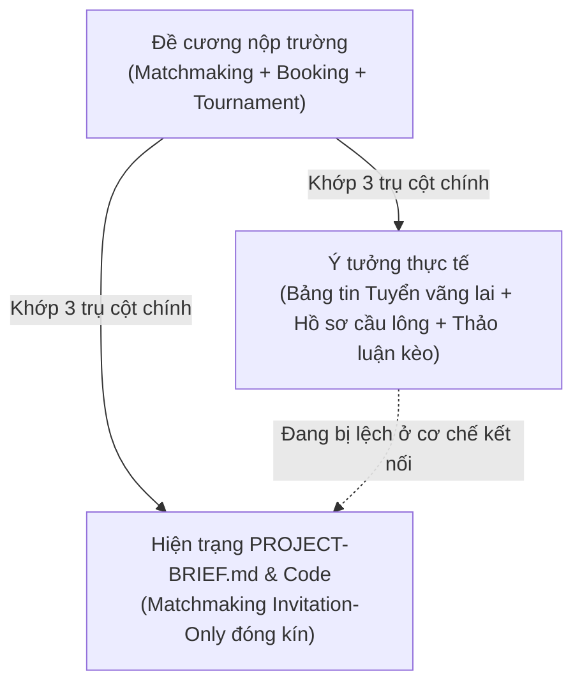
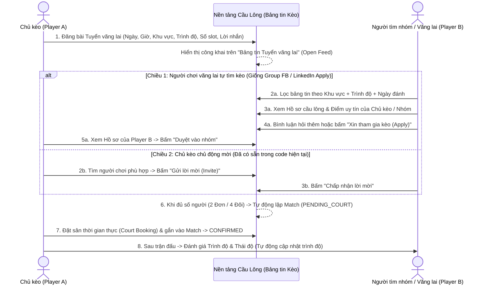

# Báo Cáo Phân Tích Định Hướng Dự Án & Đề Xuất Chiến Lược

**Dự án:** Nền tảng số hóa hệ sinh thái cầu lông (`badminton-platform`)  
**Ngày lập:** 28/10/2026  
**Mục đích tài liệu:** Phân tích độ khớp giữa **(1) Đề cương đăng ký đề tài**, **(2) Ý tưởng thực tế của nhóm (Cộng đồng tuyển vãng lai / tìm nhóm chơi thay thế Group Facebook & kết nối kiểu LinkedIn)**, và **(3) Hiện trạng `PROJECT-BRIEF.md` + Code trong repo** — từ đó đưa ra lời khuyên, agenda họp nhóm và phương án điều chỉnh hợp lý nhất.

---

## 1. Phân tích Bài toán Thực tế (Ý tưởng gốc)

Thực tế hiện nay tại Việt Nam, khi người chơi cầu lông muốn **tuyển vãng lai** (nhóm đã có sân hoặc định lập kèo nhưng thiếu 1–3 tay vợt) hoặc **kiếm nhóm đi đánh giao lưu** (người chơi lẻ muốn tìm kèo phù hợp), họ phải lên các **Group Facebook / Zalo cộng đồng cầu lông** để đăng bài.

Cách làm trên Facebook Group gặp **4 vấn đề lớn**:
1. **Bài đăng hỗn loạn và trôi nhanh:** Không thể lọc chính xác theo *Quận/Huyện*, *Khung giờ đánh (VD: 19h–21h tối nay)*, *Trình độ (TB yếu, TB, TB khá)* hay *Số slot còn thiếu*. Khi người chơi đọc được bài thì kèo đã đủ người hoặc đã qua giờ.
2. **Mù thông tin về trình độ và độ uy tín ("Hồ sơ ảo"):** Trên Facebook không có thước đo trình độ chuẩn và lịch sử thái độ. Rất phổ biến tình trạng người xin vào nhận là "trình Trung Bình" nhưng vào sân lại mới tập chơi, hoặc đăng ký xong hủy kèo sát giờ ("bùng kèo").
3. **Đặt sân và Gom người bị đứt gãy:** Gom đủ người trên Facebook xong lại phải đi hỏi từng sân xem còn trống giờ đó không, hoặc đặt sân trước rồi lên Facebook đăng bài nhưng không tuyển đủ người.
4. **Quản lý slot thủ công:** Chủ kèo phải tự đếm từng bình luận/tin nhắn xem ai chắc chắn đi, ai rút lui để tìm người thế chỗ.

> **Giá trị cốt lõi từ ý tưởng:** Xây dựng một nền tảng mà ở đó **100% người dùng đều là người chơi cầu lông và chủ sân**, có **Hồ sơ năng lực cầu lông rõ ràng (kiểu LinkedIn)** và **Bảng tin đăng bài tuyển vãng lai / tìm nhóm có cấu trúc (thay thế Group Facebook)**, gắn liền với **Đặt sân thời gian thực**; còn **Giải đấu (Tournament)** là tiện ích mở rộng khi cộng đồng muốn giao lưu quy mô lớn hơn.

---

## 2. Đối chiếu 3 bên: Đề cương — Ý tưởng Cộng đồng — Hiện trạng Repo

### 2.1. Điểm đang lệch lớn nhất trong Repo hiện tại: Cơ chế Matchmaking bị "đóng kín"

Khi kiểm tra `PROJECT-BRIEF.md`, `docs/features/matchmaking/matchmaking/prd.md` và code tại `MatchmakingRequestService.ts` / `MatchmakingPage.tsx`:

| Khía cạnh | Ý tưởng mong muốn (Tuyển vãng lai / Group cầu lông) | Hiện trạng trong `PROJECT-BRIEF.md` & Code | Hệ quả thực tế |
| :--- | :--- | :--- | :--- |
| **Hiển thị bài đăng tìm người (Kèo đấu)** | Chủ kèo đăng bài tuyển vãng lai lên **Bảng tin chung (Public Feed)** để mọi người chơi cầu lông lướt xem, lọc theo khu vực/trình độ/ngày giờ. | Kèo tạo ra (`matchmaking_requests`) bị **ẩn hoàn toàn với cộng đồng**. Hàm `listRequests` chỉ trả về kèo của chính chủ kèo; hàm `getRequestDetail` trả lỗi `404` nếu người ngoài bấm vào xem. | Người chơi lẻ muốn "kiếm nhóm đi đánh cầu lông" vào trang `MatchmakingPage.tsx` sẽ chỉ thấy màn hình trống, **không thấy bất kỳ kèo nào đang tuyển người trên hệ thống**. |
| **Cách kết nối người chơi** | **2 chiều:** Người đi tìm kèo thấy bài đăng thì bấm **"Xin tham gia (Apply)"**; hoặc chủ kèo chủ động **"Mời (Invite)"**. | **Chỉ 1 chiều (`Invitation-only`):** Chủ kèo phải tự vào `CandidateList.tsx` mò tên từng người trong danh bạ toàn hệ thống rồi bấm gửi lời mời. | Nếu chủ kèo là người mới, không quen biết ai trên hệ thống thì việc nhìn vào danh sách hàng trăm cái tên xa lạ (không biết ai đang rảnh tối nay) để bấm mời từng người là **rất thiếu thực tế**. |
| **Nội dung bài tuyển vãng lai** | Có tiêu đề/lời nhắn cụ thể (VD: *"Tối nay 19h–21h sân Quận 7 tuyển 2 vãng lai trình TB, cầu Hải Yến"*). | Bảng `matchmaking_requests` chỉ có các trường khô khan (`preferredDate`, `startTime`, `endTime`, `area`, `minSkill`, `maxSkill`), **không có trường ghi chú/mô tả bài đăng** và không có chỗ bình luận hỏi đáp. | Thiếu chất "kết nối cộng đồng", trải nghiệm giống điền biểu mẫu hành chính hơn là đăng kèo giao lưu cầu lông. |
| **Hồ sơ người chơi (Player Profile)** | Giống LinkedIn cho người chơi cầu lông: xem được trình độ, lịch sử trận, điểm kỹ năng & thái độ, giới thiệu lối đánh/khu vực. | Tài liệu `docs/features/player/profile/prd.md` giới hạn chỉ cho chỉnh sửa `full_name` và `avatar` (loại bỏ `bio`, khu vực, lối đánh dù trên Figma `P44` đã vẽ sẵn). | Hồ sơ hơi sơ sài để người chơi đánh giá và kết nối với nhau. |

### 2.2. Còn so với Đề cương nộp trường thì sao?

Trong đề cương đăng ký đề tài với khoa/trường, nhóm đã cam kết 3 cụm chức năng:
1. **Người chơi:** Quản lý hồ sơ, tìm bạn chơi cùng trình độ (Matchmaking), xem lịch trống, đặt sân thời gian thực và chia sẻ chi phí (split bill).
2. **Chủ sân:** Quản lý cơ sở vật chất (số thảm), cấu hình giá (giờ vàng/thường), quản lý và duyệt lịch đặt sân.
3. **Tổ chức giải đấu:** Cho phép người dùng tự tạo giải, hệ thống tự động bốc thăm và sinh sơ đồ thi đấu cây nhị phân (Bracket).

> **Lưu ý quan trọng khi bảo vệ:**  
> Dù trong định hướng sản phẩm thực tế, Giải đấu chỉ là chức năng phụ trợ, nhưng trong **bản mô tả đề tài nộp cho hội đồng** đã ghi rất cụ thể: *"hệ thống tự động bốc thăm và sinh sơ đồ thi đấu cây nhị phân (Bracket)"*. Khi chấm bảo vệ, giảng viên sẽ đối chiếu trực tiếp câu này. Vì vậy, nhóm **không nên cắt bỏ Giải đấu**, mà nên **định vị lại trọng tâm**:
> - **Luồng chính khi thuyết trình & demo (60%):** Bài toán cộng đồng — Hồ sơ năng lực cầu lông $\rightarrow$ Đăng bài tuyển vãng lai / Lướt bảng tin tìm kèo $\rightarrow$ Gom đủ nhóm $\rightarrow$ Đặt sân thời gian thực $\rightarrow$ Đánh giá trình độ & thái độ sau trận.
> - **Luồng hoàn thiện hệ sinh thái (40%):** Chủ sân quản lý sân/giá + Người chơi tạo giải giao lưu và sinh sơ đồ thi đấu cây nhị phân (Bracket).

---

## 3. Đề xuất Kiến trúc Nghiệp vụ: "Bảng Tin Tuyển Vãng Lai & Kết Nối Cầu Lông"

Để biến dự án hiện tại thành đúng mô hình **"Thay thế Group Facebook tuyển vãng lai + Hồ sơ cầu lông kiểu LinkedIn"** mà **tận dụng được 90% code Backend/Frontend đã làm**, luồng Matchmaking chỉ cần mở rộng nhẹ như sơ đồ dưới đây:

### Điểm mạnh của mô hình kết hợp này:
1. **Đúng 100% nhu cầu thực tế của dân cầu lông:** Người muốn lập kèo tuyển vãng lai thì đăng bài lên bảng tin; người lẻ muốn đi đánh thì lướt bảng tin lọc đúng khu vực, trình độ và khung giờ để xin vào.
2. **Vượt trội hoàn toàn so với Facebook Group (Điểm ăn tiền khi bảo vệ đồ án):**
   - Có **Bộ lọc chuyên sâu** (trình độ, khu vực, khung giờ, đơn/đôi, số slot trống).
   - Có **Hồ sơ cầu lông & Điểm uy tín thực tế** (Skill Rating + Attitude Rating + Tự động điều chỉnh trình độ sau mỗi 5 trận đánh giá) — chống khai man trình độ và chống "bùng kèo".
   - Có **Kiểm tra trùng lịch tự động** (người chơi không thể nhận/xin vào 2 kèo trùng giờ nhau).
   - Có **Liên kết Đặt sân thời gian thực** ngay khi gom đủ người.
3. **Không phá vỡ cấu trúc Database & Code hiện có:**
   - Một "Bài đăng tuyển vãng lai" bản chất chính là một bản ghi trong bảng `MATCHMAKING_REQUESTS` hiện tại (chỉ cần thêm cột `note`/`description` cho lời nhắn của chủ kèo).
   - Yêu cầu "Xin tham gia (Apply)" và "Lời mời (Invite)" dùng chung bảng `MATCHMAKING_INVITATIONS` (chỉ khác nhau người khởi tạo).

---

## 4. Bản nháp đề xuất điều chỉnh `PROJECT-BRIEF.md` (Khi 2 bạn đồng ý)

### 4.1. Tại mục `## 1. Tổng quan`
Bổ sung bối cảnh bài toán cộng đồng để định hướng rõ cho toàn bộ dự án:
- **Bối cảnh:** Cộng đồng cầu lông hiện đang phải tạo các hội nhóm trên mạng xã hội (Facebook/Zalo) để đăng bài tuyển vãng lai hoặc tìm nhóm chơi. Việc này gây trôi bài, khó lọc theo trình độ/khu vực/thời gian, không kiểm chứng được trình độ thật và tách rời khỏi việc đặt sân.
- **Mục tiêu:** Xây dựng nền tảng số hóa chuyên biệt kết nối người chơi cầu lông với nhau (thông qua **Bảng tin tuyển vãng lai & Hồ sơ năng lực cầu lông**) và kết nối với chủ sân (**Đặt sân thời gian thực**), kèm công cụ bổ trợ **Tổ chức giải đấu phong trào**.

### 4.2. Tại mục `### 3.1 Matchmaking` và `## 7. Confirmed Business Decisions -> Matchmaking`
Thay cụm **"mời trực tiếp (invitation-only)"** bằng **"Bảng tin Tuyển vãng lai kết hợp Mời trực tiếp (Open Match Feed & Two-way Connection)"**:
- Cho phép các nhu cầu tìm người chơi (`OPEN`) hiển thị công khai trên **Bảng tin tuyển vãng lai** để mọi Player tìm kiếm, lọc và xem chi tiết.
- Hỗ trợ cả **2 chiều kết nối**:
  1. Chủ kèo tìm và gửi lời mời trực tiếp (`Invite`).
  2. Người chơi vãng lai xem bảng tin và gửi yêu cầu xin tham gia (`Apply/Join`), chủ kèo duyệt.
- Cho phép **bình luận / trao đổi ngắn** trong phạm vi bài đăng kèo / nhóm chơi.
- Mở rộng nhẹ **Hồ sơ người chơi (Player Profile)** để hiển thị thêm mô tả bản thân (`bio`), khu vực hoạt động, lối đánh bên cạnh trình độ và điểm đánh giá uy tín.

---

## 5. Lời khuyên & Khuyến nghị Quyết định (3 Phương Án)

Dựa trên tiến độ thực tế của dự án (Auth 95%, Admin 90%, Ratings 95%, Booking ~60%, Matchmaking Invitation-only ~80%, trong khi Payment, Court Owner, Profile, Tournament còn nhiều việc), dưới đây là **3 phương án** để nhóm lựa chọn:

| Phương án | Nội dung thực hiện | Khối lượng phát sinh | Mức độ khuyên dùng |
| :--- | :--- | :--- | :--- |
| **Phương án 1 (Khuyên dùng nhất): "Social Matchmaking Gọn Nhẹ"** | - Giữ nguyên toàn bộ code hiện có. - Mở công khai các `matchmaking_requests` đang `OPEN` thành **Bảng tin Tuyển vãng lai** (thêm lời nhắn ghi chú cho kèo + bộ lọc Khu vực/Trình độ/Ngày). - Cho phép người chơi xem bảng tin, xem Hồ sơ cầu lông, bấm **"Xin tham gia kèo"** và **Bình luận trao đổi trong kèo**. - Không làm mạng xã hội đăng status tự do hay chat 1-1 phức tạp để dành thời gian hoàn thiện nốt Payment, Booking, Court Owner và Tournament. | Rất thấp (~2–3 ngày làm việc) | **⭐⭐⭐⭐⭐ (Tối ưu nhất)**: Vừa đúng ý tưởng "thay thế Group Facebook tuyển vãng lai / LinkedIn cầu lông", vừa kịp tiến độ hoàn thành đủ 3 trụ cột để bảo vệ điểm cao. |
| **Phương án 2: Giữ nguyên `Invitation-only` như hiện tại** | - Không sửa Brief hay Matchmaking. - Chấp nhận việc người chơi chỉ có thể tự đi mò tên người khác để mời 1-1, không có bảng tin tuyển vãng lai công khai. | 0 ngày | **⭐⭐⭐ (An toàn tiến độ nhưng thiếu thực tế)**: Đỡ phải sửa lại phần Matchmaking, nhưng khi demo sẽ không thể hiện được ý tưởng "tuyển vãng lai cộng đồng". |
| **Phương án 3: Làm Mạng xã hội đầy đủ (Newsfeed tự do, kết bạn, nhắn tin 1-1 riêng)** | - Xây thêm các bảng bài viết tự do, like/share, kết bạn, hệ thống chat realtime toàn cục. | Rất lớn (~2–3 tuần) | **⭐ (Không khuyến nghị)**: Sẽ làm trễ hạn các chức năng bắt buộc trong đề cương (Thanh toán VNPAY, Chủ sân, Giải đấu cây nhị phân). |

---

## 6. Agenda Họp Nhóm Tối Nay: Các Việc Cần Bàn & Chốt

> **Điểm mấu chốt để thống nhất trong buổi họp tối nay:**  
> Hướng thay đổi này **KHÔNG đập bỏ bất kỳ dòng code hay bảng DB nào của phần Matchmaking & Ratings đã làm**. Toàn bộ logic tạo kèo, mời người, chống trùng giờ, tự tạo Match khi đủ 2/4 người và đánh giá trình độ đều giữ nguyên 100%. Nhóm chỉ **MỞ CÔNG KHAI** các kèo đang `OPEN` thành một **Bảng tin Tuyển vãng lai** và thêm nút để người chơi lẻ bấm **Xin tham gia**.

### 6.1. Bảng 6 vấn đề cần đưa ra bàn & chốt tối nay

| STT | Vấn đề cần bàn | Hiện trạng đang bị vướng | Hướng đề xuất thống nhất (Khuyên chốt) | Kết quả chốt |
| :---: | :--- | :--- | :--- | :--- |
| **1** | **Mở "Bảng tin Tuyển vãng lai" (Public Open Match Feed)** | Kèo tạo ra trong `matchmaking_requests` hiện bị ẩn, chỉ chủ kèo và người được mời mới xem được (`MatchmakingRequestService.ts`). Người chơi lẻ muốn kiếm nhóm đi đánh không thấy bất kỳ bài đăng nào. | Mở thêm tab **"Bảng tin Tuyển vãng lai"** trên trang Matchmaking: hiển thị tất cả các kèo đang `OPEN` của cộng đồng, lọc được theo **Khu vực, Ngày chơi, Trình độ, Đơn/Đôi**. Mọi Player đều xem được chi tiết kèo đang `OPEN`. | `[ ] Đồng ý` |
| **2** | **Thêm chiều "Người chơi lẻ bấm Xin tham gia kèo (Apply/Join)"** | Hiện chỉ có chiều chủ kèo tự đi mò tên từng người trong danh bạ để gửi lời mời (`Invitation-only`). Nếu không quen biết trước thì chủ kèo không biết mời ai. | Bổ sung chiều ngược lại: Người chơi xem Bảng tin Tuyển vãng lai $\rightarrow$ bấm **"Xin tham gia"** $\rightarrow$ Chủ kèo xem Hồ sơ cầu lông của người đó và bấm **"Duyệt / Từ chối"**. Khi duyệt đủ 2/4 người thì chạy vào đúng hàm tạo `Match` hiện có. | `[ ] Đồng ý` |
| **3** | **Thêm lời nhắn / mô tả cho bài đăng tuyển vãng lai (`note`)** | Khi tạo kèo hiện chỉ chọn được Ngày/Giờ/Quận/Trình độ, không ghi được nội dung cụ thể như trên Group Facebook (VD: *"Sân số 3 CLB Phú Thọ, cầu Hải Yến, giao lưu vui vẻ"*). | Thêm 1 cột `note` (hoặc `description`, tối đa ~300–500 ký tự) vào bảng `matchmaking_requests` và hiển thị ngay trên Card bài đăng ở Bảng tin. | `[ ] Đồng ý` |
| **4** | **Tương tác / Thảo luận trong kèo (Bình luận bài đăng kèo)** | Người chơi muốn hỏi chủ kèo thêm thông tin trước khi xin vào hoặc trao đổi với các thành viên trong nhóm nhưng chưa có chỗ nhắn. | Không làm hệ thống Chat 1-1 phức tạp toàn app; chỉ làm **Khung Bình luận / Thảo luận (Comments)** ngay bên dưới trang Chi tiết Kèo (`MatchmakingRequestDetailPage.tsx`), dùng cơ chế HTTP Polling sẵn có. | `[ ] Đồng ý` |
| **5** | **Làm giàu "Hồ sơ năng lực cầu lông" (Player Profile kiểu LinkedIn)** | Spec `docs/features/player/profile/prd.md` hiện chỉ cho hiển thị/sửa mỗi `full_name` và `avatar`, hơi ít thông tin để đánh giá bạn chơi vãng lai. (Phần này chưa code nên sửa rất dễ). | Khi triển khai task `PP-01` $\rightarrow$ `PP-05`, cho phép hiển thị rõ **Hồ sơ cầu lông**: Trình độ hiện tại + Lịch sử tăng/giảm hạng + Điểm Kỹ năng & Thái độ + Số trận đã chơi + thêm trường `bio` (giới thiệu ngắn/khu vực/lối đánh). | `[ ] Đồng ý` |
| **6** | **Xác định lại tỷ trọng ưu tiên từ nay đến lúc bảo vệ** | Đang dàn trải đều, trong khi câu chuyện chính khi bảo vệ là *"Nền tảng kết nối người chơi cầu lông & tuyển vãng lai thay thế Group Facebook"*. | - **Ưu tiên 1 (Luồng đinh khi demo):** Hồ sơ cầu lông + Bảng tin Tuyển vãng lai (Đăng kèo / Xin vào / Mời / Bình luận) + Đặt sân thời gian thực (dùng Payment Mock trước) + Đánh giá sau trận. - **Ưu tiên 2 (Đủ cam kết đề cương):** Chủ sân quản lý sân/giá + Giải đấu cây nhị phân (Bracket) ở mức gọn, chạy mượt luồng chính. | `[ ] Đồng ý` |

---

## 7. Hướng Thay Đổi Cụ Thể (Để 2 Bạn Thấy Rõ Khối Lượng Rất Nhỏ)

Nếu trong cuộc họp tối nay cần ước lượng công sức (*"Vậy cụ thể phải sửa những file nào, mất bao lâu?"*), có thể đối chiếu trực tiếp dưới đây:

### 7.1. Thay đổi về Database Schema (Chỉ thêm nhẹ, không xóa/sửa cấu trúc cũ)
1. **Bảng `matchmaking_requests` (`backend/src/db/schema/matchmaking.ts`):**
   - Thêm cột `note: text('note')` (nullable) để chủ kèo viết lời nhắn tuyển vãng lai.
2. **Bảng `matchmaking_invitations` (`backend/src/db/schema/matchmaking.ts`):**
   - Tận dụng luôn bảng này cho cả **Mời (`INVITE`)** và **Xin tham gia (`APPLY`)** bằng cách thêm cột `initiatedBy: varchar('initiated_by').default('OWNER')` (`'OWNER'` = chủ kèo mời người chơi; `'PLAYER'` = người chơi lẻ xin vào kèo của chủ kèo).
   - Nhờ vậy, toàn bộ ràng buộc chống trùng lặp, thời hạn hết hạn (`expires_at`), rút khỏi nhóm (`WITHDRAWN`) và gom đủ nhóm tạo `Match` giữ nguyên 100%!
3. **Bảng mới `matchmaking_comments` (Tùy chọn nếu chốt mục #4):**
   - Gồm `id`, `request_id` (FK $\rightarrow$ `matchmaking_requests.id`), `author_id` (FK $\rightarrow$ `users.id`), `content`, `created_at`.

### 7.2. Thay đổi về Backend (`backend/src/`)
1. **`MatchmakingRequestService.ts`:**
   - Thêm hàm `listPublicRequests(filter)` cho API `GET /api/v1/matchmaking/feed` (lọc theo `area`, `preferredDate`, `matchType`, `skillLevelId`) trả về các bài đăng tuyển vãng lai đang `OPEN` kèm thông tin chủ kèo (tên, avatar, trình độ) và số slot còn thiếu (`remainingCount`).
   - Trong `getRequestDetail`: Cho phép mọi `PLAYER` xem được thông tin kèo khi `status === 'OPEN'` (thay vì bắn lỗi `404` như hiện tại).
2. **`MatchInvitationService.ts`:**
   - Thêm hàm `applyToRequest(playerId, requestId)` (kiểm tra người xin vào không bị trùng lịch giờ đó, tạo bản ghi `initiated_by = 'PLAYER'`, `status = 'PENDING'`).
   - Cho phép chủ kèo gọi `respondToApplication(ownerId, invitationId, 'ACCEPTED' | 'DECLINED')` — khi `ACCEPTED` đủ số người sẽ gọi thẳng vào đoạn code tạo `PENDING_COURT` Match sẵn có ở dòng 309–323!

### 7.3. Thay đổi về Frontend (`frontend/src/`)
1. **Trang `MatchmakingPage.tsx`:**
   - Đổi tiêu đề từ *"Tìm đối thủ"* thành **"Cộng đồng & Tuyển vãng lai"**.
   - Thêm tab đầu tiên **"Bảng tin Tuyển vãng lai"** (bên cạnh 2 tab hiện có là *"Kèo của tôi"* và *"Lời mời / Yêu cầu tham gia"*).
   - Trên mỗi Card bài đăng tuyển vãng lai: Hiển thị Avatar + Tên + Badge Trình độ của chủ kèo, lời nhắn `note`, ngày giờ, khu vực, tiến độ gom người (VD: `Đã có 2/4 người - Còn thiếu 2 slot`) và nút **"Xin tham gia"**.
2. **Trang `MatchmakingRequestDetailPage.tsx`:**
   - Nếu là chủ kèo: Xem được danh sách người đang bấm *"Xin tham gia"* để bấm Duyệt/Từ chối, và vẫn có danh sách gợi ý để chủ động bấm *"Gửi lời mời"*.
   - Nếu là người chơi khác: Xem được danh sách các thành viên đã ở trong nhóm (bấm vào xem Hồ sơ cầu lông) và khung **Bình luận hỏi đáp** bên dưới.

### 7.4. Thay đổi về Tài liệu (`PROJECT-BRIEF.md` & `docs/`)
Theo quy tắc mục 10.1 trong `docs/documentation-guide.md` (mọi thay đổi tài liệu dùng chung đều qua PR có 2 thành viên duyệt):
1. Sau khi 2 bạn chốt trong cuộc họp tối nay, tạo 1 nhánh PR cập nhật:
   - `PROJECT-BRIEF.md` (§1, §3.1, §7)
   - `docs/business-rules-config-matrix.md` (§3)
   - `docs/architecture/database-schema.md` (§3.11, §3.29)
   - `docs/features/matchmaking/matchmaking/prd.md` & `tech-design.md`
   - `docs/features/player/profile/prd.md`

---

## 8. Gợi Ý Phân Chia Công Việc Sau Buổi Họp

Để không làm chậm tiến độ chung của nhóm:
- **Người đang phụ trách Payment / Booking / Tournament:** Tiếp tục làm bình thường theo lộ trình cũ, hoàn toàn không bị ảnh hưởng hay chặn (block) bởi thay đổi này.
- **Người phụ trách Matchmaking & Player Profile:**
  - **Bước 1 (0.5 ngày):** Cập nhật PR tài liệu (`PROJECT-BRIEF.md`, `matchmaking`, `profile`).
  - **Bước 2 (1 ngày):** Làm phần **Player Profile** (`PP-01` $\rightarrow$ `PP-05`) theo phong cách Hồ sơ cầu lông (hiển thị trình độ, thống kê trận, điểm đánh giá kỹ năng/thái độ, giới thiệu bản thân) để khi bấm vào người chơi trên bảng tin là có hồ sơ đẹp để xem ngay.
  - **Bước 3 (1.5 ngày):** Mở API + Giao diện **Bảng tin Tuyển vãng lai**, nút **Xin tham gia kèo** và **Bình luận trong kèo**.

