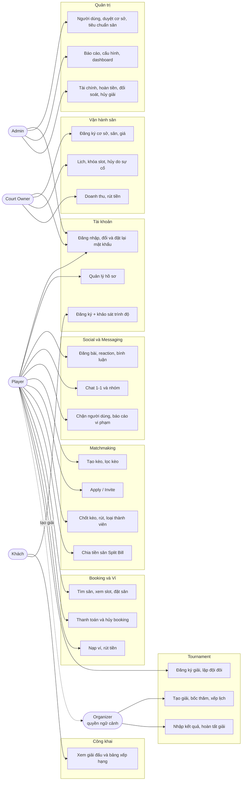
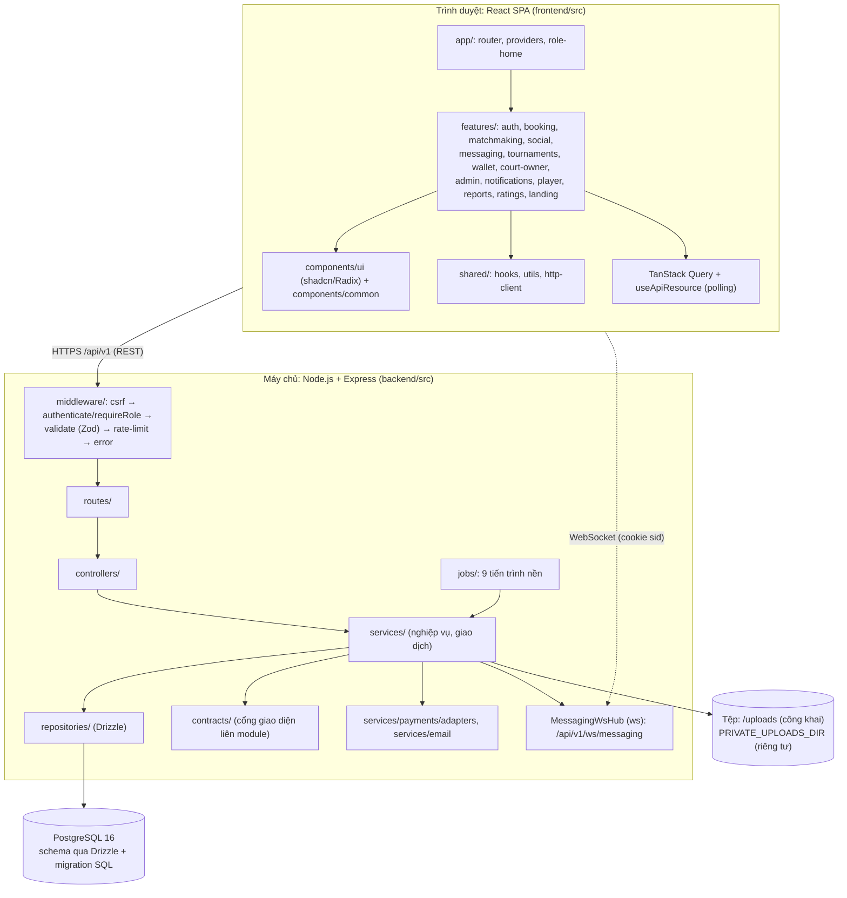
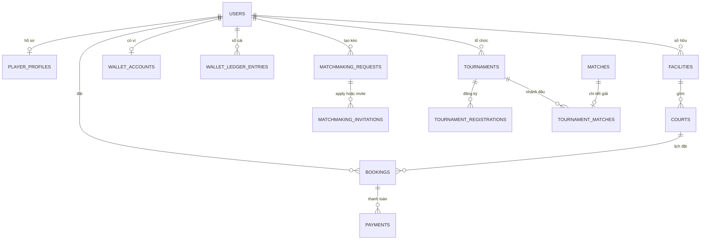
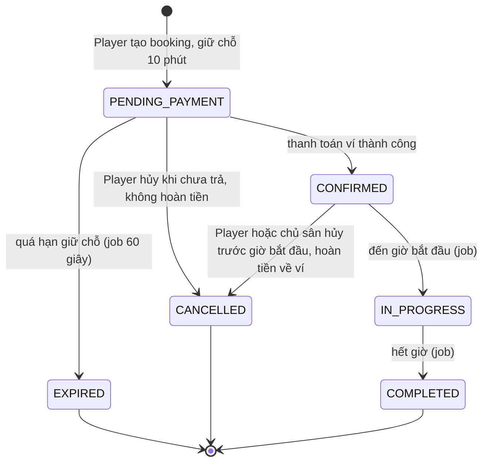
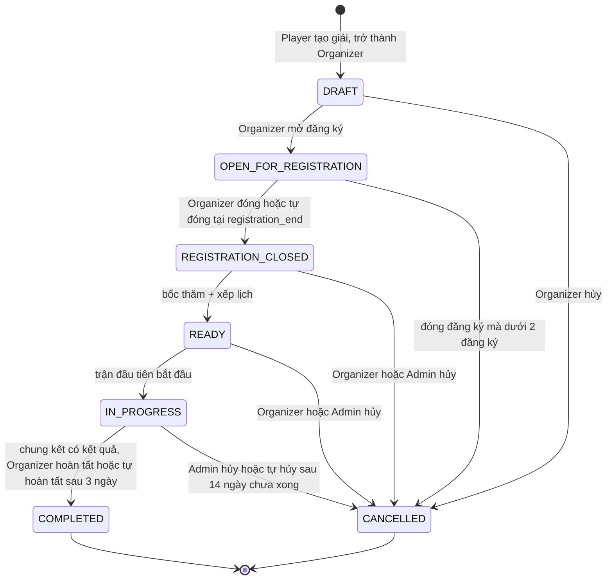
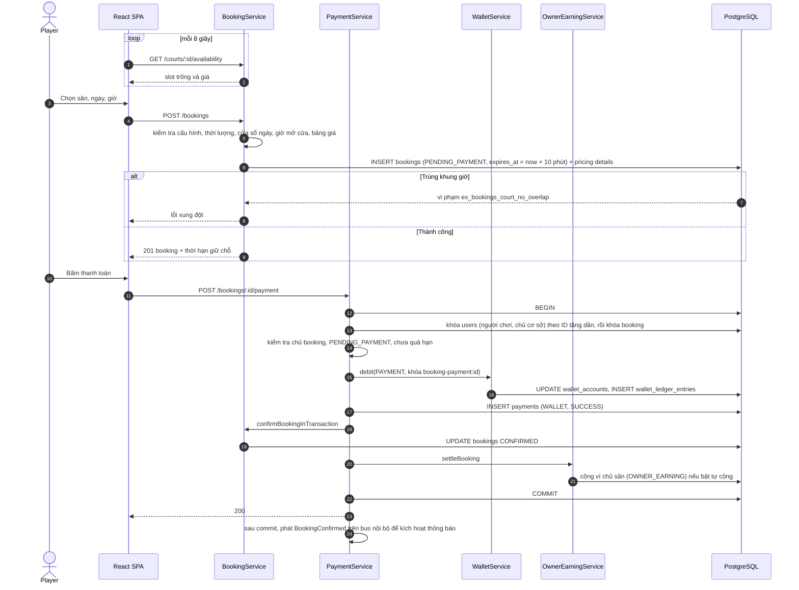
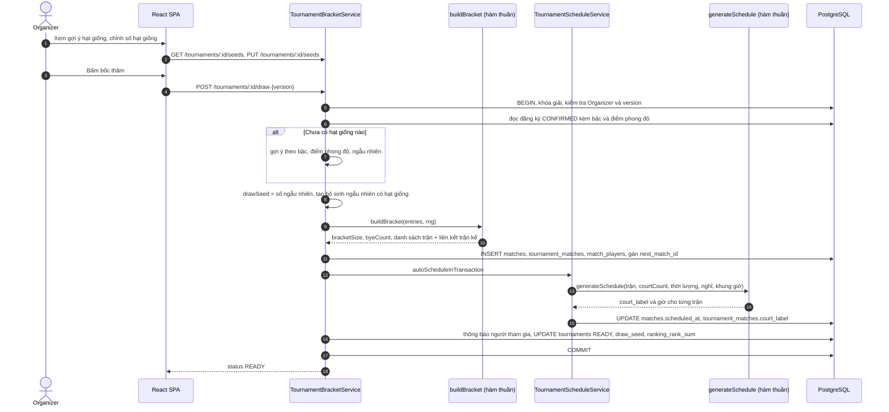

<!-- # TÀI LIỆU ĐẶC TẢ YÊU CẦU VÀ THIẾT KẾ HỆ THỐNG (SRS/SDD)

**Đề tài:** Số hóa hệ sinh thái cầu lông (Badminton Ecosystem Digital Platform)  
**Nhóm thực hiện:** [Điền họ tên, MSSV các thành viên]  
**Giảng viên hướng dẫn:** [Điền họ tên]  
**Phiên bản:** 1.0 — Bản báo cáo rút gọn, ngày 26/11/2026

Tài liệu trình bày yêu cầu và thiết kế của nền tảng cầu lông, tập trung vào ba nghiệp vụ Matchmaking, Court Booking và Tournament. Phụ lục A giữ danh mục use case và tiêu chí chấp nhận; các đặc tả kỹ thuật mở rộng được dẫn tại Phụ lục B. Tài liệu phục vụ báo cáo học phần, không thay thế PRD và Tech Design của dự án.

## Mục lục

1. Giới thiệu và phạm vi
2. Tác nhân và yêu cầu chức năng
3. Quy tắc nghiệp vụ và yêu cầu phi chức năng
4. Kiến trúc hệ thống
5. Thiết kế dữ liệu
6. Thiết kế hành vi
7. Thiết kế thuật toán
8. Thiết kế giao diện và giao tiếp
9. Giới hạn của giải pháp
- Phụ lục A. Danh mục use case và tiêu chí chấp nhận
- Phụ lục B. Tài liệu tham chiếu -->

## 1. Giới thiệu và phạm vi

### 1.1. Bối cảnh và mục tiêu

Người chơi cầu lông thường tìm đối thủ và tuyển thành viên qua Facebook/Zalo. Bài đăng dễ trôi, khó lọc theo khu vực, thời gian và trình độ; việc gom người, trao đổi và đặt sân bị tách rời. Các giải nhỏ thường sử dụng bảng tính và nhóm chat nên khó đồng bộ đăng ký, lịch đấu và kết quả.

Nền tảng được xây dựng nhằm:

- Cung cấp kèo có cấu trúc, hỗ trợ xin tham gia và mời người chơi.
- Cho phép đặt sân theo thời gian thực, bảo đảm không trùng lịch.
- Thống nhất thanh toán và hoàn tiền qua ví nội bộ.
- Quản lý giải đấu từ đăng ký, bốc thăm, xếp lịch đến ghi nhận kết quả.
- Gắn trình độ người chơi với khảo sát ban đầu và kết quả giải chuyên nghiệp.
- Cung cấp công cụ vận hành cho chủ sân và quản trị viên.

### 1.2. Phạm vi sản phẩm

| Nhóm | Nội dung |
|---|---|
| Nghiệp vụ cốt lõi | Tìm kèo, Apply/Invite, chốt kèo, đặt sân, chia tiền sân, giải chuyên nghiệp đơn/đôi |
| Chức năng hỗ trợ | Tài khoản, hồ sơ, khảo sát trình độ, ví, Social, nhắn tin và thông báo |
| Vận hành | Quản lý cơ sở sân, giá và lịch; quản lý người dùng, báo cáo vi phạm và tài chính |
| Ngoài phạm vi triển khai hiện tại | Giải phong trào, đánh giá người chơi sau trận giao lưu, đánh giá cơ sở sân, gọi thoại/video, CLB cố định, liên kết giải đấu với booking sân thật |

Giải đấu sử dụng nhãn sân ảo phục vụ xếp lịch. Đặt sân thông thường được xác nhận theo luồng thời gian thực; chủ sân không duyệt từng booking.

### 1.3. Thuật ngữ chính

| Thuật ngữ | Ý nghĩa |
|---|---|
| Player | Người chơi, một vai trò hệ thống |
| Court Owner | Chủ cơ sở sân, một vai trò hệ thống |
| Admin | Quản trị viên nền tảng |
| Organizer | Quyền theo ngữ cảnh của Player đối với giải mình tổ chức |
| Kèo / Match | Yêu cầu tìm người / trận được tạo sau khi chủ kèo chốt danh sách |
| Split Bill | Chia tiền sân và trừ ví thành viên trong cùng giao dịch |
| BYE | Suất đi tiếp không cần thi đấu ở vòng tương ứng |
| Điểm phong độ | Điểm 0–100 dùng để cập nhật bậc trình độ, tách khỏi điểm xếp hạng thành tích |

## 2. Tác nhân và yêu cầu chức năng

### 2.1. Tác nhân

| Tác nhân | Trách nhiệm và quyền hạn |
|---|---|
| Khách | Xem trang công khai, giải không phải bản nháp và bảng xếp hạng |
| Player | Quản lý hồ sơ, đăng bài, tìm kèo, đặt sân, dùng ví, nhắn tin, tham gia và tạo giải |
| Organizer | Quản lý đăng ký, nhánh đấu, lịch và kết quả trong giải của mình |
| Court Owner | Quản lý cơ sở, sân, bảng giá, lịch, bảo trì và ví doanh thu |
| Admin | Quản lý người dùng, duyệt cơ sở, xử lý báo cáo, cấu hình và tài chính |
| Hệ thống ngoài | SePay gửi thông tin nạp ví; dịch vụ email gửi OTP và email qua hàng đợi |

### 2.2. Sơ đồ chức năng tổng quát

**Hình 2.1. Sơ đồ chức năng tổng quát theo tác nhân**



### 2.3. Các nhóm yêu cầu chức năng

| Nhóm | Yêu cầu chính | Use case chi tiết |
|---|---|---|
| Tài khoản và hồ sơ | Đăng ký với OTP, đăng nhập, quản lý mật khẩu, khảo sát và hồ sơ trình độ | AUTH, PRF |
| Cộng đồng | Bài viết, reaction, bình luận và báo cáo vi phạm | SC, RPT |
| Tìm kèo | Đăng và lọc kèo; Apply/Invite; duyệt thành viên; chốt, rút kèo; chat nhóm | MM |
| Đặt sân | Tìm sân, xem slot, giữ chỗ, thanh toán và hủy theo chính sách | BK |
| Chủ sân | Quản lý cơ sở, sân, giá, lịch, khóa bảo trì và sự cố | OWN |
| Ví | Nạp tiền, thanh toán, hoàn tiền, rút tiền và xem sổ cái | WAL |
| Giải đấu | Tạo giải, đăng ký đơn/đôi, bốc thăm, lịch đấu, kết quả và thành tích | TRN |
| Liên lạc và quản trị | Nhắn tin, thông báo, xử lý báo cáo, quản lý người dùng và cấu hình | MSG, NTF, ADM |

Danh mục với mã use case và tiêu chí chấp nhận nằm trong Phụ lục A. Các mã gốc được giữ để tra cứu sang tài liệu chi tiết.

## 3. Quy tắc nghiệp vụ và yêu cầu phi chức năng

### 3.1. Quy tắc nghiệp vụ trọng yếu

| Nhóm | Quy tắc |
|---|---|
| Phân quyền | Organizer là quyền trong một giải, không phải vai trò hệ thống độc lập |
| Tìm kèo | Chấp nhận Apply/Invite chỉ giữ chỗ; chủ kèo phải chốt để tạo Match |
| Rút kèo | Chỉ được rút hoặc loại thành viên trước khi thanh toán sân thành công và trước giờ bắt đầu; thành viên rời kèo bị gỡ quyền chat nhóm kèo |
| Trùng lịch | Một sân không có hai booking hiệu lực chồng thời gian; người chơi không có hai cam kết thi đấu chồng nhau |
| Ví | Số dư không âm; sổ cái chỉ thêm; cùng khóa idempotency không tạo bút toán trùng |
| Chia tiền sân | Thiếu tiền ở bất kỳ thành viên nào thì toàn bộ giao dịch không thực hiện; tổng các phần bằng đúng tiền sân |
| Hủy do phía sân | Chủ sân hủy vì sự cố phải đi kèm thông báo và xử lý hoàn tiền |
| Giải đấu | Loại trực tiếp đơn/đôi; 2–128 đăng ký, 1–20 sân ảo; không bốc lại nhánh sau khi đã bốc thăm |
| Lệ phí giải | Trừ ví khi đăng ký; hoàn theo điều kiện rút, loại hoặc hủy; kết chuyển lệ phí cho Organizer khi hoàn tất đúng một lần |
| Kết quả | Tối đa 3 set, thắng 2; set 21 điểm cách 2, trần 30–29; sửa kết quả chịu điều kiện trạng thái trận kế tiếp và cửa sổ 48 giờ sau hoàn tất |
| Trình độ | Khảo sát ban đầu một lần, 7 bậc; điểm phong độ cập nhật từ giải chuyên nghiệp; trận giao lưu không dùng để nâng trình |
| Riêng tư | Chỉ chủ hồ sơ thấy điểm phong độ chi tiết; người khác thấy bậc trình độ |

### 3.2. Yêu cầu phi chức năng

Các ràng buộc dưới đây mô tả yêu cầu thiết kế. Việc có cơ chế thực thi không thay thế kết quả kiểm thử thực nghiệm.

| Mã | Nhóm | Ràng buộc và cách kiểm chứng |
|---|---|---|
| NFR-01 | Bảo mật phiên | Token ngẫu nhiên 32 byte, lưu băm SHA-256; cookie HttpOnly, Secure, SameSite=Lax; kiểm tra cấu hình phiên và kiểm thử xác thực |
| NFR-02 | Chống dò mật khẩu | Khóa 15 phút sau 5 lần sai; giới hạn đăng nhập 20 lần/15 phút/IP; kiểm thử giới hạn và khóa tài khoản |
| NFR-03 | CSRF | Yêu cầu thay đổi dữ liệu dùng phiên phải có X-CSRF-Token hợp lệ, trừ các ngoại lệ được định nghĩa; kiểm thử middleware |
| NFR-04 | Toàn vẹn lịch | Không có hai booking hiệu lực chồng thời gian trên cùng sân; kiểm thử yêu cầu đặt sân đồng thời và ràng buộc PostgreSQL |
| NFR-05 | Toàn vẹn tiền | Số dư ≥ 0; thao tác lặp không ghi tiền hai lần; thanh toán và thay đổi nghiệp vụ cùng giao dịch; kiểm thử rollback và idempotency |
| NFR-06 | Làm mới dữ liệu | Polling slot sân 8 giây, thông báo 30 giây; kiểm tra cấu hình và hành vi giao diện |
| NFR-07 | Giới hạn quy mô | Tối đa 128 đăng ký và 20 sân mỗi giải; kiểm thử biên nhập liệu và ràng buộc dữ liệu |
| NFR-08 | Tính xác định | Cùng đầu vào và draw_seed cho cùng nhánh đấu; kiểm thử tái lập thuật toán |
| NFR-09 | Tương thích giao diện | Kiểm tra bố cục tại chiều rộng 390 px và 1280 px |

<!-- ### 3.3. Mục tiêu cần kiểm chứng bằng thực nghiệm

| Chỉ số | Mục tiêu đề xuất | Trạng thái bằng chứng |
|---|---|---|
| Thời gian API đọc ở p95 | ≤ 500 ms với dữ liệu mẫu | Chưa đo |
| Người dùng đồng thời | 100 người trên một instance | Chưa đo |
| Coverage booking, ví và giải đấu | ≥ 70% dòng lệnh | Chưa có báo cáo coverage |
| Tỷ lệ CI thành công | ≥ 90% | Chưa tổng hợp lịch sử CI |

Các giá trị đề xuất chưa được coi là kết quả đạt được. Kết quả đo cần ghi kèm cấu hình máy, dữ liệu, tải thử và thời điểm thực hiện. -->

## 4. Kiến trúc hệ thống

### 4.1. Kiến trúc tổng thể

Hệ thống sử dụng kiến trúc monolith client–server với React SPA giao tiếp với Express qua REST API và WebSocket. PostgreSQL lưu dữ liệu nghiệp vụ, phiên và sổ cái. Backend phân lớp Route → Controller → Service → Repository; Service điều phối nghiệp vụ và giao dịch, Repository truy cập dữ liệu.

Monolith phù hợp phạm vi nhóm và MVP, giúp giữ giao dịch nhất quán giữa đặt sân, ví và tìm kèo, đồng thời giảm yêu cầu vận hành hạ tầng phân tán.

**Hình 4.1. Sơ đồ thành phần (kiến trúc phân lớp)**



### 4.2. Công nghệ và lý do lựa chọn

| Thành phần | Công nghệ | Lý do |
|---|---|---|
| Frontend | React, TypeScript, Vite | Tổ chức giao diện theo thành phần, hỗ trợ kiểu dữ liệu và quy trình phát triển thống nhất |
| Giao diện và dữ liệu | Tailwind v4, shadcn/Radix, TanStack Query | Thống nhất trình bày, hỗ trợ khả năng truy cập và quản lý trạng thái dữ liệu máy chủ |
| Backend | Node.js, Express, TypeScript | Phù hợp REST API và WebSocket; dùng chung ngôn ngữ với frontend |
| CSDL | PostgreSQL, Drizzle ORM | Giao dịch ACID, migration và ràng buộc khoảng thời gian chống trùng lịch |
| Validation | Zod | Kiểm tra dữ liệu tại biên API |
| Xác thực | Phiên lưu ở máy chủ | Hỗ trợ thu hồi phiên và kiểm tra trạng thái tài khoản |
| Thời gian thực | WebSocket và polling | WebSocket cho chat/giải đấu; polling cho slot sân và thông báo |
| Kiểm thử | Vitest, Supertest, Playwright | Bao phủ hàm nghiệp vụ, API và luồng giao diện |

### 4.3. Giao dịch, bảo mật và vận hành

Thanh toán, hoàn tiền và chia tiền phải có biên giao dịch rõ ràng. Hệ thống sử dụng khóa và ràng buộc CSDL cho các tài nguyên tranh chấp; callback nạp ví được kiểm tra xác thực và chống xử lý trùng.

Phân quyền kết hợp vai trò hệ thống với quyền sở hữu tài nguyên. Phiên dùng cookie HttpOnly; các yêu cầu thay đổi dữ liệu được bảo vệ CSRF. Dữ liệu đầu vào được xác thực trước khi xử lý nghiệp vụ; lỗi trả về không chứa chi tiết nội bộ.

Tiến trình nền xử lý hết hạn giữ chỗ, trạng thái booking/kèo/giải, hoàn tiền và email. Môi trường hiện có gồm máy phát triển và CI; phương án production chưa chốt.

## 5. Thiết kế dữ liệu

### 5.1. Các thực thể và quan hệ chính

ERD dưới đây lược bỏ thuộc tính để thể hiện quan hệ cốt lõi. Đây là sơ đồ tổng quan; lược đồ và từ điển dữ liệu đầy đủ nằm trong tài liệu kiến trúc CSDL.

**Hình 5.1. ERD tổng quan các nghiệp vụ chính**



### 5.2. Trách nhiệm dữ liệu

| Nhóm dữ liệu | Nội dung lưu trữ |
|---|---|
| users, player_profiles, auth_sessions | Danh tính, vai trò, hồ sơ và phiên đăng nhập |
| facilities, courts, court_pricings | Cơ sở, sân và cấu hình giá |
| bookings, booking_pricing_details | Khoảng thời gian đặt và giá chụp tại lúc đặt |
| wallet_accounts, wallet_ledger_entries | Số dư và lịch sử biến động tiền |
| payments, payment_refunds | Thanh toán và hoàn tiền nghiệp vụ |
| matchmaking_requests, matchmaking_invitations | Kèo và yêu cầu Apply/Invite |
| matches | Trận sau chốt kèo hoặc trận thi đấu |
| tournaments, tournament_registrations, tournament_matches | Thông tin giải, đăng ký và liên kết nhánh đấu |
| conversations, messages | Hội thoại và tin nhắn |
| skill_rating_events, skill_level_changes | Sự kiện điểm phong độ và lịch sử đổi bậc |

### 5.3. Bất biến dữ liệu

- Khóa ngoại bảo đảm quan hệ giữa thực thể; các chỉ mục duy nhất ngăn đăng ký và bút toán trùng theo nghiệp vụ.
- Ràng buộc loại trừ khoảng thời gian chặn hai booking hiệu lực chồng nhau trên cùng sân.
- Ràng buộc số dư không âm kết hợp giao dịch bảo vệ ví.
- Giá booking được chụp để thay đổi bảng giá không làm sai lịch sử.
- Liên kết trận kế tiếp cho phép tự chuyển bên thắng trong nhánh loại trực tiếp.

## 6. Thiết kế hành vi

### 6.1. Vòng đời đặt sân

**Hình 6.1. Vòng đời của booking**



### 6.2. Vòng đời giải đấu

**Hình 6.2. Vòng đời của giải đấu**



### 6.3. Luồng đặt sân và thanh toán

Hệ thống kiểm tra lịch, giữ chỗ và tính tiền. Khi thanh toán, số dư và trạng thái booking được xử lý cùng giao dịch; lỗi hoặc thiếu tiền không được để lại thanh toán một phần.

**Hình 6.3. Đặt sân, giữ chỗ và thanh toán bằng Ví sàn**



### 6.4. Luồng bốc thăm và xếp lịch

Organizer chỉ thực hiện sau khi đóng đăng ký. Hệ thống sinh nhánh từ danh sách hợp lệ, lưu hạt giống ngẫu nhiên và xếp lịch trên sân ảo.

**Hình 6.4. Bốc thăm và xếp lịch tự động**



## 7. Thiết kế thuật toán

### 7.1. Sinh nhánh đấu và xử lý BYE

**Đầu vào:** danh sách đăng ký hợp lệ, thứ tự hạt giống và draw_seed. **Đầu ra:** vị trí đăng ký, các vòng và liên kết trận kế tiếp.

1. Chọn kích thước nhánh B là lũy thừa của 2 nhỏ nhất không nhỏ hơn số đăng ký N; số BYE bằng B − N.
2. Sắp hạt giống theo vị trí chuẩn; với nhánh 8, thứ tự là 1, 8, 4, 5, 2, 7, 3, 6.
3. Xáo phần chưa có hạt giống bằng bộ sinh ngẫu nhiên có seed.
4. Điền đăng ký vào ô, để trống các ô BYE; tạo trận và liên kết bên thắng sang vòng kế.

Ví dụ 6 đăng ký cho nhánh 8 có 2 BYE: `[1, BYE, 4, 5, 2, BYE, 3, 6]`. Cùng đầu vào và draw_seed cho cùng nhánh. Độ phức tạp chủ yếu O(N log N) do sắp xếp.

### 7.2. Xếp lịch trên sân ảo

Thuật toán tham lam duyệt trận theo vòng và chỉ số trận. Với mỗi trận, thời điểm sẵn sàng phụ thuộc vào kết thúc trận nguồn, thời gian nghỉ và thời điểm rảnh của người chơi. Hệ thống chọn sân có giờ bắt đầu hợp lệ sớm nhất; hòa thì chọn sân có số nhỏ hơn. Nếu trận không vừa khung giờ ngày hiện tại thì chuyển sang ngày kế tiếp.

Lịch phải đáp ứng: không chồng sân, đủ thời gian nghỉ, đúng thứ tự phụ thuộc và nằm trong khung giờ tổ chức. Giờ tính theo Asia/Ho_Chi_Minh. Với M trận và k sân, độ phức tạp O(M × k). Khi Organizer sửa tay, hệ thống cảnh báo xung đột lịch.

### 7.3. Điểm phong độ và bậc trình độ

Điểm phong độ R nằm trong [0, 100], khởi tạo từ khảo sát. Sau trận giải chuyên nghiệp, cập nhật theo kỳ vọng kiểu Elo:

```text
E = 1 / (1 + 10^((R_đối - R) / D))
R_mới = clamp(R + K × (S - E), 0, 100)
```

Trong đó S = 1 khi thắng, 0 khi thua; mặc định D = 15, K = 3. Sáu trận đầu dùng K = 6; trận đôi dùng điểm trung bình mỗi bên và nhân hệ số 0,8. Mọi thay đổi được tính từ điểm trước trận.

Cuối giải, người chơi lên bậc khi đạt ngưỡng bậc kế tiếp cộng 3, xuống bậc khi thấp hơn ngưỡng bậc hiện tại trừ 3. Vùng đệm giúp giảm dao động quanh ranh giới. Ví dụ điểm 60,32 chưa đủ lên bậc có ngưỡng 60 vì cần đạt 63.

Khi sửa kết quả hợp lệ, hệ thống tính lại lịch sử theo thứ tự hoàn tất giải để bảo đảm kết quả tái lập. Các tham số hiện tại cần tiếp tục được hiệu chỉnh bằng dữ liệu thi đấu thực tế.

## 8. Thiết kế giao diện và giao tiếp

### 8.1. Tổ chức giao diện

| Vùng | Màn hình và thao tác chính |
|---|---|
| Công khai | Trang đích, danh sách/chi tiết giải và bảng xếp hạng |
| Player | Social, tìm kèo, tìm sân, booking, ví, tin nhắn, hồ sơ và giải đấu |
| Organizer | Danh sách đăng ký, hạt giống, nhánh, lịch và nhập kết quả của giải |
| Court Owner | Cơ sở/sân, giá, lịch, bảo trì, booking và ví doanh thu |
| Admin | Người dùng, duyệt cơ sở, báo cáo, cấu hình và tài chính |

Giao diện tổ chức theo tính năng, dùng các thành phần dùng chung cho biểu mẫu, bảng và bộ lọc. Mỗi luồng có trạng thái đang tải, rỗng, lỗi và kết quả thao tác. Quyền thao tác được kiểm tra lại ở backend.

### 8.2. Quy ước giao tiếp

REST API dùng tiền tố `/api/v1/`, xác thực bằng cookie phiên và phân trang bằng `page`/`limit` cùng `meta`. Zod kiểm tra dữ liệu đầu vào; lỗi nghiệp vụ trả mã ổn định và HTTP status phù hợp.

WebSocket phục vụ tin nhắn, hiện diện và cập nhật giải đấu; REST cung cấp lịch sử và đồng bộ lại. Slot sân dùng polling. SePay tích hợp qua webhook nạp ví; email phục vụ OTP và các tác vụ được cấu hình.

### 8.3. Kiểm chứng thiết kế

Vitest kiểm thử thuật toán và quy tắc nghiệp vụ; Supertest kiểm thử API, phân quyền và giao dịch; Playwright kiểm tra luồng người dùng. Các trường hợp trọng yếu gồm tranh chấp slot, thiếu số dư, callback trùng, rollback Split Bill, BYE và tính lại điểm sau sửa kết quả. Kết quả chạy và số liệu coverage được báo cáo riêng theo lần kiểm chứng thực tế.

## 9. Giới hạn của giải pháp

Hệ thống hiện phù hợp mô hình một instance: tệp được lưu cục bộ, tiến trình nền và một số bộ giới hạn chạy trong tiến trình Node.js. Khi mở rộng nhiều instance cần thiết kế lưu trữ chung và điều phối tác vụ.

Giải phong trào và đánh giá sau trận giao lưu chưa thuộc luồng triển khai hiện tại. Phương án production, CD và quét bảo mật chưa chốt. Các mục tiêu hiệu năng ở mục 3.3 chưa có kết quả đo; điểm phong độ chưa được hiệu chỉnh bằng tập dữ liệu thi đấu thực tế đủ lớn.

## Phụ lục A. Danh mục use case và tiêu chí chấp nhận

Các bảng dưới đây giữ mã và tiêu chí chấp nhận từ bản đặc tả đầy đủ. AC là điều kiện kiểm chứng yêu cầu, không phải xác nhận rằng kiểm thử đã chạy thành công.

### A.1. Xác thực và tài khoản (AUTH)

**Bảng A.1. Use case nhóm xác thực**

| Mã | User story | Tiêu chí chấp nhận (AC) | TN |
|---|---|---|---|
| UC-AUTH-01 | Là người chơi mới, tôi đăng ký bằng email, làm khảo sát trình độ và xác thực OTP để có tài khoản | 1) Email đã tồn tại → `AUTH_EMAIL_ALREADY_REGISTERED` (409). 2) Đăng ký lưu `pending_registrations` và gửi OTP 6 số qua email; chưa tạo `users`. 3) Nhập đúng OTP → tạo `users`, `player_profiles` và kết quả khảo sát; nhập sai vượt số lần cho phép (`otpMaxAttempts`) thì thử thách OTP bị vô hiệu. 4) Bộ khảo sát cũ hoặc form cũ bị từ chối. 5) Người chơi đặt mã PIN rút tiền ngay khi đăng ký | K |
| UC-AUTH-02 | Là người dùng, tôi đăng nhập để dùng chức năng theo vai trò | 1) Sai email/mật khẩu → `AUTH_INVALID_CREDENTIALS` (401), thông báo không lộ email có tồn tại hay không. 2) Sai liên tiếp 5 lần → khóa 15 phút, `AUTH_ACCOUNT_LOCKED` (429) kèm `Retry-After`. 3) Tài khoản `SUSPENDED`/`DEACTIVATED` → `AUTH_ACCOUNT_RESTRICTED` (403). 4) Thành công → cấp cookie `sid` (HttpOnly) và `csrf_token` | P, C, A |
| UC-AUTH-03 | Là người dùng, tôi đăng xuất để kết thúc phiên | 1) Đăng xuất thu hồi phiên hiện tại trong `auth_sessions`. 2) Dùng lại cookie cũ → `AUTH_SESSION_INVALID` (401). 3) Admin đặt mật khẩu mới cho người dùng → mọi phiên của người đó bị thu hồi | P, C, A |
| UC-AUTH-04 | Là người dùng quên mật khẩu, tôi đặt lại bằng OTP email | 1) Yêu cầu quên mật khẩu tạo thử thách OTP (`auth_challenges`). 2) Xác thực đúng OTP mới cấp token đặt lại dùng một lần (lưu dạng băm SHA-256). 3) Có thể gửi lại OTP; giới hạn 10 yêu cầu/15 phút/IP | K |
| UC-AUTH-05 | Là người dùng đã đăng nhập, tôi đổi mật khẩu có xác minh OTP | 1) Phải qua 3 bước: yêu cầu OTP → xác minh → đổi. 2) Court Owner do Admin tạo có `must_change_password = true` và bị chặn các chức năng khác đến khi đổi mật khẩu. 3) Mật khẩu mới được băm HMAC-SHA-256 + bcrypt cost 12 | P, C, A |
| UC-AUTH-06 | Là người chơi, tôi quản lý mã PIN rút tiền | 1) PIN được băm riêng với `WITHDRAWAL_PIN_PEPPER`. 2) Đặt lại PIN phải qua OTP email. 3) Rút tiền sai PIN bị từ chối | P, C |

### A.2. Hồ sơ và trình độ (PRF)

**Bảng A.2. Use case nhóm hồ sơ**

| Mã | User story | Tiêu chí chấp nhận (AC) | TN |
|---|---|---|---|
| UC-PRF-01 | Là người chơi, tôi làm khảo sát năng lực để được xếp vào bậc trình độ | 1) Khảo sát gồm 16 câu, 4 bước, mọi câu bắt buộc. 2) Điểm S = 0,40K + 0,20R + 0,15X + 0,10P + 0,10A + 0,05T; trừ 15 điểm nếu quay lại sau nghỉ trên 6 tháng. 3) Bậc = min(bậc theo S, trần G1, trần G2). 4) Chỉ làm một lần, không làm lại. 5) Tham số lưu theo phiên bản (`skill_survey_versions`) | K, P |
| UC-PRF-02 | Là người chơi, tôi xem và sửa hồ sơ của mình | 1) Sửa họ tên (2–50 ký tự) và ảnh đại diện; số điện thoại sửa ở UC-PRF-04. 2) Ảnh đại diện lưu công khai tại `/uploads`, tải lên qua API có xác thực. 3) Điểm phong độ chỉ hiển thị cho chủ hồ sơ (`/players/me/skill-rating`) | P |
| UC-PRF-03 | Là người chơi, tôi xem hồ sơ công khai của người khác | 1) `GET /players/:id` trả họ tên, ảnh, bậc trình độ và cờ bậc tạm thời; lịch sử giải ở `/players/:id/tournaments`; vị trí xếp hạng ở `/tournament-rankings/players/:id`. 2) Không trả email, số điện thoại, điểm phong độ. 3) Chỉ hiển thị hồ sơ đang hoạt động, ngược lại `PLAYER_NOT_FOUND` | P |
| UC-PRF-04 | Là người chơi, tôi quản lý số điện thoại liên hệ | 1) Xem và sửa qua `/players/me/contact`. 2) Số điện thoại có thể để trống (tùy chọn) | P |

### A.3. Social

**Bảng A.3. Use case nhóm Social**

| Mã | User story | Tiêu chí chấp nhận (AC) | TN |
|---|---|---|---|
| UC-SOC-01 | Là người chơi, tôi đăng bài tự do để chia sẻ với cộng đồng | 1) Nội dung tối đa 2000 ký tự, kèm ảnh riêng tư, tùy chọn nền màu (6 nền). 2) Tối đa 10 bài tự do/ngày (cấu hình `SOCIAL_FREE_POSTS_PER_DAY`). 3) Gửi trùng `clientRequestId` không tạo bài thứ hai. 4) Feed tắt bằng `SOCIAL_FEED_ENABLED` thì không đăng được | P |
| UC-SOC-02 | Là tác giả, tôi sửa hoặc xóa bài của mình | 1) Sửa ghi `edited_at`. 2) Xóa là xóa mềm (`deleted_at`). 3) Người khác không sửa/xóa được bài của tôi (403/404) | P |
| UC-SOC-03 | Là người chơi, tôi thả, đổi hoặc gỡ reaction trên bài viết | 1) Có 6 loại: LIKE, LOVE, HAHA, WOW, SAD, ANGRY. 2) Mỗi người một reaction cho mỗi bài; thả loại khác thì thay thế. 3) Gỡ bằng `DELETE` | P |
| UC-SOC-04 | Là người chơi, tôi bình luận bài viết | 1) Tối đa 10 bình luận/phút (`SOCIAL_COMMENTS_PER_MINUTE`). 2) Admin có thể ẩn bình luận vi phạm (`/admin/comments`) | P |
| UC-SOC-05 | Là người chơi, tôi xem bảng tin và chi tiết bài | 1) Danh sách phân trang `page`/`limit` kèm `meta`, sắp theo `published_at` giảm dần. 2) Bài đã xóa, bị ẩn, chưa xuất bản, hoặc của tác giả bị chặn hai chiều không có trong danh sách. 3) Giao diện Social chỉ gọi `/posts?type=FREE`; bài tìm kèo (`MATCH_FINDING`) thuộc khu vực Matchmaking và dùng chung API `/posts` với bộ lọc kèo | P |
| UC-SOC-06 | Là người đạt top 4 hoặc Organizer, tôi chia sẻ kết quả giải lên bảng tin | 1) Chỉ khi giải `COMPLETED`. 2) Mỗi người một bài kết quả cho mỗi giải (ràng buộc duy nhất `uq_posts_author_tournament_result`). 3) Bài có `type = TOURNAMENT_RESULT` kèm thẻ kết quả gồm tên giải, ngày, vô địch, á quân, hạng của mình; sau đó theo quy tắc Social thông thường (sửa, xóa, báo cáo, ẩn) | P, O |

### A.4. Matchmaking (MM)

**Bảng A.4. Use case nhóm Matchmaking**

| Mã | User story | Tiêu chí chấp nhận (AC) | TN |
|---|---|---|---|
| UC-MM-01 | Là chủ kèo, tôi tạo và đăng kèo có cấu trúc | 1) Chọn loại SINGLES (2 chỗ), DOUBLES (4 chỗ) hoặc GROUP (3–20 chỗ, tối thiểu 2 người). 2) Phải có giờ bắt đầu, thời lượng 1–1440 phút, khoảng trình độ min–max, chi phí dự kiến (tối đa 200 ký tự). 3) Kèo ở trạng thái nháp đến khi `publish`. 4) Tối đa 3 kèo mở đồng thời mỗi người | P |
| UC-MM-02 | Là người chơi, tôi tìm và lọc kèo | 1) Lọc theo khu vực, thời gian, trình độ, chỗ trống. 2) Kèo quá giờ bắt đầu hiển thị trạng thái `EXPIRED` | P |
| UC-MM-03 | Là người chơi, tôi xin tham gia kèo (Apply) và hủy yêu cầu đang chờ | 1) Apply tạo bản ghi `kind = APPLY`, `status = PENDING`. 2) Không apply trùng khi đang chờ (ràng buộc duy nhất cho PENDING/ACCEPTED). 3) Người bị chặn hai chiều với chủ kèo không apply được. 4) Hủy khi còn PENDING → `CANCELLED` | P |
| UC-MM-04 | Là chủ kèo, tôi mời người chơi phù hợp (Invite) | 1) Danh sách ứng viên lọc theo trình độ. 2) Lời mời `kind = INVITE` hết hạn sau 1440 phút hoặc khi kèo hết hạn, tùy mốc nào đến trước. 3) Người nhận chấp nhận hoặc từ chối | P |
| UC-MM-05 | Là chủ kèo, tôi duyệt hoặc từ chối yêu cầu tham gia | 1) Chấp nhận chỉ giữ chỗ, chưa tạo Match. 2) Không nhận quá số chỗ còn lại. 3) Chấp nhận hoặc từ chối đều cập nhật trạng thái bản ghi và gửi thông báo cho người liên quan | P |
| UC-MM-06 | Là chủ kèo, tôi chốt danh sách để tạo Match | 1) SINGLES/DOUBLES cần đủ 2/4 tài khoản; GROUP cần đạt tối thiểu và có ít nhất một thành viên ngoài chủ kèo, nếu không → `MATCHMAKING_EARLY_CLOSE_NOT_ALLOWED`. 2) Không có xung đột lịch của thành viên. 3) Chốt thành công: tạo Match, kèo chuyển `MATCHED`, các yêu cầu đang chờ chuyển `CANCELLED` với lý do `RECRUITMENT_CLOSED`. 4) Match `CONFIRMED` nếu đã có sân, ngược lại `PENDING_COURT` | P |
| UC-MM-07 | Là thành viên, tôi xin rút khỏi kèo; là chủ kèo, tôi loại thành viên | 1) Chỉ được trước khi booking của kèo thanh toán thành công và trước giờ bắt đầu; sau mốc thanh toán thao tác bị từ chối. 2) Rút khỏi kèo OPEN giải phóng chỗ; rút khỏi GROUP đã chốt thì mở lại tuyển và giữ Match; rút khỏi SINGLES/DOUBLES đã chốt thì hủy Match. 3) Cùng giao dịch gỡ quyền thành viên khỏi nhóm chat của kèo (không xóa tin cũ). 4) Chủ kèo không loại được chính mình | P |
| UC-MM-08 | Là chủ kèo, tôi gắn sân cho kèo | 1) Hoặc khai báo sân ngoài hệ thống (đủ tên, tỉnh/thành, quận/huyện, địa chỉ), hoặc gắn booking đặt trên hệ thống. 2) Một booking chỉ gắn một kèo (ràng buộc duy nhất `uq_matchmaking_requests_booking`). 3) Gắn booking khác địa điểm sân ngoài phải xác nhận cùng địa điểm | P |
| UC-MM-09 | Là chủ kèo, tôi đặt sân và chia đều tiền cho cả nhóm (Split Bill) | 1) Chỉ chủ kèo, kèo đã `MATCHED` và Match `PENDING_COURT`, chưa quá giờ chơi. 2) Có bước xem trước số tiền mỗi người. 3) Một thành viên thiếu số dư khả dụng → không trừ ai, trả `MATCH_SPLIT_INSUFFICIENT_WALLET` kèm danh sách và số tiền thiếu. 4) Đủ tiền → trừ ví mọi thành viên, xác nhận booking, kết chuyển doanh thu và liên kết booking trong một giao dịch. 5) Lỗi giữa chừng → hủy giữ chỗ, không trừ tiền. 6) Gọi lại sau khi thành công trả lại kết quả cũ | P |
| UC-MM-10 | Là chủ kèo, tôi tạo nhóm chat từ kèo đã chốt | 1) Mỗi kèo tối đa một nhóm liên kết; tạo lại trả nhóm đang có. 2) Thành viên bị loại/rút bị gỡ khỏi nhóm | P |
| UC-MM-11 | Là hệ thống, tôi tự xử lý kèo khi đến giờ bắt đầu và khi lời mời hết hạn | 1) Kèo còn `OPEN` khi đến giờ bắt đầu → `EXPIRED`, các yêu cầu đang chờ → `EXPIRED`, không tự bắt đầu dù đã đủ người. 2) Lời mời/apply quá hạn → `EXPIRED`. 3) Kèo `MATCHED` mà Match vẫn `PENDING_COURT` khi đến giờ → hủy kèo và Match với lý do `COURT_NOT_BOOKED`. 4) Match `CONFIRMED` nhưng không đủ người → hủy với lý do `INSUFFICIENT_PLAYERS`. 5) Match `CONFIRMED`, đủ người → chuyển `IN_PROGRESS`. 6) Quét mỗi 60 giây | H |

### A.5. Đặt sân (BK)

**Bảng A.5. Use case nhóm Court Booking**

| Mã | User story | Tiêu chí chấp nhận (AC) | TN |
|---|---|---|---|
| UC-BK-01 | Là người chơi, tôi tìm cơ sở và sân | 1) Tìm theo tên, khu vực, ngày giờ, thời lượng. 2) Chỉ đặt được khi cả cơ sở và sân ở trạng thái `ACTIVE` và chưa bị xóa mềm | P, K |
| UC-BK-02 | Là người chơi, tôi xem giá và slot trống theo thời gian thực | 1) Giao diện tự làm mới mỗi 8 giây. 2) Khung giờ không có bảng giá bao phủ coi là không khả dụng, không bao giờ coi là miễn phí. 3) Slot bị khóa bảo trì hoặc đã có booking hiệu lực hiển thị không khả dụng | P |
| UC-BK-03 | Là người chơi, tôi tạo booking và giữ chỗ | 1) Thời lượng 60–180 phút, ngày đặt trong 7 ngày tới, giờ bắt đầu chưa qua, nằm trong giờ mở cửa. 2) Tối đa 5 booking đang hoạt động mỗi người. 3) Booking mới ở `PENDING_PAYMENT`, hết hạn sau 10 phút. 4) Hai yêu cầu đồng thời cùng khung giờ: đúng một yêu cầu thành công, yêu cầu còn lại bị CSDL từ chối. 5) Giá được chụp lại theo từng khoảng giá (`booking_pricing_details`) | P |
| UC-BK-04 | Là người chơi, tôi thanh toán booking bằng Ví sàn | 1) Trừ ví, tạo thanh toán `SUCCESS`, xác nhận booking, kết chuyển doanh thu cho chủ sân trong một giao dịch. 2) Thiếu số dư → không đổi trạng thái, giao diện dẫn sang nạp ví. 3) Thanh toán lặp không trừ hai lần (khóa idempotency `booking-payment:<id>`). 4) Hết hạn giữ chỗ → `BOOKING_HOLD_EXPIRED` (409). 5) Booking đã hết hạn không bao giờ mở lại; nếu tiền đã trừ thì hoàn về ví | P |
| UC-BK-05 | Là người chơi, tôi hủy booking | 1) Hủy khi chưa thanh toán (`PENDING_PAYMENT`) → `CANCELLED`, nhả slot, không hoàn tiền. 2) Hủy booking đã thanh toán trước giờ bắt đầu → hoàn 100% về ví. 3) Sau giờ bắt đầu không hủy được | P |
| UC-BK-06 | Là người chơi, tôi xem lịch sử và booking sắp tới | 1) Danh sách phân trang theo trạng thái. 2) Chỉ thấy booking của mình | P |
| UC-BK-07 | Là hệ thống, tôi tự chuyển trạng thái booking | 1) Đến giờ bắt đầu: `CONFIRMED` → `IN_PROGRESS`. 2) Đến giờ kết thúc: `IN_PROGRESS` → `COMPLETED`. 3) Quá hạn thanh toán: `PENDING_PAYMENT` → `EXPIRED` và nhả slot. 4) Quét mỗi 60 giây, có quét bù 5 giây sau khi khởi động | H |

### A.6. Court Owner (OWN)

**Bảng A.6. Use case nhóm Court Owner**

| Mã | User story | Tiêu chí chấp nhận (AC) | TN |
|---|---|---|---|
| UC-OWN-01 | Là chủ sân, tôi đăng ký cơ sở và sân để Admin duyệt | 1) Cơ sở mới ở `PENDING_APPROVAL`, chưa được đặt. 2) Admin duyệt → `ACTIVE`; từ chối bắt buộc có lý do và chủ sân sửa, nộp lại giữ lịch sử đánh giá. 3) Đổi địa chỉ cơ sở đã duyệt phải qua yêu cầu đổi địa chỉ, địa chỉ cũ giữ hiệu lực đến khi duyệt | C |
| UC-OWN-02 | Là chủ sân, tôi quản lý sân và bảng giá | 1) Bảng giá theo khoảng thời gian; cập nhật bảng giá không đổi giá booking đã tạo. 2) Đổi giờ mở cửa bị từ chối nếu loại bỏ booking tương lai/đang chơi | C |
| UC-OWN-03 | Là chủ sân, tôi xem lịch và booking của cơ sở | 1) Chỉ thấy cơ sở của mình. 2) Không có luồng duyệt booking thủ công (không có trạng thái chờ chủ sân duyệt) | C |
| UC-OWN-04 | Là chủ sân, tôi khóa slot để bảo trì | 1) Khóa trong khoảng từ hôm nay đến 90 ngày (cấu hình `MAINTENANCE_ADVANCE_WINDOW_DAYS`). 2) Từ chối nếu chồng lên booking hiệu lực (kể cả đang chơi); giữ chỗ đã hết hạn không chặn. 3) Mở khóa theo ID khối | C |
| UC-OWN-05 | Là chủ sân, tôi hủy booking do sự cố | 1) Chỉ trước giờ bắt đầu, bắt buộc có lý do. 2) Booking đã thanh toán được hoàn tiền về ví người chơi; người chơi nhận thông báo | C |
| UC-OWN-06 | Là chủ sân, tôi gửi yêu cầu xác minh tiêu chuẩn sân | 1) Yêu cầu kèm bằng chứng ảnh. 2) Admin duyệt hoặc từ chối; mỗi tiêu chuẩn chỉ một yêu cầu đang hoạt động cho mỗi sân | C |
| UC-OWN-07 | Là chủ sân, tôi bàn giao cơ sở cho chủ sân khác | 1) Mỗi cơ sở tối đa một yêu cầu bàn giao đang mở. 2) Cần Admin duyệt và bên nhận xác nhận | C |
| UC-OWN-08 | Là chủ sân, tôi xem doanh thu và rút tiền | 1) Khi thanh toán booking thành công, doanh thu được cộng ngay vào ví chủ sân (khoản `OWNER_EARNING`, khi `OWNER_EARNING_AUTO_CREDIT_ENABLED` = true); nếu tắt, hệ thống tạo yêu cầu kết chuyển chờ Admin duyệt. 2) Booking bị hoàn tiền thì khoản kết chuyển bị từ chối hoặc đảo lại (`OWNER_EARNING_REVERSAL`) nếu ví chủ sân còn đủ số dư. 3) Rút tiền cần PIN; mặc định yêu cầu được tự duyệt (`WALLET_AUTO_APPROVE_PAYOUTS = true`), Admin đánh dấu đã chi | C |

### A.7. Ví sàn và thanh toán (WAL)

**Bảng A.7. Use case nhóm Ví**

| Mã | User story | Tiêu chí chấp nhận (AC) | TN |
|---|---|---|---|
| UC-WAL-01 | Là người dùng, tôi xem số dư và lịch sử ví | 1) Số dư khả dụng = số dư trừ các khoản đang giữ (`HELD`). 2) Sổ cái hiển thị theo thời gian giảm dần, phân trang | P, C |
| UC-WAL-02 | Là người chơi, tôi nạp tiền vào ví | 1) Tạo yêu cầu nạp có `txn_ref` duy nhất, quét QR chuyển khoản. 2) Webhook SePay hợp lệ (ký HMAC) → ví được cộng đúng một lần dù webhook gửi lặp. 3) Sai số tiền hoặc không khớp tham chiếu → ghi cảnh báo cho Admin, không cộng ví. 4) Admin có thể ghép tay giao dịch chưa khớp | P |
| UC-WAL-03 | Là người dùng, tôi liên kết tài khoản ngân hàng và rút tiền | 1) Mỗi người có thể có nhiều tài khoản, một mặc định. 2) Yêu cầu rút giữ trước số tiền (`wallet_holds`), cần PIN. 3) Trạng thái: `PENDING` → `APPROVED` → `PAID`; mặc định tự duyệt, Admin đánh dấu đã chi. 4) Admin từ chối → `REJECTED` và nhả khoản giữ; chi thất bại → `FAILED` | P, C |
| UC-WAL-04 | Là hệ thống, tôi hoàn tiền về ví | 1) Hoàn tiền tạo bản ghi `payment_refunds`, trạng thái `PENDING` → `PROCESSING` → `REFUNDED` hoặc `FAILED`. 2) Worker xử lý mỗi 60 giây; hoàn thất bại có thể thử lại bởi Admin | H |

### A.8. Giải đấu (TRN)

**Bảng A.8. Use case nhóm Tournament**

| Mã | User story | Tiêu chí chấp nhận (AC) | TN |
|---|---|---|---|
| UC-TRN-01 | Là người chơi, tôi tạo giải chuyên nghiệp và trở thành Organizer | 1) Giải khởi tạo `DRAFT`. 2) Giới hạn người tham gia 2–128; số sân 1–20; thời lượng trận 10–180 phút; nghỉ tối thiểu 0–240 phút; giờ bắt đầu nhỏ hơn giờ kết thúc mỗi ngày. 3) Trình độ min ≤ max. 4) Lệ phí ≥ 0 (0 là miễn phí), khóa sau khi có đăng ký đầu tiên | P→O |
| UC-TRN-02 | Là Organizer, tôi mở và đóng đăng ký | 1) Chuyển trạng thái yêu cầu đúng `version` hiện tại (khóa lạc quan), sai → xung đột. 2) Hệ thống tự đóng khi qua `registration_end`. 3) Đóng với dưới 2 đăng ký → giải tự hủy và hoàn tiền | O, H |
| UC-TRN-03 | Là người chơi, tôi đăng ký giải đơn và trả lệ phí bằng ví | 1) Chỉ khi `OPEN_FOR_REGISTRATION`, trong thời hạn, còn chỗ, trình độ nằm trong khoảng cho phép. 2) Lệ phí trừ ví cùng giao dịch, đăng ký `CONFIRMED` ngay. 3) Thiếu số dư → từ chối kèm số tiền cần nạp. 4) Một người chỉ một đăng ký `CONFIRMED` mỗi giải (ràng buộc duy nhất). 5) Rút trước khi đóng đăng ký được hoàn 100% | P |
| UC-TRN-04 | Là người chơi, tôi lập đội đôi và mời đồng đội | 1) Đội trưởng tạo đội, mời đúng một người đủ điều kiện bằng tìm theo tên hoặc link mời. 2) Lời mời hết hạn sau 1440 phút. 3) Đủ hai người, đội trưởng đăng ký và trả lệ phí bằng ví của mình. 4) Một người chỉ ở một đội đang hoạt động trong một giải | P |
| UC-TRN-05 | Là Organizer, tôi xem gợi ý hạt giống, chỉnh và bốc thăm | 1) Gợi ý theo bậc trình độ giảm dần, hòa thì theo điểm phong độ, vẫn hòa thì ngẫu nhiên. 2) Số hạt giống duy nhất, ≥ 1. 3) Bốc thăm cần ít nhất 2 đăng ký, tạo nhánh + lịch trong một giao dịch, giải chuyển `READY`. 4) Sau bốc thăm không bốc lại, không đổi hạt giống | O |
| UC-TRN-06 | Là Organizer, tôi xem và chỉnh lịch thi đấu | 1) Lịch tự xếp trên sân ảo "Sân 1…k" không trùng sân, không trùng vận động viên, đủ thời gian nghỉ, trong khung giờ mỗi ngày. 2) Sửa tay nhãn sân/giờ của trận chưa bắt đầu; xung đột chỉ cảnh báo, không chặn. 3) Chạy lại xếp lịch giữ nguyên trận đã/đang đấu | O |
| UC-TRN-07 | Là Organizer, tôi bắt đầu trận và nhập tỉ số từng set | 1) Trận tối đa 3 set thắng 2, mỗi set thắng ở 21 điểm cách biệt 2, trần 30–29; tỉ số sai bị từ chối kèm lý do từng set. 2) Có thể ghi bỏ cuộc (`WALKOVER`) hoặc chấn thương (`RETIRED`, giữ các set đã đánh). 3) Người thắng tự chuyển vào trận kế tiếp. 4) Trận đầu tiên bắt đầu đưa giải sang `IN_PROGRESS` | O |
| UC-TRN-08 | Là Organizer, tôi sửa kết quả đã nhập | 1) Sửa được khi trận kế tiếp chưa bắt đầu; người thắng được cập nhật lại. 2) Sau khi giải `COMPLETED` chỉ sửa trong 48 giờ, và chỉ đổi tỉ số hoặc người thắng trận chung kết; điểm thành tích và trình độ được tính lại | O |
| UC-TRN-09 | Là Organizer, tôi hoàn tất giải | 1) Chỉ khi trận chung kết đã có người thắng, nếu không → `TOURNAMENT_NOT_FINISHED` (409). 2) Lệ phí của các đăng ký còn `CONFIRMED` được cộng vào ví Organizer đúng một lần. 3) Ghi điểm thành tích và cập nhật điểm phong độ, bậc trình độ cho người tham gia. 4) Tự hoàn tất sau 3 ngày kể từ ngày kết thúc nếu chung kết đã xong; tự hủy và hoàn tiền sau 14 ngày nếu chưa xong | O, H |
| UC-TRN-10 | Là người chơi/khách, tôi theo dõi nhánh đấu, lịch và kết quả | 1) Giải `DRAFT` chỉ Organizer và Admin xem được. 2) Người chơi đăng nhập nhận cập nhật qua WebSocket; khách làm mới mỗi 30 giây khi giải ở `READY`/`IN_PROGRESS`. 3) Nhắc trước 30 phút khi sắp đến trận của mình | P, K |
| UC-TRN-11 | Là người chơi, tôi xem bảng xếp hạng thành tích và trình độ của mình | 1) Bảng xếp hạng tách đơn/đôi, lọc theo bậc, phân trang, khách xem được. 2) Điểm = điểm cơ sở theo vị trí × độ mạnh của giải × hệ số quy mô; tổng của 4 giải tốt nhất trong 12 tháng. 3) Trình độ của tôi thay đổi (lên hoặc xuống) kèm thông báo; điểm phong độ chỉ mình tôi xem | P, K |
| UC-TRN-12 | Là Organizer hoặc Admin, tôi hủy giải | 1) Organizer hủy trước `IN_PROGRESS`; Admin hủy ở mọi trạng thái chưa kết thúc, bắt buộc có lý do. 2) Mọi đăng ký `CONFIRMED` hoàn 100% về ví người trả. 3) Organizer không nhận tiền khi giải bị hủy | O, A |
| UC-TRN-13 | Là Organizer, tôi loại một đăng ký có lý do | 1) Chỉ trước khi bốc thăm. 2) Hoàn 100% và thông báo cho người bị loại; người đó bị gỡ khỏi nhóm chat của giải | O |
| UC-TRN-14 | Là người tham gia, tôi dùng nhóm chat của giải | 1) Nhóm tạo khi đóng đăng ký với ít nhất 2 đăng ký. 2) Khóa chỉ đọc khi giải bị hủy hoặc 30 ngày sau khi hoàn tất | P, O |

### A.9. Messaging (MSG)

**Bảng A.9. Use case nhóm Messaging**

| Mã | User story | Tiêu chí chấp nhận (AC) | TN |
|---|---|---|---|
| UC-MSG-01 | Là người chơi, tôi nhắn tin 1-1 | 1) Tối đa 20 hội thoại mới/ngày, 30 tin/phút. 2) Tin mới đến người nhận qua WebSocket trong cùng phiên; mất kết nối thì đồng bộ bù theo số thứ tự (`seq`) | P |
| UC-MSG-02 | Là người chơi, tôi tạo và quản lý nhóm chat | 1) Tối đa 50 thành viên mặc định. 2) Chủ nhóm thêm, xóa thành viên, giải tán; thành viên tự rời | P |
| UC-MSG-03 | Là người chơi, tôi gửi ảnh và tệp đính kèm | 1) Tệp lưu ở thư mục riêng tư, tải qua API có kiểm quyền từng lần, không phục vụ tĩnh. 2) Tệp DOCX/XLSX được kiểm tra cấu trúc ZIP trước khi nhận | P |
| UC-MSG-04 | Là người chơi, tôi thả reaction, thu hồi và ẩn tin nhắn | 1) Reaction cập nhật realtime. 2) Thu hồi tin của mình; ẩn tin chỉ ẩn với bản thân | P |
| UC-MSG-05 | Là người chơi, tôi thấy trạng thái online, đang nhập, chưa đọc | 1) Heartbeat hiện diện từ trình duyệt mỗi 25 giây khi tab hiển thị. 2) Đánh dấu đã đọc cập nhật số chưa đọc tức thì | P |
| UC-MSG-06 | Là người chơi, tôi chặn và bỏ chặn người dùng | 1) Chặn hai chiều: không nhắn tin, không apply/invite kèo giữa hai người. 2) Danh sách chặn xem và bỏ chặn được | P |

### A.10. Thông báo, báo cáo, quản trị (NTF, RPT, ADM)

**Bảng A.10. Use case nhóm thông báo, báo cáo và quản trị**

| Mã | User story | Tiêu chí chấp nhận (AC) | TN |
|---|---|---|---|
| UC-NTF-01 | Là người dùng, tôi nhận thông báo trong ứng dụng | 1) Thông báo lưu ở `notifications`. 2) Giao diện kiểm tra thông báo chưa đọc mỗi 30 giây khi tab hiển thị. 3) Đánh dấu đã đọc từng thông báo | P, C, A |
| UC-RPT-01 | Là người dùng, tôi báo cáo người chơi, cơ sở, giải đấu, bài viết, bình luận hoặc tin nhắn | 1) Mỗi báo cáo đúng một đối tượng (CHECK `chk_report_target`). 2) Có thể đính kèm bằng chứng ảnh. 3) Đủ 5 người báo cáo khác nhau cùng một đối tượng trong 24 giờ → cảnh báo mức cao cho Admin | P, C |
| UC-ADM-01 | Là Admin, tôi quản lý người dùng | 1) Tạo tài khoản (Court Owner/Admin), khóa/mở khóa, xóa mềm, thao tác hàng loạt. 2) Tài khoản được bảo vệ không bị thao tác hàng loạt. 3) Mọi thao tác ghi `admin_action_audits` | A |
| UC-ADM-02 | Là Admin, tôi duyệt cơ sở, sân và tiêu chuẩn sân | 1) Hàng chờ duyệt có số đếm. 2) Từ chối bắt buộc nêu lý do. 3) Duyệt thay đổi trạng thái cơ sở và ghi `facility_status_audits` | A |
| UC-ADM-03 | Là Admin, tôi xử lý báo cáo vi phạm | 1) Xem báo cáo và bằng chứng qua API có kiểm quyền. 2) Có thể ẩn bài viết/bình luận bị báo cáo | A |
| UC-ADM-04 | Là Admin, tôi quản lý ví và dòng tiền toàn sàn | 1) Xem tổng quan, giao dịch, ví từng người. 2) Duyệt/từ chối/đánh dấu đã chi các yêu cầu rút. 3) Ghi có/ghi nợ thủ công bắt buộc có lý do. 4) Thử lại hoàn tiền, đối soát với nhà cung cấp, xuất báo cáo. 5) Mọi thao tác ghi `finance_audit_events` | A |
| UC-ADM-05 | Là Admin, tôi chỉnh cấu hình hệ thống | 1) 71 khóa cấu hình có kiểu, giá trị mặc định, ngưỡng min/max. 2) Giá trị ngoài ngưỡng bị từ chối. 3) Thay đổi ghi `system_config_audit` | A |
| UC-ADM-06 | Là Admin, tôi xem dashboard | 1) KPI và biểu đồ tổng hợp người dùng, booking, doanh thu, giải đấu | A |
| UC-ADM-07 | Là Admin, tôi hủy giải đấu vi phạm | 1) Theo UC-TRN-12; Admin không điều hành hộ, không nhập kết quả | A |

<!-- ## Phụ lục B. Tài liệu tham chiếu

| Tài liệu | Nội dung tham chiếu |
|---|---|
| [Project Brief](../../PROJECT-BRIEF.md) | Phạm vi và quyết định nghiệp vụ |
| [Kiến trúc và công nghệ](../architecture/tech-stack.md) | Công nghệ, ràng buộc và quyết định chưa chốt |
| [Lược đồ CSDL](../architecture/database-schema.md) | Lược đồ và từ điển dữ liệu đầy đủ |
| [Quy ước kỹ thuật](../architecture/conventions.md) | API, mã nguồn và kiểm thử |
| [Kiến trúc frontend](../architecture/frontend.md) | Cấu trúc giao diện và tuyến điều hướng |
| [Ma trận quy tắc nghiệp vụ](../business-rules-config-matrix.md) | Quy tắc và tham số cấu hình |
| [SRS/SDD đầy đủ](SRS-SDD-badminton-platform.md) | Chương 3.12: luồng use case chi tiết; chương 6: giao tiếp và từ điển; chương 9: ERD chi tiết; chương 12: API và xử lý kỹ thuật |
| [Rubric học phần](Rubric_Do_An_Mon_Hoc_CNPM_v2.docx.md) | Tiêu chí đánh giá báo cáo |

Các sơ đồ trong bản báo cáo được viết bằng Mermaid. Khi xuất Word/PDF, cần dựng chúng thành hình và kiểm tra khả năng đọc ở khổ trang nộp. -->
