<!-- # TÀI LIỆU ĐẶC TẢ YÊU CẦU VÀ THIẾT KẾ (SRS/SDD) KÈM CÁC SƠ ĐỒ THIẾT KẾ

**Đề tài:** Số hóa hệ sinh thái cầu lông (Badminton Ecosystem Digital Platform)
**Nhóm thực hiện:** [điền họ tên, MSSV các thành viên]
**Giảng viên hướng dẫn:** [điền]
**Phiên bản:** 1.0 (26/11/2026)
**Tiêu chí rubric đáp ứng:** TC2.1 – Phân tích nghiệp vụ, đặc tả yêu cầu và thiết kế – giải pháp

> **Cách đọc tài liệu này.** Tài liệu gồm hai phần. Phần I (SRS, chương 1–6) trả lời câu hỏi *hệ thống phải làm gì*. Phần II (SDD, chương 7–14) trả lời câu hỏi *hệ thống được thiết kế và xây dựng như thế nào*. Chương 15 ghi lại các thay đổi thiết kế và những điểm còn lệch giữa tài liệu và mã nguồn.
>
> **Nguyên tắc đối chiếu.** Mọi tên bảng, trạng thái, API, tham số cấu hình và thuật toán trong tài liệu được đối chiếu với mã nguồn tại nhánh hiện tại (thư mục `backend/src`, `frontend/src`). Khi tài liệu cũ trong `docs/` mâu thuẫn với mã nguồn, tài liệu này theo mã nguồn và ghi rõ mâu thuẫn ở mục 15.3. Chương 14 liệt kê vị trí tệp để hội đồng kiểm tra ngẫu nhiên.
>
> **Sơ đồ.** Các sơ đồ viết bằng Mermaid, hiển thị trực tiếp trong Kiro/VS Code (Markdown Preview Mermaid), GitHub và các công cụ xuất PDF hỗ trợ Mermaid. Có thể dán mã sơ đồ vào https://mermaid.live để xuất ảnh PNG/SVG cho bản Word.

---

## MỤC LỤC

**PHẦN I – ĐẶC TẢ YÊU CẦU PHẦN MỀM (SRS)**
1. Giới thiệu
2. Mô tả tổng quan
3. Mô hình nghiệp vụ và yêu cầu chức năng
4. Quy tắc nghiệp vụ
5. Yêu cầu phi chức năng
6. Giao diện ngoài và từ điển dữ liệu

**PHẦN II – THIẾT KẾ HỆ THỐNG (SDD)**
7. Kiến trúc và lựa chọn công nghệ
8. Sơ đồ ngữ cảnh, thành phần và triển khai
9. Thiết kế dữ liệu (ERD)
10. Thiết kế hành vi (sơ đồ trạng thái và tuần tự)
11. Thiết kế thuật toán
12. Thiết kế API, bảo mật, đồng thời và tiến trình nền
13. Thiết kế giao diện
14. Truy vết yêu cầu và đối chiếu sơ đồ với mã nguồn
15. Nhật ký thay đổi thiết kế, hạn chế và điểm lệch tài liệu

--- -->

# PHẦN I – ĐẶC TẢ YÊU CẦU PHẦN MỀM (SRS)

## 1. Giới thiệu

### 1.1. Mục đích tài liệu

Tài liệu mô tả đầy đủ yêu cầu chức năng, yêu cầu phi chức năng, quy tắc nghiệp vụ và thiết kế kỹ thuật của nền tảng cầu lông. Đối tượng đọc gồm giảng viên hướng dẫn, giảng viên phản biện, hội đồng và thành viên nhóm tiếp nhận mã nguồn.

### 1.2. Bối cảnh và vấn đề

Người chơi cầu lông hiện tìm đối thủ, tuyển vãng lai và tìm nhóm qua các nhóm Facebook/Zalo. Bài đăng dễ trôi, khó lọc theo khu vực, thời gian, trình độ và số chỗ trống. Việc gom người, trao đổi và đặt sân bị tách rời nhau. Giải đấu nhỏ do người chơi tự tổ chức thường quản lý bằng bảng tính và nhóm chat: đăng ký, lệ phí, bốc thăm, thứ tự trận và kết quả nằm rải rác, người tham gia không biết khi nào mình thi đấu.

### 1.3. Mục tiêu

**Bảng 1.1. Mục tiêu của đề tài**

| Mã | Mục tiêu | Thước đo kiểm chứng được trong sản phẩm |
|---|---|---|
| G1 | Kết nối cộng đồng bằng bảng tin Social và tìm kèo có cấu trúc | Bộ lọc kèo theo khu vực, thời gian, trình độ, số chỗ trống; luồng Apply/Invite hai chiều |
| G2 | Đặt sân theo thời gian thực, không trùng lịch | Ràng buộc loại trừ ở PostgreSQL ngăn hai booking chồng thời gian trên cùng một sân |
| G3 | Thanh toán thống nhất bằng Ví sàn | Mọi khoản trừ/hoàn đi qua sổ cái ví, mỗi giao dịch có khóa idempotency |
| G4 | Quản lý giải đấu từ tạo giải đến vinh danh | Giải chuyên nghiệp: bốc thăm, xếp lịch tự động, nhập tỉ số hợp lệ, tự chuyển người thắng |
| G5 | Trình độ phản ánh phong độ thực | Điểm phong độ 0–100 cập nhật sau mỗi trận giải chuyên nghiệp, lên/xuống bậc có vùng đệm |
| G6 | Vận hành và kiểm soát nền tảng | Admin quản lý người dùng, cơ sở sân, báo cáo vi phạm, cấu hình, dòng tiền |

### 1.4. Phạm vi

**Trong phạm vi (MVP đã triển khai):**

- Xác thực, phân quyền, hồ sơ người chơi và khảo sát trình độ khi đăng ký.
- Social (bài tự do, reaction, bình luận, vinh danh giải đấu) tách biệt với Matchmaking về giao diện và luồng nghiệp vụ; hai phân hệ dùng chung bảng `posts` và API `/posts`.
- Matchmaking: kèo đơn, đôi, nhóm (GROUP); Apply/Invite; chủ kèo chốt thủ công; liên kết sân tùy chọn; chia đều tiền sân (Split Bill); nhóm chat của kèo.
- Court Booking thời gian thực; thanh toán bằng Ví sàn; hủy và hoàn tiền về ví.
- Court Owner: đăng ký cơ sở và sân (Admin duyệt), bảng giá, lịch, khóa slot bảo trì, hủy booking do sự cố, tiêu chuẩn sân, bàn giao cơ sở, ví doanh thu và rút tiền.
- Ví sàn: nạp tiền qua SePay, rút tiền về tài khoản ngân hàng (PIN rút tiền + Admin duyệt), sổ cái bất biến.
- Tournament chuyên nghiệp: đơn và đôi, đăng ký trả phí bằng ví, bốc thăm, xếp lịch trên sân ảo, nhập kết quả, cập nhật realtime, trình độ theo phong độ, bảng xếp hạng thành tích.
- Messaging realtime (WebSocket + REST): chat 1-1, chat nhóm, ảnh và tệp, reaction, trạng thái online và đang nhập, chặn người dùng.
- Thông báo trong ứng dụng, báo cáo vi phạm, cấu hình hệ thống, dashboard và quản lý tài chính cho Admin.

**Ngoài phạm vi (ghi nhận để tránh hiểu nhầm):**

**Bảng 1.2. Hạng mục ngoài phạm vi**

| Hạng mục | Lý do / trạng thái |
|---|---|
| Đánh giá người chơi sau trận (Post-match Rating) | Tạm hoãn theo định hướng giảng viên hướng dẫn; tránh chấm điểm cảm tính và cày điểm ảo. Một số bảng và route cũ còn trong mã nhưng không dùng để nâng trình |
| Giải phong trào (CASUAL) | Đã giữ cột `competition_type`, chưa triển khai luồng nghiệp vụ |
| Hoãn trận đã bắt đầu (Match Rescheduling) | Ngoài MVP; Organizer vẫn sửa giờ và nhãn sân của trận chưa bắt đầu |
| Super Admin, quản lý hoàn tiền như module riêng, đánh giá cơ sở sân | Ngoài MVP |
| Kết bạn/theo dõi, chia sẻ lại bài, feed cá nhân hóa, CLB cố định, gọi thoại/video | Ngoài MVP |
| Giải đấu liên kết sân/booking thật | Đã bỏ: giải dùng sân ảo (nhãn tự do) |
| Triển khai production, CD, quét bảo mật SAST/phụ thuộc | Chưa quyết định (TBD trong `docs/architecture/tech-stack.md`) |

### 1.5. Thuật ngữ

**Bảng 1.3. Thuật ngữ**

| Thuật ngữ | Giải thích |
|---|---|
| Player | Người chơi; vai trò hệ thống |
| Court Owner | Chủ cơ sở sân; vai trò hệ thống, tài khoản do Admin tạo |
| Admin | Quản trị nền tảng; không tham gia nghiệp vụ chơi cầu lông |
| Organizer | Quyền theo ngữ cảnh của Player đã tạo một giải; không phải vai trò hệ thống |
| Kèo (recruitment) | Bài tìm đối thủ/tuyển vãng lai có cấu trúc, lưu ở `matchmaking_requests` |
| Apply / Invite | Người chơi xin vào kèo / chủ kèo mời người chơi; cùng lưu ở `matchmaking_invitations` với `kind` = `APPLY` hoặc `INVITE` |
| Chốt kèo | Chủ kèo bấm tạo Match từ danh sách đã nhận; Apply/Invite được chấp nhận chỉ giữ chỗ |
| Ví sàn | Ví nội bộ của mỗi người dùng; số dư và sổ cái ở `wallet_accounts`, `wallet_ledger_entries` |
| Split Bill | Chia đều tiền sân của kèo đã chốt, trừ ví mọi thành viên trong một giao dịch |
| Seeding / BYE | Xếp hạt giống / suất miễn vòng đầu khi số đăng ký không phải lũy thừa của 2 |
| Điểm phong độ | Số thực 0–100 của người chơi, chỉ chủ hồ sơ thấy; người khác chỉ thấy bậc trình độ |
| SePay | Cổng nạp tiền ngân hàng bằng webhook, dùng cho nạp ví |

### 1.6. Tài liệu tham chiếu

Các tài liệu nội bộ là nguồn quyết định nghiệp vụ; tài liệu này tổng hợp và đối chiếu với mã nguồn.

**Bảng 1.4. Tài liệu tham chiếu**

| Tài liệu | Vai trò |
|---|---|
| `PROJECT-BRIEF.md` | Phạm vi, vai trò, quyết định đã chốt |
| `docs/business-rules-config-matrix.md` | Quy tắc nghiệp vụ và ma trận cấu hình |
| `docs/architecture/tech-stack.md`, `database-schema.md`, `conventions.md`, `frontend.md` | Kiến trúc, lược đồ CSDL, quy ước, giao diện |
| `docs/features/<module>/prd.md`, `tech-design.md` | PRD và thiết kế kỹ thuật theo module |
| `docs/research/bao-cao-cong-thuc-danh-gia-trinh-do.md`, `bao-cao-cong-thuc-nang-trinh.md` | Cơ sở lý luận của khảo sát trình độ và công thức nâng trình |

---

## 2. Mô tả tổng quan

### 2.1. Tác nhân và quyền hạn

**Bảng 2.1. Tác nhân của hệ thống**

| Tác nhân | Loại | Cách có tài khoản | Quyền chính |
|---|---|---|---|
| Khách (Visitor) | Chưa đăng nhập | Không cần | Xem danh sách và chi tiết giải đấu không phải bản nháp, bảng xếp hạng, trang đích |
| Player | Vai trò hệ thống `PLAYER` | Tự đăng ký (OTP email + khảo sát) | Social, Matchmaking, Booking, Ví, Messaging, tham gia và tổ chức giải |
| Organizer | Quyền ngữ cảnh | Player tạo giải trở thành Organizer của giải đó | Quản lý giải của mình: đăng ký, bốc thăm, lịch, kết quả, hoàn tất |
| Court Owner | Vai trò hệ thống `COURT_OWNER` | Admin tạo, bắt buộc đổi mật khẩu lần đầu | Quản lý cơ sở, sân, giá, lịch, khóa slot, hủy booking sự cố, ví doanh thu |
| Admin | Vai trò hệ thống `ADMIN` | Admin tạo | Quản trị người dùng, cơ sở, báo cáo, cấu hình, tài chính, hủy giải |
| Bộ lập lịch nền | Tác nhân hệ thống | Tiến trình trong Node.js | Hết hạn giữ chỗ, chuyển trạng thái booking, hết hạn kèo, đóng đăng ký giải, hoàn tiền, kết chuyển doanh thu |
| SePay | Hệ thống ngoài | Webhook ký xác thực | Báo giao dịch ngân hàng để nạp ví |
| Dịch vụ email | Hệ thống ngoài (Resend) | Hàng đợi `email_outbox` | Gửi OTP và thông báo email |

### 2.2. Sơ đồ chức năng theo tác nhân

**Hình 2.1. Sơ đồ chức năng tổng quát theo tác nhân**

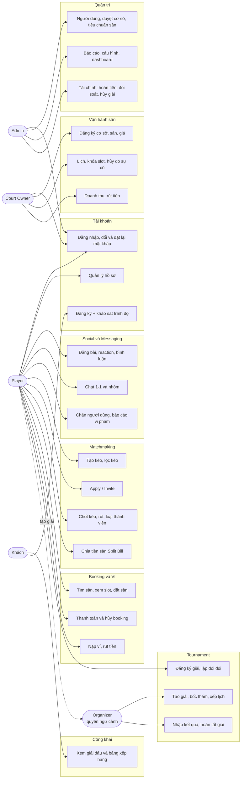

### 2.3. Quy trình nghiệp vụ tổng thể

**Hình 2.2. Luồng trải nghiệm chính của Player**

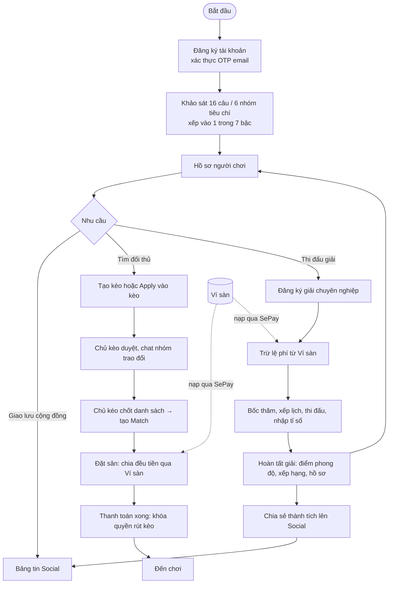

### 2.4. Môi trường vận hành, ràng buộc và giả định

**Bảng 2.2. Ràng buộc và giả định**

| Mã | Nội dung | Nguồn |
|---|---|---|
| C1 | Kiến trúc monolith client–server, không dùng microservice, Redis, Kafka, RabbitMQ | `tech-stack.md` (Architectural Constraints) |
| C2 | Một origin cho giao diện và `/api` (dev: Vite proxy) vì cookie phiên và CSRF | `tech-stack.md` |
| C3 | Node.js `^20.19.0 \|\| >=22.12.0`, PostgreSQL 16, trình duyệt hiện đại theo yêu cầu Tailwind v4 | `README.md`, `docker-compose.yml` |
| C4 | Tiến trình nền chạy trong tiến trình Node (`setInterval`), phù hợp một instance | `backend/src/index.ts`, `jobs/` |
| C5 | Tệp tải lên lưu trên hệ thống tệp cục bộ; ảnh/tệp riêng tư nằm ngoài thư mục tĩnh công khai | `PRIVATE_UPLOADS_DIR` |
| C6 | Múi giờ nghiệp vụ `Asia/Ho_Chi_Minh` | Mã booking, tournament |
| A1 | Mỗi người dùng có đúng một ví; số dư không âm | CHECK `chk_wallet_balance` |
| A2 | Giải chuyên nghiệp chỉ cho người có tài khoản và đã làm khảo sát trình độ | PRD Tournament |

---

## 3. Mô hình nghiệp vụ và yêu cầu chức năng

### 3.1. Quy ước

- Mỗi yêu cầu chức năng là một use case/user story có mã `UC-<module>-<số>` và **luôn kèm tiêu chí chấp nhận (AC)**. Tổng cộng 75 use case, tỷ lệ có AC là 100%.
- AC viết theo dạng điều kiện → kết quả có thể kiểm chứng. Mã lỗi (ví dụ `AUTH_ACCOUNT_LOCKED`) là mã trả về thật của API.
- Cột "Tác nhân" dùng ký hiệu: P = Player, O = Organizer, C = Court Owner, A = Admin, K = Khách, H = Hệ thống.
- Số liệu như "10 phút", "60–180 phút" là giá trị mặc định lấy từ cấu hình (`system_configs`, đăng ký trong `shared/config/config-registry.ts`), Admin có thể đổi.

### 3.2. Xác thực và tài khoản (AUTH)

**Bảng 3.1. Use case nhóm xác thực**

| Mã | User story | Tiêu chí chấp nhận (AC) | TN |
|---|---|---|---|
| UC-AUTH-01 | Là người chơi mới, tôi đăng ký bằng email, làm khảo sát trình độ và xác thực OTP để có tài khoản | 1) Email đã tồn tại → `AUTH_EMAIL_ALREADY_REGISTERED` (409). 2) Đăng ký lưu `pending_registrations` và gửi OTP 6 số qua email; chưa tạo `users`. 3) Nhập đúng OTP → tạo `users`, `player_profiles` và kết quả khảo sát; nhập sai vượt số lần cho phép (`otpMaxAttempts`) thì thử thách OTP bị vô hiệu. 4) Bộ khảo sát cũ hoặc form cũ bị từ chối. 5) Người chơi đặt mã PIN rút tiền ngay khi đăng ký | K |
| UC-AUTH-02 | Là người dùng, tôi đăng nhập để dùng chức năng theo vai trò | 1) Sai email/mật khẩu → `AUTH_INVALID_CREDENTIALS` (401), thông báo không lộ email có tồn tại hay không. 2) Sai liên tiếp 5 lần → khóa 15 phút, `AUTH_ACCOUNT_LOCKED` (429) kèm `Retry-After`. 3) Tài khoản `SUSPENDED`/`DEACTIVATED` → `AUTH_ACCOUNT_RESTRICTED` (403). 4) Thành công → cấp cookie `sid` (HttpOnly) và `csrf_token` | P, C, A |
| UC-AUTH-03 | Là người dùng, tôi đăng xuất để kết thúc phiên | 1) Đăng xuất thu hồi phiên hiện tại trong `auth_sessions`. 2) Dùng lại cookie cũ → `AUTH_SESSION_INVALID` (401). 3) Admin đặt mật khẩu mới cho người dùng → mọi phiên của người đó bị thu hồi | P, C, A |
| UC-AUTH-04 | Là người dùng quên mật khẩu, tôi đặt lại bằng OTP email | 1) Yêu cầu quên mật khẩu tạo thử thách OTP (`auth_challenges`). 2) Xác thực đúng OTP mới cấp token đặt lại dùng một lần (lưu dạng băm SHA-256). 3) Có thể gửi lại OTP; giới hạn 10 yêu cầu/15 phút/IP | K |
| UC-AUTH-05 | Là người dùng đã đăng nhập, tôi đổi mật khẩu có xác minh OTP | 1) Phải qua 3 bước: yêu cầu OTP → xác minh → đổi. 2) Court Owner do Admin tạo có `must_change_password = true` và bị chặn các chức năng khác đến khi đổi mật khẩu. 3) Mật khẩu mới được băm HMAC-SHA-256 + bcrypt cost 12 | P, C, A |
| UC-AUTH-06 | Là người chơi, tôi quản lý mã PIN rút tiền | 1) PIN được băm riêng với `WITHDRAWAL_PIN_PEPPER`. 2) Đặt lại PIN phải qua OTP email. 3) Rút tiền sai PIN bị từ chối | P, C |

### 3.3. Hồ sơ và trình độ (PRF)

**Bảng 3.2. Use case nhóm hồ sơ**

| Mã | User story | Tiêu chí chấp nhận (AC) | TN |
|---|---|---|---|
| UC-PRF-01 | Là người chơi, tôi làm khảo sát năng lực để được xếp vào bậc trình độ | 1) Khảo sát gồm 16 câu, 4 bước, mọi câu bắt buộc. 2) Điểm S = 0,40K + 0,20R + 0,15X + 0,10P + 0,10A + 0,05T; trừ 15 điểm nếu quay lại sau nghỉ trên 6 tháng. 3) Bậc = min(bậc theo S, trần G1, trần G2). 4) Chỉ làm một lần, không làm lại. 5) Tham số lưu theo phiên bản (`skill_survey_versions`) | K, P |
| UC-PRF-02 | Là người chơi, tôi xem và sửa hồ sơ của mình | 1) Sửa họ tên (2–50 ký tự) và ảnh đại diện; số điện thoại sửa ở UC-PRF-04. 2) Ảnh đại diện lưu công khai tại `/uploads`, tải lên qua API có xác thực. 3) Điểm phong độ chỉ hiển thị cho chủ hồ sơ (`/players/me/skill-rating`) | P |
| UC-PRF-03 | Là người chơi, tôi xem hồ sơ công khai của người khác | 1) `GET /players/:id` trả họ tên, ảnh, bậc trình độ và cờ bậc tạm thời; lịch sử giải ở `/players/:id/tournaments`; vị trí xếp hạng ở `/tournament-rankings/players/:id`. 2) Không trả email, số điện thoại, điểm phong độ. 3) Chỉ hiển thị hồ sơ đang hoạt động, ngược lại `PLAYER_NOT_FOUND` | P |
| UC-PRF-04 | Là người chơi, tôi quản lý số điện thoại liên hệ | 1) Xem và sửa qua `/players/me/contact`. 2) Số điện thoại có thể để trống (tùy chọn) | P |

### 3.4. Social

**Bảng 3.3. Use case nhóm Social**

| Mã | User story | Tiêu chí chấp nhận (AC) | TN |
|---|---|---|---|
| UC-SOC-01 | Là người chơi, tôi đăng bài tự do để chia sẻ với cộng đồng | 1) Nội dung tối đa 2000 ký tự, kèm ảnh riêng tư, tùy chọn nền màu (6 nền). 2) Tối đa 10 bài tự do/ngày (cấu hình `SOCIAL_FREE_POSTS_PER_DAY`). 3) Gửi trùng `clientRequestId` không tạo bài thứ hai. 4) Feed tắt bằng `SOCIAL_FEED_ENABLED` thì không đăng được | P |
| UC-SOC-02 | Là tác giả, tôi sửa hoặc xóa bài của mình | 1) Sửa ghi `edited_at`. 2) Xóa là xóa mềm (`deleted_at`). 3) Người khác không sửa/xóa được bài của tôi (403/404) | P |
| UC-SOC-03 | Là người chơi, tôi thả, đổi hoặc gỡ reaction trên bài viết | 1) Có 6 loại: LIKE, LOVE, HAHA, WOW, SAD, ANGRY. 2) Mỗi người một reaction cho mỗi bài; thả loại khác thì thay thế. 3) Gỡ bằng `DELETE` | P |
| UC-SOC-04 | Là người chơi, tôi bình luận bài viết | 1) Tối đa 10 bình luận/phút (`SOCIAL_COMMENTS_PER_MINUTE`). 2) Admin có thể ẩn bình luận vi phạm (`/admin/comments`) | P |
| UC-SOC-05 | Là người chơi, tôi xem bảng tin và chi tiết bài | 1) Danh sách phân trang `page`/`limit` kèm `meta`, sắp theo `published_at` giảm dần. 2) Bài đã xóa, bị ẩn, chưa xuất bản, hoặc của tác giả bị chặn hai chiều không có trong danh sách. 3) Giao diện Social chỉ gọi `/posts?type=FREE`; bài tìm kèo (`MATCH_FINDING`) thuộc khu vực Matchmaking và dùng chung API `/posts` với bộ lọc kèo | P |
| UC-SOC-06 | Là người đạt top 4 hoặc Organizer, tôi chia sẻ kết quả giải lên bảng tin | 1) Chỉ khi giải `COMPLETED`. 2) Mỗi người một bài kết quả cho mỗi giải (ràng buộc duy nhất `uq_posts_author_tournament_result`). 3) Bài có `type = TOURNAMENT_RESULT` kèm thẻ kết quả gồm tên giải, ngày, vô địch, á quân, hạng của mình; sau đó theo quy tắc Social thông thường (sửa, xóa, báo cáo, ẩn) | P, O |

### 3.5. Matchmaking (MM)

**Bảng 3.4. Use case nhóm Matchmaking**

| Mã | User story | Tiêu chí chấp nhận (AC) | TN |
|---|---|---|---|
| UC-MM-01 | Là chủ kèo, tôi tạo và đăng kèo có cấu trúc | 1) Chọn loại SINGLES (2 chỗ), DOUBLES (4 chỗ) hoặc GROUP (3–20 chỗ, tối thiểu 2 người). 2) Phải có giờ bắt đầu, thời lượng 1–1440 phút, khoảng trình độ min–max, chi phí dự kiến (tối đa 200 ký tự). 3) Kèo ở trạng thái nháp đến khi `publish`. 4) Tối đa 3 kèo mở đồng thời mỗi người | P |
| UC-MM-02 | Là người chơi, tôi tìm và lọc kèo | 1) Lọc theo khu vực, thời gian, trình độ, chỗ trống. 2) Kèo quá giờ bắt đầu hiển thị trạng thái `EXPIRED` | P |
| UC-MM-03 | Là người chơi, tôi xin tham gia kèo (Apply) và hủy yêu cầu đang chờ | 1) Apply tạo bản ghi `kind = APPLY`, `status = PENDING`. 2) Không apply trùng khi đang chờ (ràng buộc duy nhất cho PENDING/ACCEPTED). 3) Người bị chặn hai chiều với chủ kèo không apply được. 4) Hủy khi còn PENDING → `CANCELLED` | P |
| UC-MM-04 | Là chủ kèo, tôi mời người chơi phù hợp (Invite) | 1) Danh sách ứng viên lọc theo trình độ. 2) Lời mời `kind = INVITE` hết hạn sau 1440 phút hoặc khi kèo hết hạn, tùy mốc nào đến trước. 3) Người nhận chấp nhận hoặc từ chối | P |
| UC-MM-05 | Là chủ kèo, tôi duyệt hoặc từ chối yêu cầu tham gia | 1) Chấp nhận chỉ giữ chỗ, chưa tạo Match. 2) Không nhận quá số chỗ còn lại. 3) Chấp nhận hoặc từ chối đều cập nhật trạng thái bản ghi và gửi thông báo cho người liên quan | P |
| UC-MM-06 | Là chủ kèo, tôi chốt danh sách để tạo Match | 1) SINGLES/DOUBLES cần đủ 2/4 tài khoản; GROUP cần đạt tối thiểu và có ít nhất một thành viên ngoài chủ kèo, nếu không → `MATCHMAKING_EARLY_CLOSE_NOT_ALLOWED`. 2) Không có xung đột lịch của thành viên. 3) Chốt thành công: tạo Match, kèo chuyển `MATCHED`, các yêu cầu đang chờ chuyển `CANCELLED` với lý do `RECRUITMENT_CLOSED`. 4) Match `CONFIRMED` nếu đã có sân, ngược lại `PENDING_COURT` | P |
| UC-MM-07 | Là thành viên, tôi xin rút khỏi kèo; là chủ kèo, tôi loại thành viên | 1) Chỉ được trước khi booking của kèo thanh toán thành công và trước giờ bắt đầu; sau mốc thanh toán thao tác bị từ chối. 2) Rút khỏi kèo OPEN giải phóng chỗ; rút khỏi GROUP đã chốt thì mở lại tuyển và giữ Match; rút khỏi SINGLES/DOUBLES đã chốt thì hủy Match. 3) Cùng giao dịch gỡ quyền thành viên khỏi nhóm chat của kèo (không xóa tin cũ). 4) Chủ kèo không loại được chính mình | P |
| UC-MM-08 | Là chủ kèo, tôi gắn sân cho kèo | 1) Hoặc khai báo sân ngoài hệ thống (đủ tên, tỉnh/thành, quận/huyện, địa chỉ), hoặc gắn booking đặt trên hệ thống. 2) Một booking chỉ gắn một kèo (ràng buộc duy nhất `uq_matchmaking_requests_booking`). 3) Gắn booking khác địa điểm sân ngoài phải xác nhận cùng địa điểm | P |
| UC-MM-09 | Là chủ kèo, tôi đặt sân và chia đều tiền cho cả nhóm (Split Bill) | 1) Chỉ chủ kèo, kèo đã `MATCHED` và Match `PENDING_COURT`, chưa quá giờ chơi. 2) Có bước xem trước số tiền mỗi người. 3) Một thành viên thiếu số dư khả dụng → không trừ ai, trả `MATCH_SPLIT_INSUFFICIENT_WALLET` kèm danh sách và số tiền thiếu. 4) Đủ tiền → trừ ví mọi thành viên, xác nhận booking, kết chuyển doanh thu và liên kết booking trong một giao dịch. 5) Lỗi giữa chừng → hủy giữ chỗ, không trừ tiền. 6) Gọi lại sau khi thành công trả lại kết quả cũ | P |
| UC-MM-10 | Là chủ kèo, tôi tạo nhóm chat từ kèo đã chốt | 1) Mỗi kèo tối đa một nhóm liên kết; tạo lại trả nhóm đang có. 2) Thành viên bị loại/rút bị gỡ khỏi nhóm | P |
| UC-MM-11 | Là hệ thống, tôi tự xử lý kèo khi đến giờ bắt đầu và khi lời mời hết hạn | 1) Kèo còn `OPEN` khi đến giờ bắt đầu → `EXPIRED`, các yêu cầu đang chờ → `EXPIRED`, không tự bắt đầu dù đã đủ người. 2) Lời mời/apply quá hạn → `EXPIRED`. 3) Kèo `MATCHED` mà Match vẫn `PENDING_COURT` khi đến giờ → hủy kèo và Match với lý do `COURT_NOT_BOOKED`. 4) Match `CONFIRMED` nhưng không đủ người → hủy với lý do `INSUFFICIENT_PLAYERS`. 5) Match `CONFIRMED`, đủ người → chuyển `IN_PROGRESS`. 6) Quét mỗi 60 giây | H |

### 3.6. Đặt sân (BK)

**Bảng 3.5. Use case nhóm Court Booking**

| Mã | User story | Tiêu chí chấp nhận (AC) | TN |
|---|---|---|---|
| UC-BK-01 | Là người chơi, tôi tìm cơ sở và sân | 1) Tìm theo tên, khu vực, ngày giờ, thời lượng. 2) Chỉ đặt được khi cả cơ sở và sân ở trạng thái `ACTIVE` và chưa bị xóa mềm | P, K |
| UC-BK-02 | Là người chơi, tôi xem giá và slot trống theo thời gian thực | 1) Giao diện tự làm mới mỗi 8 giây. 2) Khung giờ không có bảng giá bao phủ coi là không khả dụng, không bao giờ coi là miễn phí. 3) Slot bị khóa bảo trì hoặc đã có booking hiệu lực hiển thị không khả dụng | P |
| UC-BK-03 | Là người chơi, tôi tạo booking và giữ chỗ | 1) Thời lượng 60–180 phút, ngày đặt trong 7 ngày tới, giờ bắt đầu chưa qua, nằm trong giờ mở cửa. 2) Tối đa 5 booking đang hoạt động mỗi người. 3) Booking mới ở `PENDING_PAYMENT`, hết hạn sau 10 phút. 4) Hai yêu cầu đồng thời cùng khung giờ: đúng một yêu cầu thành công, yêu cầu còn lại bị CSDL từ chối. 5) Giá được chụp lại theo từng khoảng giá (`booking_pricing_details`) | P |
| UC-BK-04 | Là người chơi, tôi thanh toán booking bằng Ví sàn | 1) Trừ ví, tạo thanh toán `SUCCESS`, xác nhận booking, kết chuyển doanh thu cho chủ sân trong một giao dịch. 2) Thiếu số dư → không đổi trạng thái, giao diện dẫn sang nạp ví. 3) Thanh toán lặp không trừ hai lần (khóa idempotency `booking-payment:<id>`). 4) Hết hạn giữ chỗ → `BOOKING_HOLD_EXPIRED` (409). 5) Booking đã hết hạn không bao giờ mở lại; nếu tiền đã trừ thì hoàn về ví | P |
| UC-BK-05 | Là người chơi, tôi hủy booking | 1) Hủy khi chưa thanh toán (`PENDING_PAYMENT`) → `CANCELLED`, nhả slot, không hoàn tiền. 2) Hủy booking đã thanh toán trước giờ bắt đầu → hoàn 100% về ví. 3) Sau giờ bắt đầu không hủy được | P |
| UC-BK-06 | Là người chơi, tôi xem lịch sử và booking sắp tới | 1) Danh sách phân trang theo trạng thái. 2) Chỉ thấy booking của mình | P |
| UC-BK-07 | Là hệ thống, tôi tự chuyển trạng thái booking | 1) Đến giờ bắt đầu: `CONFIRMED` → `IN_PROGRESS`. 2) Đến giờ kết thúc: `IN_PROGRESS` → `COMPLETED`. 3) Quá hạn thanh toán: `PENDING_PAYMENT` → `EXPIRED` và nhả slot. 4) Quét mỗi 60 giây, có quét bù 5 giây sau khi khởi động | H |

### 3.7. Court Owner (OWN)

**Bảng 3.6. Use case nhóm Court Owner**

| Mã | User story | Tiêu chí chấp nhận (AC) | TN |
|---|---|---|---|
| UC-OWN-01 | Là chủ sân, tôi đăng ký cơ sở và sân để Admin duyệt | 1) Cơ sở mới ở `PENDING_APPROVAL`, chưa được đặt. 2) Admin duyệt → `ACTIVE`; từ chối bắt buộc có lý do và chủ sân sửa, nộp lại giữ lịch sử đánh giá. 3) Đổi địa chỉ cơ sở đã duyệt phải qua yêu cầu đổi địa chỉ, địa chỉ cũ giữ hiệu lực đến khi duyệt | C |
| UC-OWN-02 | Là chủ sân, tôi quản lý sân và bảng giá | 1) Bảng giá theo khoảng thời gian; cập nhật bảng giá không đổi giá booking đã tạo. 2) Đổi giờ mở cửa bị từ chối nếu loại bỏ booking tương lai/đang chơi | C |
| UC-OWN-03 | Là chủ sân, tôi xem lịch và booking của cơ sở | 1) Chỉ thấy cơ sở của mình. 2) Không có luồng duyệt booking thủ công (không có trạng thái chờ chủ sân duyệt) | C |
| UC-OWN-04 | Là chủ sân, tôi khóa slot để bảo trì | 1) Khóa trong khoảng từ hôm nay đến 90 ngày (cấu hình `MAINTENANCE_ADVANCE_WINDOW_DAYS`). 2) Từ chối nếu chồng lên booking hiệu lực (kể cả đang chơi); giữ chỗ đã hết hạn không chặn. 3) Mở khóa theo ID khối | C |
| UC-OWN-05 | Là chủ sân, tôi hủy booking do sự cố | 1) Chỉ trước giờ bắt đầu, bắt buộc có lý do. 2) Booking đã thanh toán được hoàn tiền về ví người chơi; người chơi nhận thông báo | C |
| UC-OWN-06 | Là chủ sân, tôi gửi yêu cầu xác minh tiêu chuẩn sân | 1) Yêu cầu kèm bằng chứng ảnh. 2) Admin duyệt hoặc từ chối; mỗi tiêu chuẩn chỉ một yêu cầu đang hoạt động cho mỗi sân | C |
| UC-OWN-07 | Là chủ sân, tôi bàn giao cơ sở cho chủ sân khác | 1) Mỗi cơ sở tối đa một yêu cầu bàn giao đang mở. 2) Cần Admin duyệt và bên nhận xác nhận | C |
| UC-OWN-08 | Là chủ sân, tôi xem doanh thu và rút tiền | 1) Khi thanh toán booking thành công, doanh thu được cộng ngay vào ví chủ sân (khoản `OWNER_EARNING`, khi `OWNER_EARNING_AUTO_CREDIT_ENABLED` = true); nếu tắt, hệ thống tạo yêu cầu kết chuyển chờ Admin duyệt. 2) Booking bị hoàn tiền thì khoản kết chuyển bị từ chối hoặc đảo lại (`OWNER_EARNING_REVERSAL`) nếu ví chủ sân còn đủ số dư. 3) Rút tiền cần PIN; mặc định yêu cầu được tự duyệt (`WALLET_AUTO_APPROVE_PAYOUTS = true`), Admin đánh dấu đã chi | C |

### 3.8. Ví sàn và thanh toán (WAL)

**Bảng 3.7. Use case nhóm Ví**

| Mã | User story | Tiêu chí chấp nhận (AC) | TN |
|---|---|---|---|
| UC-WAL-01 | Là người dùng, tôi xem số dư và lịch sử ví | 1) Số dư khả dụng = số dư trừ các khoản đang giữ (`HELD`). 2) Sổ cái hiển thị theo thời gian giảm dần, phân trang | P, C |
| UC-WAL-02 | Là người chơi, tôi nạp tiền vào ví | 1) Tạo yêu cầu nạp có `txn_ref` duy nhất, quét QR chuyển khoản. 2) Webhook SePay hợp lệ (ký HMAC) → ví được cộng đúng một lần dù webhook gửi lặp. 3) Sai số tiền hoặc không khớp tham chiếu → ghi cảnh báo cho Admin, không cộng ví. 4) Admin có thể ghép tay giao dịch chưa khớp | P |
| UC-WAL-03 | Là người dùng, tôi liên kết tài khoản ngân hàng và rút tiền | 1) Mỗi người có thể có nhiều tài khoản, một mặc định. 2) Yêu cầu rút giữ trước số tiền (`wallet_holds`), cần PIN. 3) Trạng thái: `PENDING` → `APPROVED` → `PAID`; mặc định tự duyệt, Admin đánh dấu đã chi. 4) Admin từ chối → `REJECTED` và nhả khoản giữ; chi thất bại → `FAILED` | P, C |
| UC-WAL-04 | Là hệ thống, tôi hoàn tiền về ví | 1) Hoàn tiền tạo bản ghi `payment_refunds`, trạng thái `PENDING` → `PROCESSING` → `REFUNDED` hoặc `FAILED`. 2) Worker xử lý mỗi 60 giây; hoàn thất bại có thể thử lại bởi Admin | H |

### 3.9. Giải đấu (TRN)

**Bảng 3.8. Use case nhóm Tournament**

| Mã | User story | Tiêu chí chấp nhận (AC) | TN |
|---|---|---|---|
| UC-TRN-01 | Là người chơi, tôi tạo giải chuyên nghiệp và trở thành Organizer | 1) Giải khởi tạo `DRAFT`. 2) Giới hạn người tham gia 2–128; số sân 1–20; thời lượng trận 10–180 phút; nghỉ tối thiểu 0–240 phút; giờ bắt đầu nhỏ hơn giờ kết thúc mỗi ngày. 3) Trình độ min ≤ max. 4) Lệ phí ≥ 0 (0 là miễn phí), khóa sau khi có đăng ký đầu tiên | P→O |
| UC-TRN-02 | Là Organizer, tôi mở và đóng đăng ký | 1) Chuyển trạng thái yêu cầu đúng `version` hiện tại (khóa lạc quan), sai → xung đột. 2) Hệ thống tự đóng khi qua `registration_end`. 3) Đóng với dưới 2 đăng ký → giải tự hủy và hoàn tiền | O, H |
| UC-TRN-03 | Là người chơi, tôi đăng ký giải đơn và trả lệ phí bằng ví | 1) Chỉ khi `OPEN_FOR_REGISTRATION`, trong thời hạn, còn chỗ, trình độ nằm trong khoảng cho phép. 2) Lệ phí trừ ví cùng giao dịch, đăng ký `CONFIRMED` ngay. 3) Thiếu số dư → từ chối kèm số tiền cần nạp. 4) Một người chỉ một đăng ký `CONFIRMED` mỗi giải (ràng buộc duy nhất). 5) Rút trước khi đóng đăng ký được hoàn 100% | P |
| UC-TRN-04 | Là người chơi, tôi lập đội đôi và mời đồng đội | 1) Đội trưởng tạo đội, mời đúng một người đủ điều kiện bằng tìm theo tên hoặc link mời. 2) Lời mời hết hạn sau 1440 phút. 3) Đủ hai người, đội trưởng đăng ký và trả lệ phí bằng ví của mình. 4) Một người chỉ ở một đội đang hoạt động trong một giải | P |
| UC-TRN-05 | Là Organizer, tôi xem gợi ý hạt giống, chỉnh và bốc thăm | 1) Gợi ý theo bậc trình độ giảm dần, hòa thì theo điểm phong độ, vẫn hòa thì ngẫu nhiên. 2) Số hạt giống duy nhất, ≥ 1. 3) Bốc thăm cần ít nhất 2 đăng ký, tạo nhánh + lịch trong một giao dịch, giải chuyển `READY`. 4) Sau bốc thăm không bốc lại, không đổi hạt giống | O |
| UC-TRN-06 | Là Organizer, tôi xem và chỉnh lịch thi đấu | 1) Lịch tự xếp trên sân ảo "Sân 1…k" không trùng sân, không trùng vận động viên, đủ thời gian nghỉ, trong khung giờ mỗi ngày. 2) Sửa tay nhãn sân/giờ của trận chưa bắt đầu; xung đột chỉ cảnh báo, không chặn. 3) Chạy lại xếp lịch giữ nguyên trận đã/đang đấu | O |
| UC-TRN-07 | Là Organizer, tôi bắt đầu trận và nhập tỉ số từng set | 1) Trận tối đa 3 set thắng 2, mỗi set thắng ở 21 điểm cách biệt 2, trần 30–29; tỉ số sai bị từ chối kèm lý do từng set. 2) Có thể ghi bỏ cuộc (`WALKOVER`) hoặc chấn thương (`RETIRED`, giữ các set đã đánh). 3) Người thắng tự chuyển vào trận kế tiếp. 4) Trận đầu tiên bắt đầu đưa giải sang `IN_PROGRESS` | O |
| UC-TRN-08 | Là Organizer, tôi sửa kết quả đã nhập | 1) Sửa được khi trận kế tiếp chưa bắt đầu; người thắng được cập nhật lại. 2) Sau khi giải `COMPLETED` chỉ sửa trong 48 giờ, và chỉ đổi tỉ số hoặc người thắng trận chung kết; điểm thành tích và trình độ được tính lại | O |
| UC-TRN-09 | Là Organizer, tôi hoàn tất giải | 1) Chỉ khi trận chung kết đã có người thắng, nếu không → `TOURNAMENT_NOT_FINISHED` (409). 2) Lệ phí của các đăng ký còn `CONFIRMED` được cộng vào ví Organizer đúng một lần. 3) Ghi điểm thành tích và cập nhật điểm phong độ, bậc trình độ cho người tham gia. 4) Tự hoàn tất sau 3 ngày kể từ ngày kết thúc nếu chung kết đã xong; tự hủy và hoàn tiền sau 14 ngày nếu chưa xong | O, H |
| UC-TRN-10 | Là người chơi/khách, tôi theo dõi nhánh đấu, lịch và kết quả | 1) Giải `DRAFT` chỉ Organizer và Admin xem được. 2) Người chơi đăng nhập nhận cập nhật qua WebSocket; khách làm mới mỗi 30 giây khi giải ở `READY`/`IN_PROGRESS`. 3) Nhắc trước 30 phút khi sắp đến trận của mình | P, K |
| UC-TRN-11 | Là người chơi, tôi xem bảng xếp hạng thành tích và trình độ của mình | 1) Bảng xếp hạng tách đơn/đôi, lọc theo bậc, phân trang, khách xem được. 2) Điểm = điểm cơ sở theo vị trí × độ mạnh của giải × hệ số quy mô; tổng của 4 giải tốt nhất trong 12 tháng. 3) Trình độ của tôi thay đổi (lên hoặc xuống) kèm thông báo; điểm phong độ chỉ mình tôi xem | P, K |
| UC-TRN-12 | Là Organizer hoặc Admin, tôi hủy giải | 1) Organizer hủy trước `IN_PROGRESS`; Admin hủy ở mọi trạng thái chưa kết thúc, bắt buộc có lý do. 2) Mọi đăng ký `CONFIRMED` hoàn 100% về ví người trả. 3) Organizer không nhận tiền khi giải bị hủy | O, A |
| UC-TRN-13 | Là Organizer, tôi loại một đăng ký có lý do | 1) Chỉ trước khi bốc thăm. 2) Hoàn 100% và thông báo cho người bị loại; người đó bị gỡ khỏi nhóm chat của giải | O |
| UC-TRN-14 | Là người tham gia, tôi dùng nhóm chat của giải | 1) Nhóm tạo khi đóng đăng ký với ít nhất 2 đăng ký. 2) Khóa chỉ đọc khi giải bị hủy hoặc 30 ngày sau khi hoàn tất | P, O |

### 3.10. Messaging (MSG)

**Bảng 3.9. Use case nhóm Messaging**

| Mã | User story | Tiêu chí chấp nhận (AC) | TN |
|---|---|---|---|
| UC-MSG-01 | Là người chơi, tôi nhắn tin 1-1 | 1) Tối đa 20 hội thoại mới/ngày, 30 tin/phút. 2) Tin mới đến người nhận qua WebSocket trong cùng phiên; mất kết nối thì đồng bộ bù theo số thứ tự (`seq`) | P |
| UC-MSG-02 | Là người chơi, tôi tạo và quản lý nhóm chat | 1) Tối đa 50 thành viên mặc định. 2) Chủ nhóm thêm, xóa thành viên, giải tán; thành viên tự rời | P |
| UC-MSG-03 | Là người chơi, tôi gửi ảnh và tệp đính kèm | 1) Tệp lưu ở thư mục riêng tư, tải qua API có kiểm quyền từng lần, không phục vụ tĩnh. 2) Tệp DOCX/XLSX được kiểm tra cấu trúc ZIP trước khi nhận | P |
| UC-MSG-04 | Là người chơi, tôi thả reaction, thu hồi và ẩn tin nhắn | 1) Reaction cập nhật realtime. 2) Thu hồi tin của mình; ẩn tin chỉ ẩn với bản thân | P |
| UC-MSG-05 | Là người chơi, tôi thấy trạng thái online, đang nhập, chưa đọc | 1) Heartbeat hiện diện từ trình duyệt mỗi 25 giây khi tab hiển thị. 2) Đánh dấu đã đọc cập nhật số chưa đọc tức thì | P |
| UC-MSG-06 | Là người chơi, tôi chặn và bỏ chặn người dùng | 1) Chặn hai chiều: không nhắn tin, không apply/invite kèo giữa hai người. 2) Danh sách chặn xem và bỏ chặn được | P |

### 3.11. Thông báo, báo cáo, quản trị (NTF, RPT, ADM)

**Bảng 3.10. Use case nhóm thông báo, báo cáo và quản trị**

| Mã | User story | Tiêu chí chấp nhận (AC) | TN |
|---|---|---|---|
| UC-NTF-01 | Là người dùng, tôi nhận thông báo trong ứng dụng | 1) Thông báo lưu ở `notifications`. 2) Giao diện kiểm tra thông báo chưa đọc mỗi 30 giây khi tab hiển thị. 3) Đánh dấu đã đọc từng thông báo | P, C, A |
| UC-RPT-01 | Là người dùng, tôi báo cáo người chơi, cơ sở, giải đấu, bài viết, bình luận hoặc tin nhắn | 1) Mỗi báo cáo đúng một đối tượng (CHECK `chk_report_target`). 2) Có thể đính kèm bằng chứng ảnh. 3) Đủ 5 người báo cáo khác nhau cùng một đối tượng trong 24 giờ → cảnh báo mức cao cho Admin | P, C |
| UC-ADM-01 | Là Admin, tôi quản lý người dùng | 1) Tạo tài khoản (Court Owner/Admin), khóa/mở khóa, xóa mềm, thao tác hàng loạt. 2) Tài khoản được bảo vệ không bị thao tác hàng loạt. 3) Mọi thao tác ghi `admin_action_audits` | A |
| UC-ADM-02 | Là Admin, tôi duyệt cơ sở, sân và tiêu chuẩn sân | 1) Hàng chờ duyệt có số đếm. 2) Từ chối bắt buộc nêu lý do. 3) Duyệt thay đổi trạng thái cơ sở và ghi `facility_status_audits` | A |
| UC-ADM-03 | Là Admin, tôi xử lý báo cáo vi phạm | 1) Xem báo cáo và bằng chứng qua API có kiểm quyền. 2) Có thể ẩn bài viết/bình luận bị báo cáo | A |
| UC-ADM-04 | Là Admin, tôi quản lý ví và dòng tiền toàn sàn | 1) Xem tổng quan, giao dịch, ví từng người. 2) Duyệt/từ chối/đánh dấu đã chi các yêu cầu rút. 3) Ghi có/ghi nợ thủ công bắt buộc có lý do. 4) Thử lại hoàn tiền, đối soát với nhà cung cấp, xuất báo cáo. 5) Mọi thao tác ghi `finance_audit_events` | A |
| UC-ADM-05 | Là Admin, tôi chỉnh cấu hình hệ thống | 1) 71 khóa cấu hình có kiểu, giá trị mặc định, ngưỡng min/max. 2) Giá trị ngoài ngưỡng bị từ chối. 3) Thay đổi ghi `system_config_audit` | A |
| UC-ADM-06 | Là Admin, tôi xem dashboard | 1) KPI và biểu đồ tổng hợp người dùng, booking, doanh thu, giải đấu | A |
| UC-ADM-07 | Là Admin, tôi hủy giải đấu vi phạm | 1) Theo UC-TRN-12; Admin không điều hành hộ, không nhập kết quả | A |

### 3.12. Đặc tả chi tiết các use case trọng yếu

Phần này đặc tả đầy đủ luồng chính, luồng thay thế và luồng ngoại lệ của sáu use case cốt lõi, theo mẫu bảng đặc tả của báo cáo.

**Bảng 3.11. Đặc tả UC-AUTH-02 "Đăng nhập"**

| Mục | Nội dung |
|---|---|
| Tác nhân | Player, Court Owner, Admin |
| Kích hoạt | Người dùng gửi `POST /api/v1/auth/login` từ trang đăng nhập |
| Tiền điều kiện | Tài khoản tồn tại, chưa xóa mềm |
| Hậu điều kiện | Có một dòng mới trong `auth_sessions`; trình duyệt giữ cookie `sid` và `csrf_token`; bộ đếm đăng nhập sai về 0 |
| Luồng chính | 1. Người dùng nhập email và mật khẩu. 2. Hệ thống chuẩn hóa email (chữ thường, bỏ khoảng trắng). 3. Hệ thống kiểm tra khóa tạm thời. 4. Hệ thống xác minh mật khẩu (HMAC-SHA-256 với pepper, rồi bcrypt). 5. Hệ thống xóa bộ đếm sai. 6. Hệ thống kiểm tra trạng thái tài khoản. 7. Hệ thống tạo phiên, đặt cookie, trả thông tin người dùng. 8. Giao diện chuyển đến trang chủ theo vai trò |
| Luồng thay thế | Tài khoản có `must_change_password` → giao diện chuyển sang trang đổi mật khẩu trước khi vào chức năng khác |
| Luồng ngoại lệ | E1. Email không tồn tại hoặc đã xóa mềm → vẫn chạy xác minh giả để cân bằng thời gian, trả `AUTH_INVALID_CREDENTIALS` (401). E2. Đang bị khóa → `AUTH_ACCOUNT_LOCKED` (429) kèm `Retry-After`. E3. Sai mật khẩu → tăng bộ đếm; đạt ngưỡng 5 lần thì khóa 15 phút; trả 401. E4. Tài khoản `SUSPENDED`/`DEACTIVATED` → `AUTH_ACCOUNT_RESTRICTED` (403). E5. Quá 20 yêu cầu/15 phút từ một IP → `AUTH_RATE_LIMITED` (429) |

**Bảng 3.12. Đặc tả UC-BK-04 "Thanh toán booking bằng Ví sàn"**

| Mục | Nội dung |
|---|---|
| Tác nhân | Player (chủ booking) |
| Kích hoạt | Người chơi bấm thanh toán ở trang chờ thanh toán, gọi `POST /api/v1/bookings/:id/payment` |
| Tiền điều kiện | Booking ở `PENDING_PAYMENT`, chưa quá `expires_at`, thuộc về người gọi |
| Hậu điều kiện | Booking `CONFIRMED`; một `payments` trạng thái `SUCCESS` (nhà cung cấp `WALLET`); một dòng sổ cái `PAYMENT`; doanh thu được kết chuyển cho chủ sân |
| Luồng chính | 1. Hệ thống khóa hàng `users` của người chơi và chủ cơ sở theo thứ tự tăng dần, rồi khóa booking. 2. Kiểm tra quyền sở hữu và trạng thái. 3. Trừ ví với khóa idempotency `booking-payment:<id>`. 4. Tạo bản ghi thanh toán thành công. 5. Xác nhận booking trong cùng giao dịch. 6. Kết chuyển doanh thu cho chủ sân. 7. Sau khi giao dịch hoàn tất, phát sự kiện booking để cập nhật giao diện |
| Luồng thay thế | Booking đã `CONFIRMED` và thanh toán đã `SUCCESS` → trả lại kết quả cũ, không trừ lần hai (idempotent) |
| Luồng ngoại lệ | E1. Không phải chủ booking → 403 `BOOKING_NOT_OWNER`. E2. Booking không còn `PENDING_PAYMENT` → 409 `BOOKING_NOT_PAYABLE`. E3. Quá hạn giữ chỗ → 409 `BOOKING_HOLD_EXPIRED`. E4. Số dư khả dụng không đủ → giao dịch hoàn tác, không thay đổi dữ liệu. E5. Xác nhận trả tín hiệu hoàn tiền (booking đã hết hạn cùng lúc) → cộng lại ví (`REFUND`) và đặt thanh toán `REFUNDED` |

**Bảng 3.13. Đặc tả UC-MM-06 "Chốt kèo"**

| Mục | Nội dung |
|---|---|
| Tác nhân | Chủ kèo (Player) |
| Kích hoạt | Chủ kèo bấm "Chốt danh sách", gọi `POST /api/v1/matchmaking-requests/:id/close` |
| Tiền điều kiện | Kèo `OPEN`, chưa đến giờ bắt đầu, chưa hết hạn |
| Hậu điều kiện | Kèo `MATCHED`; có một Match (`CONFIRMED` nếu đã có sân, ngược lại `PENDING_COURT`); các yêu cầu/lời mời đang chờ chuyển `CANCELLED` |
| Luồng chính | 1. Khóa hàng người dùng liên quan theo thứ tự tăng dần, rồi khóa kèo. 2. Kiểm tra chủ kèo. 3. Kiểm tra đủ người theo loại kèo. 4. Kiểm tra từng thành viên không có kèo/Match trùng giờ. 5. Đóng các yêu cầu đang chờ. 6. Tạo Match và danh sách người chơi (đôi được chia hai đội ngẫu nhiên). 7. Đánh dấu kèo `MATCHED`. 8. Thông báo thành viên |
| Luồng thay thế | Kèo đã `MATCHED` → trả lại Match hiện có, không tạo thêm |
| Luồng ngoại lệ | E1. Không đủ người → 409 `MATCHMAKING_EARLY_CLOSE_NOT_ALLOWED`. E2. Kèo không còn mở → 409 `MATCHMAKING_REQUEST_NOT_OPEN`. E3. Thành viên trùng lịch → 409. E4. Tập thành viên thay đổi trong lúc chờ khóa → giao dịch tự thử lại từ đầu |

**Bảng 3.14. Đặc tả UC-MM-09 "Đặt sân và chia tiền (Split Bill)"**

| Mục | Nội dung |
|---|---|
| Tác nhân | Chủ kèo |
| Kích hoạt | `POST /api/v1/matches/:id/booking/create` sau bước xem trước `.../booking/preview` |
| Tiền điều kiện | Kèo `MATCHED`, Match `PENDING_COURT`, kèo chưa có booking, chưa quá giờ chơi |
| Hậu điều kiện | Booking `CONFIRMED` gắn với kèo; Match `CONFIRMED`; mỗi thành viên có một dòng sổ cái `PAYMENT` và một dòng `booking_cost_shares` |
| Luồng chính | 1. Xem trước: tính số tiền mỗi người, liệt kê người thiếu số dư. 2. Tạo giữ chỗ booking cho chủ kèo (`PENDING_PAYMENT`). 3. Trong một giao dịch: khóa kèo, Match, booking. 4. Chia tiền theo xu để tổng các phần bằng đúng tổng tiền sân; xu dư cộng lần lượt cho chủ kèo rồi các thành viên theo ID tăng dần. 5. Kiểm tra số dư khả dụng từng người. 6. Trừ ví từng thành viên với khóa `match-booking-share:<booking>:<người>`. 7. Tạo thanh toán `WALLET_SPLIT` thành công và các phần chia `PAID`. 8. Xác nhận booking, kết chuyển doanh thu. 9. Liên kết booking với Match và kèo. 10. Thông báo sân và số tiền từng người |
| Luồng thay thế | Đã đặt thành công trước đó → trả lại kết quả cũ (idempotent) |
| Luồng ngoại lệ | E1. Có người thiếu tiền → 409 `MATCH_SPLIT_INSUFFICIENT_WALLET` kèm danh sách; không trừ ai; chủ kèo có thể nhắc nạp ví (`remind-topup`). E2. Giữ chỗ hết hạn → 409 `MATCH_SPLIT_BOOKING_EXPIRED`. E3. Quá giờ chơi → 409 `MATCH_SPLIT_DEADLINE_PASSED`. E4. Mọi lỗi sau khi tạo giữ chỗ → giao dịch hoàn tác và giữ chỗ được hủy, không thành viên nào bị trừ tiền |

**Bảng 3.15. Đặc tả UC-TRN-05 "Bốc thăm và xếp lịch tự động"**

| Mục | Nội dung |
|---|---|
| Tác nhân | Organizer |
| Kích hoạt | `POST /api/v1/tournaments/:id/draw` kèm `version` hiện tại |
| Tiền điều kiện | Giải `REGISTRATION_CLOSED`, có ít nhất 2 đăng ký `CONFIRMED` |
| Hậu điều kiện | Giải `READY`; có `tournament_matches` cho mọi vòng; mỗi trận đủ người có lịch; `draw_seed` được lưu để tái lập kết quả |
| Luồng chính | 1. Khóa giải theo Organizer và kiểm tra `version`. 2. Nếu chưa có hạt giống nào, tự gán theo gợi ý. 3. Sinh `draw_seed` ngẫu nhiên. 4. Dựng nhánh: kích thước = lũy thừa 2 nhỏ nhất ≥ số đăng ký, đặt hạt giống theo vị trí chuẩn, BYE cho hạt giống cao nhất. 5. Ghi `matches`, `tournament_matches`, danh sách người chơi, liên kết trận kế tiếp. 6. Xếp lịch tự động trên sân ảo. 7. Thông báo người tham gia. 8. Lưu tổng bậc và số người của giải để tính điểm thành tích sau này |
| Luồng thay thế | Organizer đặt hạt giống tay trước khi bốc thăm → hạt giống tay lấy vị trí 1..k, phần còn lại bốc ngẫu nhiên |
| Luồng ngoại lệ | E1. Dưới 2 đăng ký → từ chối. E2. `version` cũ → xung đột. E3. Không phải Organizer → 403 |

**Bảng 3.16. Đặc tả UC-TRN-07 "Nhập kết quả trận"**

| Mục | Nội dung |
|---|---|
| Tác nhân | Organizer |
| Kích hoạt | `POST .../matches/:tournamentMatchId/start`, sau đó `PUT .../matches/:tournamentMatchId/result` |
| Tiền điều kiện | Giải `READY` hoặc `IN_PROGRESS`; trận có đủ hai bên và chưa bị hủy |
| Hậu điều kiện | Trận `COMPLETED` với `resolution` = `WINNER_DECLARED`/`RETIRED`/`WALKOVER`; các set lưu trong `match_games`; người thắng nằm ở trận kế tiếp |
| Luồng chính | 1. Bắt đầu trận: `matches.status` = `IN_PROGRESS`; nếu giải đang `READY` thì sang `IN_PROGRESS`. 2. Nhập điểm từng set. 3. Hệ thống kiểm tra luật: set thắng 21 điểm cách 2 (22–30 cách đúng 2, hoặc 30–29), set 3 chỉ khi 1–1. 4. Xác định người thắng (2 set). 5. Ghi set và kết quả trong một giao dịch. 6. Ghi người thắng vào vị trí tương ứng của trận kế tiếp, cập nhật danh sách người chơi |
| Luồng thay thế | A1. Ghi bỏ cuộc: chọn bên thắng, không có set. A2. Ghi chấn thương: giữ các set đã đánh, bên còn lại thắng; bên bỏ cuộc không được là bên đã thắng trận. A3. Hủy trận (`NONE`): không đẩy người thắng, bắt buộc xử lý lại trước khi hoàn tất giải |
| Luồng ngoại lệ | E1. Tỉ số sai luật → 4xx kèm danh sách lỗi từng set. E2. Chưa bấm bắt đầu mà nhập tỉ số → từ chối. E3. Sửa kết quả khi trận kế tiếp đã bắt đầu → từ chối. E4. Giải đã `COMPLETED` quá 48 giờ → từ chối |

### 3.13. Tổng hợp độ phủ tiêu chí chấp nhận

**Bảng 3.17. Số use case theo nhóm**

| Nhóm | Số UC | Số UC có AC | Tỷ lệ |
|---|---|---|---|
| AUTH | 6 | 6 | 100% |
| PRF | 4 | 4 | 100% |
| SOC | 6 | 6 | 100% |
| MM | 11 | 11 | 100% |
| BK | 7 | 7 | 100% |
| OWN | 8 | 8 | 100% |
| WAL | 4 | 4 | 100% |
| TRN | 14 | 14 | 100% |
| MSG | 6 | 6 | 100% |
| NTF, RPT, ADM | 9 | 9 | 100% |
| **Tổng** | **75** | **75** | **100%** |

---

## 4. Quy tắc nghiệp vụ

Mỗi quy tắc có mã `BR-<nhóm>-<số>`, nguồn gốc (tài liệu, khóa cấu hình hoặc ràng buộc CSDL) và nơi thực thi. Quy tắc được thực thi ở ba lớp: kiểm tra đầu vào bằng Zod, kiểm tra nghiệp vụ trong service, ràng buộc ở PostgreSQL. Lớp CSDL là chốt chặn cuối cùng.

**Bảng 4.1. Quy tắc đặt sân (BK)**

| Mã | Quy tắc | Giá trị / nguồn | Thực thi |
|---|---|---|---|
| BR-BK-01 | Đặt sân theo thời gian thực; không có luồng chủ sân duyệt từng booking | `business-rules-config-matrix.md` §2.1 | Service |
| BR-BK-02 | Hai booking đang hiệu lực trên cùng một sân không được chồng thời gian; hai khoảng chạm biên (19:00–20:00 và 20:00–21:00) hợp lệ | Ràng buộc loại trừ `ex_bookings_court_no_overlap` trên `court_id` và khoảng `[start, end)`, áp cho `PENDING_PAYMENT`, `CONFIRMED`, `IN_PROGRESS` | CSDL |
| BR-BK-03 | Thời lượng 60–180 phút; đặt trước tối đa 7 ngày; tối đa 5 booking hoạt động mỗi người | `BOOKING_MIN_DURATION_MINUTES`, `BOOKING_MAX_DURATION_MINUTES`, `BOOKING_ADVANCE_WINDOW_DAYS`, `BOOKING_MAX_ACTIVE_PER_PLAYER` | Service |
| BR-BK-04 | Giá booking là tổng các khoảng giá bao phủ khung giờ, được chụp lại; đổi bảng giá không đổi booking cũ; khung giờ thiếu giá là không khả dụng | `booking_pricing_details` | Service |
| BR-BK-05 | Vòng đời: `PENDING_PAYMENT` → `CONFIRMED` → `IN_PROGRESS` → `COMPLETED`; nhánh `EXPIRED` (quá 10 phút chưa thanh toán) và `CANCELLED` | `BOOKING_PAYMENT_TIMEOUT_MINUTES` = 10; worker 60 giây | Service + job |
| BR-BK-06 | Hủy booking chưa thanh toán: nhả slot, không hoàn tiền. Hủy booking đã thanh toán trước giờ bắt đầu: hoàn 100% về ví. Chủ sân hủy do sự cố: hoàn về ví và thông báo | Matrix §2.4 | Service |
| BR-BK-07 | Thanh toán đến sau khi booking đã hết hạn: không mở lại booking, hoàn tiền | Matrix §2.7 | Service |
| BR-BK-08 | Khóa bảo trì tối đa 90 ngày, không được chồng booking hiệu lực | `MAINTENANCE_ADVANCE_WINDOW_DAYS` = 90 | Service |

**Bảng 4.2. Quy tắc Ví sàn (WL)**

| Mã | Quy tắc | Giá trị / nguồn | Thực thi |
|---|---|---|---|
| BR-WL-01 | Mỗi người dùng một ví; số dư không âm; số dư khả dụng = số dư trừ các khoản đang giữ (`HELD`) | CHECK `chk_wallet_balance` | CSDL |
| BR-WL-02 | Sổ cái chỉ thêm, không sửa/xóa; mỗi dòng ghi số dư sau giao dịch; loại giao dịch: `TOP_UP`, `PAYMENT`, `REFUND`, `WITHDRAWAL`, `PAYOUT`, `ADMIN_ADJUSTMENT`, `OWNER_EARNING`, `OWNER_EARNING_REVERSAL`, `TOURNAMENT_EARNING` | CHECK `chk_wallet_entry_type` | CSDL |
| BR-WL-03 | Mỗi thao tác tiền có khóa idempotency; cặp (người dùng, khóa) là duy nhất | `uq_wallet_entries_user_idempotency` | CSDL |
| BR-WL-04 | Một giao dịch nhà cung cấp chỉ cộng ví một lần | `uq_wallet_top_ups_provider_transaction`, `txn_ref` duy nhất | CSDL |
| BR-WL-05 | Rút tiền yêu cầu PIN, giữ trước số tiền; Admin từ chối thì nhả khoản giữ | `wallet_holds`, `WalletPayoutService` | Service |
| BR-WL-06 | Ghi có/ghi nợ thủ công của Admin bắt buộc có lý do và để lại dấu vết kiểm toán | `finance_audit_events` | Service |
| BR-WL-07 | Doanh thu booking được cộng vào ví chủ sân ngay sau khi thanh toán thành công (mặc định); nếu tắt tự cộng thì chờ Admin duyệt; khi booking hoàn tiền, khoản cộng bị từ chối hoặc đảo lại nếu ví chủ sân còn đủ số dư | `OWNER_EARNING_AUTO_CREDIT_ENABLED`, `owner_earning_settlements`, `OwnerEarningService` | Service + job |

**Bảng 4.3. Quy tắc Matchmaking (MM)**

| Mã | Quy tắc | Giá trị / nguồn | Thực thi |
|---|---|---|---|
| BR-MM-01 | SINGLES: 2 chỗ; DOUBLES: 4 chỗ; GROUP: 3–20 chỗ, tối thiểu 2 người và không vượt số chỗ | CHECK `chk_matchmaking_requests_type_shape` | CSDL |
| BR-MM-02 | Apply/Invite được chấp nhận chỉ giữ chỗ. Chủ kèo bấm chốt mới tạo Match. Kèo còn `OPEN` khi đến giờ bắt đầu thì `EXPIRED` | Brief §3.2, §7 | Service + job |
| BR-MM-03 | Thành viên chỉ rút, hoặc bị loại, trước khi booking gắn với kèo được thanh toán thành công và trước giờ bắt đầu | Brief §3.2; thực thi dùng chung khóa booking với thanh toán | Service |
| BR-MM-04 | Khi rút/bị loại, thành viên bị gỡ khỏi nhóm chat của kèo trong cùng giao dịch; tin nhắn cũ và nhóm chat độc lập không bị ảnh hưởng | Brief §3.5 | Service |
| BR-MM-05 | Một booking gắn tối đa một kèo và một Match; một kèo có tối đa một bài viết | `uq_matchmaking_requests_booking`, `uq_matchmaking_requests_post`, `matches.booking_id` UNIQUE | CSDL |
| BR-MM-06 | Một người không được có hai kèo/Match trùng khoảng thời gian | `hasOverlappingCommitment` | Service |
| BR-MM-07 | Người bị chặn hai chiều không apply/invite lẫn nhau | `matchmakingBlockPort` | Service |
| BR-MM-08 | Split Bill: tổng tiền chia theo xu, phần dư cộng lần lượt cho chủ kèo rồi thành viên theo ID tăng dần; thiếu ví một người thì không ai bị trừ | `splitAmounts` | Service |
| BR-MM-09 | Tối đa 3 kèo mở đồng thời mỗi người; lời mời/apply hết hạn sau 1440 phút hoặc khi kèo hết hạn | `MATCHMAKING_MAX_OPEN_POSTS_PER_PLAYER`, `MATCHMAKING_INVITATION_TIMEOUT_MINUTES`, `MATCHMAKING_APPLICATION_TIMEOUT_MINUTES` | Service |
| BR-MM-10 | Kết quả trận giao lưu không dùng để nâng trình; trình độ chỉ đổi qua giải chuyên nghiệp | Brief §3.2 | Thiết kế |

**Bảng 4.4. Quy tắc giải đấu (TR)**

| Mã | Quy tắc | Giá trị / nguồn | Thực thi |
|---|---|---|---|
| BR-TR-01 | Định dạng `SINGLE_ELIMINATION`; thể thức `SINGLES`/`DOUBLES`; loại giải hiện hỗ trợ: `PROFESSIONAL` | CHECK `chk_tournament_format`, `chk_tournament_match_type` | CSDL |
| BR-TR-02 | Giới hạn: 2–128 đăng ký, 1–20 sân, 10–180 phút/trận, nghỉ 0–240 phút, giờ bắt đầu < giờ kết thúc | CHECK trong `tournaments` | CSDL |
| BR-TR-03 | Vòng đời: `DRAFT` → `OPEN_FOR_REGISTRATION` → `REGISTRATION_CLOSED` → `READY` → `IN_PROGRESS` → `COMPLETED`; `CANCELLED` từ các trạng thái chưa kết thúc | CHECK `chk_tournament_status` | CSDL + Service |
| BR-TR-04 | Lệ phí trừ ví ngay khi đăng ký; hoàn 100% khi rút (trước khi đóng đăng ký), bị loại hoặc giải hủy; tiền giữ ở sàn đến khi giải `COMPLETED` rồi cộng vào ví Organizer đúng một lần | PRD Tournament §8 | Service |
| BR-TR-05 | Điều kiện trình độ [min, max]; kiểm tra khi đăng ký, tạo đội, nhận lời mời; không kiểm tra lại sau đó | PRD §8 | Service |
| BR-TR-06 | Sau khi đóng đăng ký không tự rút; vắng mặt thì Organizer ghi `WALKOVER`, không hoàn phí; bỏ cuộc do chấn thương ghi `RETIRED` | PRD §8 | Service |
| BR-TR-07 | Mỗi trận tối đa 3 set thắng 2; set thắng ở 21 điểm cách 2, kéo dài tới trần 30–29 | `result/score.ts` | Service |
| BR-TR-08 | Nhánh và hạt giống khóa sau bốc thăm, không bốc lại; trận đã bắt đầu không dời; xung đột lịch chỉ cảnh báo | PRD §8 | Service |
| BR-TR-09 | Sửa kết quả khi trận kế tiếp chưa bắt đầu; sau khi hoàn tất chỉ sửa trong 48 giờ, và không đổi tiền | `CORRECTION_WINDOW_MS` | Service |
| BR-TR-10 | Tự hoàn tất 3 ngày sau `tournament_end` nếu chung kết đã có kết quả; tự hủy và hoàn tiền sau 14 ngày nếu chưa hoàn tất | `TournamentJobService` | Job |
| BR-TR-11 | Một người chỉ một đăng ký `CONFIRMED` trong một giải; một người chỉ ở một đội đang hoạt động trong một giải; số hạt giống duy nhất | Chỉ mục duy nhất từng phần trong `tournaments.ts` | CSDL |
| BR-TR-12 | Đội đôi mời đúng một đồng đội; lời mời hết hạn sau 1440 phút | `TEAM_INVITATION_TIMEOUT_MINUTES` | Service + job |
| BR-TR-13 | Điểm phong độ chỉ chủ hồ sơ thấy; người khác chỉ thấy bậc trình độ | PRD Decision #28 | Service |
| BR-TR-14 | Điểm xếp hạng thành tích tách đơn/đôi, không ảnh hưởng bậc trình độ | PRD Decision #27 | Service |

**Bảng 4.5. Quy tắc trình độ (SK)**

| Mã | Quy tắc | Giá trị | Thực thi |
|---|---|---|---|
| BR-SK-01 | Danh mục 7 bậc: Mới chơi, Yếu, Trung bình yếu, Trung bình, Trung bình khá, Khá, Giỏi | `skill_levels.rank` 1–7 | CSDL |
| BR-SK-02 | Khảo sát 16 câu gồm 6 nhóm tiêu chí với trọng số: Kỹ thuật 40%, Độ ổn định 20%, Kinh nghiệm 15%, Thể lực 10%, Thành tích 10%, Đào tạo 5% | `docs/research/bao-cao-cong-thuc-danh-gia-trinh-do.md` | Service |
| BR-SK-03 | Ngưỡng bậc theo điểm S: 15, 30, 45, 60, 70, 80; trần G1 (điểm yếu nhất + 1 bậc) và G2 (thời gian chơi dưới 6 tháng tối đa Trung bình yếu, dưới 1 năm tối đa Trung bình) | Matrix §1.2 | Service |
| BR-SK-04 | Người đã quay lại sau nghỉ trên 6 tháng bị trừ 15 điểm | Matrix §1.2 | Service |
| BR-SK-05 | Khảo sát làm một lần; tham số lưu theo phiên bản, phiên bản đã phát hành không sửa | `skill_survey_versions` | Service |
| BR-SK-06 | Điểm phong độ R ∈ [0, 100] khởi đầu từ điểm khảo sát; sau mỗi trận giải chuyên nghiệp, R đổi theo kỳ vọng kiểu Elo; bậc xét lại cuối mỗi giải với vùng đệm ±3 | `skillRating.ts` | Service |

**Bảng 4.6. Quy tắc xác thực, Social, Messaging**

| Mã | Quy tắc | Giá trị / nguồn | Thực thi |
|---|---|---|---|
| BR-AU-01 | Khóa tài khoản 15 phút sau 5 lần sai liên tiếp | `AUTH_FAILED_LOGIN_LOCKOUT_THRESHOLD`, `AUTH_FAILED_LOGIN_LOCKOUT_MINUTES` | Service |
| BR-AU-02 | Phiên: Player và Court Owner nhàn rỗi 7 ngày, tối đa 30 ngày; Admin nhàn rỗi 1 giờ, tối đa 8 giờ; giá trị chụp lại khi tạo phiên | Matrix §8.7 | Service |
| BR-AU-03 | Court Owner do Admin tạo phải đổi mật khẩu trước khi dùng chức năng khác | `AUTH_PASSWORD_CHANGE_REQUIRED` (403) | Middleware |
| BR-SC-01 | Bài viết tối đa 2000 ký tự; mỗi người tối đa 10 bài tự do/ngày; 10 bình luận/phút | CHECK `chk_posts_body_length`, `SOCIAL_FREE_POSTS_PER_DAY`, `SOCIAL_COMMENTS_PER_MINUTE` | CSDL + Service |
| BR-SC-02 | Loại bài: `FREE`, `MATCH_FINDING`, `TOURNAMENT_RESULT`; bài kết quả giải phải gắn một giải; mỗi tác giả một bài kết quả cho mỗi giải | CHECK `chk_posts_type`, `chk_posts_tournament` | CSDL |
| BR-MS-01 | Nhóm chat tối đa 50 thành viên; 20 hội thoại 1-1 mới/ngày; 30 tin/phút | `MESSAGING_GROUP_MAX_MEMBERS`, `MESSAGING_NEW_DIRECT_CONVERSATIONS_PER_DAY`, `MESSAGING_MESSAGES_PER_MINUTE` | Service |
| BR-MS-02 | Mỗi cặp người dùng chỉ một hội thoại 1-1 | `uq_conversations_direct_pair` | CSDL |
| BR-RP-01 | Mỗi báo cáo đúng một đối tượng; 5 người báo cáo khác nhau trong 24 giờ kích hoạt cảnh báo mức cao | `chk_report_target`, `REPORT_HIGH_RISK_THRESHOLD`, `REPORT_HIGH_RISK_WINDOW_HOURS` | CSDL + Service |

---

## 5. Yêu cầu phi chức năng

Các yêu cầu dưới đây có ràng buộc định lượng. Cột "Cách kiểm chứng" chỉ ra tệp mã hoặc bài kiểm thử chứa bằng chứng. Mục 5.2 nêu rõ những chỉ số chưa đo.

### 5.1. Danh mục yêu cầu phi chức năng

**Bảng 5.1. Yêu cầu phi chức năng có ràng buộc định lượng**

| Mã | Nhóm | Yêu cầu và ràng buộc định lượng | Cách kiểm chứng |
|---|---|---|---|
| NFR-01 | Bảo mật phiên | Token phiên là 32 byte ngẫu nhiên, chỉ lưu băm SHA-256; cookie `HttpOnly; Secure; SameSite=Lax`. Hết hạn nhàn rỗi/tuyệt đối: Player và Court Owner 7 ngày/30 ngày, Admin 60 phút/480 phút | `auth_sessions.token_hash`, `utils/session-cookie.ts`; kiểm thử `auth-endpoints.test.ts`, `auth-middleware.test.ts` |
| NFR-02 | Chống dò mật khẩu | Khóa tài khoản 15 phút sau 5 lần sai; giới hạn theo IP: đăng nhập 20 lần/15 phút, đăng ký 10 lần/60 phút, đổi/đặt lại mật khẩu 10 lần/15 phút; mật khẩu băm bcrypt cost 12 sau bước HMAC-SHA-256 với pepper tối thiểu 32 byte | `middleware/rate-limit.middleware.ts`, `shared/config/env.ts`; kiểm thử `csrf-and-rate-limit.test.ts` |
| NFR-03 | Chống CSRF | 100% yêu cầu `POST/PUT/PATCH/DELETE` có phiên phải mang header `X-CSRF-Token` trùng cookie (so sánh hằng thời gian); chỉ webhook ký chữ ký và các route công khai trước đăng nhập được miễn | `middleware/csrf.middleware.ts` |
| NFR-04 | Toàn vẹn đặt sân | 0 trường hợp hai booking hiệu lực chồng thời gian trên một sân, kể cả khi yêu cầu đồng thời, bảo đảm bằng ràng buộc loại trừ của PostgreSQL chứ không bằng mã ứng dụng | Migration `0003`, kiểm thử `booking-write.test.ts`, `booking-lock-order.test.ts` |
| NFR-05 | Toàn vẹn tài chính | Số dư ví luôn ≥ 0 (CHECK); sổ cái chỉ thêm; 100% thao tác trừ/hoàn/chia tiền nằm trong một giao dịch CSDL cùng thay đổi nghiệp vụ; thao tác lặp với cùng khóa idempotency không tạo bút toán thứ hai | `db/schema/wallet.ts`, `services/payments/WalletService.ts`; kiểm thử `booking-payment.test.ts`, `booking-cancel-refund.test.ts` |
| NFR-06 | Độ tươi dữ liệu thời gian thực | Slot sân làm mới mỗi 8 giây (yêu cầu thiết kế 5–10 giây); thông báo chưa đọc mỗi 30 giây; giải đang diễn ra: đẩy qua WebSocket, dự phòng làm mới 30 giây cho khách; heartbeat WebSocket máy chủ 30 giây, hiện diện từ trình duyệt 25 giây | `useCourtAvailability.ts` (`POLL_INTERVAL_MS = 8000`), `notifications-context.tsx`, `tournaments/queries.ts`, `MessagingWsHub.ts` |
| NFR-07 | Độ trễ chuyển trạng thái tự động | Trạng thái booking, kèo, giải đấu, hoàn tiền được quét mỗi 60 giây (kết chuyển doanh thu mỗi 5 phút, email mỗi 15 giây), nên độ trễ tối đa của một chuyển trạng thái theo thời gian là một chu kỳ quét; có quét bù 5–15 giây sau khi khởi động lại | `jobs/*.ts`; kiểm thử `booking-state-worker.test.ts` |
| NFR-08 | Độ tin cậy tiến trình nền | Mỗi lần quét bắt lỗi riêng, không làm sập tiến trình; bộ quét giải đấu dùng khóa tư vấn PostgreSQL để hai bản chạy không xử lý trùng | `jobs/*.job.ts`, `TournamentJobService.runOnce` |
| NFR-09 | Khả năng bảo trì và kiểm thử | Tối thiểu 117 tệp kiểm thử backend (khoảng 958 ca, đếm bằng `grep` các lệnh `it(`/`test(`) và 71 tệp trong `frontend/e2e`; mọi PR vào `main` chạy xác minh migration, build và kiểm thử backend, lint và build frontend; kiểm thử E2E chạy hằng đêm lúc 02:00 giờ Việt Nam | `backend/src/__tests__`, `frontend/e2e`, `.github/workflows/ci.yml`, `e2e-nightly.yml` |
| NFR-10 | Khả năng mở rộng trong phạm vi MVP | Giải tối đa 128 đăng ký, 20 sân; mỗi kết nối WebSocket theo dõi tối đa 5 giải; nhóm chat tối đa 50 thành viên (cấu hình, tối đa 100); phân trang bắt buộc cho danh sách | CHECK trong `tournaments.ts`, `MAX_TOURNAMENT_WATCHES`, `config-registry.ts` |
| NFR-11 | Tương thích | Node.js `^20.19.0 \|\| >=22.12.0`; PostgreSQL 16; giao diện được kiểm tra ở chiều rộng 390 px và 1280 px | `README.md`, `docker-compose.yml`, `.agents/AGENTS.md` mục 12 |
| NFR-12 | Tính xác định của thuật toán | Với cùng đầu vào và `draw_seed`, thuật toán bốc thăm, xếp lịch và tính điểm phong độ cho cùng kết quả; sửa kết quả thì tính lại toàn bộ lịch sử theo thứ tự hoàn tất giải | `bracketGenerator.ts`, `scheduleGenerator.ts`, `skillRating.ts` và các kiểm thử `bracketGenerator.test.ts`, `skillRating.test.ts` |
| NFR-13 | Bảo mật dữ liệu riêng tư | Ảnh bài viết và tệp tin nhắn nằm ngoài thư mục tĩnh, chỉ tải qua API có kiểm quyền từng lần; email và số điện thoại không lộ trong hồ sơ công khai | `shared/storage/private-root.ts`, `PrivateMediaService.ts` |

### 5.2. Chỉ số chưa đo

Các chỉ số sau chưa có số liệu đo trong kho mã nguồn. Nhóm cần bổ sung phép đo trước buổi bảo vệ nếu muốn nêu thành cam kết.

**Bảng 5.2. Chỉ số chưa đo**

| Chỉ số | Mục tiêu đề xuất | Trạng thái |
|---|---|---|
| Thời gian phản hồi API đọc (tìm sân, danh sách kèo) ở bách phân vị 95 | Đề xuất ≤ 500 ms với dữ liệu mẫu của dự án | Chưa đo |
| Số người dùng đồng thời | Đề xuất 100 người dùng đồng thời trên một instance | Chưa đo |
| Độ phủ dòng lệnh của mô-đun cốt lõi | Đề xuất ≥ 70% cho booking, ví, giải đấu | Chưa có báo cáo coverage |
| Tỷ lệ build xanh của CI | Đề xuất ≥ 90% | Cần lấy từ lịch sử GitHub Actions |

---

## 6. Giao diện ngoài và từ điển dữ liệu

### 6.1. Giao diện với hệ thống ngoài

**Bảng 6.1. Các giao diện ngoài**

| Hệ thống ngoài | Chiều | Giao thức và điểm vào | Bảo vệ | Ghi chú |
|---|---|---|---|---|
| SePay (nạp ví) | Vào | `POST /api/v1/payments/sepay/bank-webhook` (thân yêu cầu thô), `POST /api/v1/payments/sepay/webhook` | Xác minh chữ ký HMAC trên thân thô; miễn CSRF vì đã ký | Cộng ví đúng một lần theo mã giao dịch nhà cung cấp |
| VNPAY | Vào/ra | `GET/POST /api/v1/payments/vnpay/webhook`, adapter `vnpay.adapter.ts` | Chữ ký `vnpay-signature.ts` | Có adapter nhưng nhà cung cấp mặc định của booking là `WALLET` |
| Mock | Nội bộ | `mock.adapter.ts`, `POST /wallet/top-ups/:id/mock-confirm` | Bị chặn khi `NODE_ENV = production` | Dùng phát triển và kiểm thử |
| Resend (email) | Ra | Hàng đợi `email_outbox` do worker gửi mỗi 15 giây | `RESEND_API_KEY` bắt buộc ở production; có adapter giả để kiểm thử | OTP đăng ký, đặt lại mật khẩu, PIN |
| Hệ thống tệp cục bộ | Ra/vào | `/uploads` (avatar công khai), `PRIVATE_UPLOADS_DIR` (ảnh, tệp riêng tư) | Thư mục riêng tư phải tuyệt đối, ghi được, nằm ngoài mọi thư mục tĩnh | Kiểm tra khi khởi động |

### 6.2. Quy ước API

**Bảng 6.2. Quy ước API**

| Hạng mục | Quy ước |
|---|---|
| Tiền tố | `/api/v1/` |
| Xác thực | Cookie `sid`; thay đổi trạng thái cần `X-CSRF-Token` |
| Lỗi | `{ "error": { "code": "...", "message": "...", "details": [] } }`; mã lỗi ổn định, không lộ chi tiết nội bộ |
| Phân trang | `page`, `limit` ở yêu cầu; `meta: { page, limit, total, totalPages }` ở phản hồi |
| Mã trạng thái | 400 dữ liệu sai, 401 chưa xác thực, 403 không đủ quyền, 404 không tồn tại, 409 xung đột trạng thái/quy tắc, 429 vượt giới hạn, 500 lỗi không lường trước |
| Khóa lạc quan | Các thao tác chuyển trạng thái giải đấu gửi kèm `version`; sai phiên bản trả xung đột |
| WebSocket | `/api/v1/ws/messaging`, xác thực bằng cookie `sid` khi nâng cấp kết nối; sự kiện: `message.created`, `message.updated`, `message.recalled`, `message.reaction_updated`, `conversation.read_updated`, `conversation.member_changed`, `conversation.updated`, `conversation.dissolved`, `presence.updated`, `typing.updated`, `tournament.updated` |

### 6.3. Từ điển dữ liệu

Lược đồ đầy đủ (hơn 70 bảng) nằm ở `docs/architecture/database-schema.md` và `backend/src/db/schema/*.ts`; đó là nguồn duy nhất. Bảng dưới trích các thực thể cốt lõi. Mọi cột thời gian dùng `timestamp`; mọi khóa chính là `bigint` tự tăng, trừ khi ghi khác.

**Bảng 6.3. Từ điển dữ liệu các thực thể cốt lõi**

| Bảng | Mục đích | Cột chính | Ràng buộc quan trọng |
|---|---|---|---|
| `users` | Tài khoản | `email` (duy nhất), `password_hash`, `role` (`PLAYER`/`COURT_OWNER`/`ADMIN`), `status`, `must_change_password`, `email_verified_at`, `deleted_at` | Chỉ mục theo (`role`, `status`, `id`) |
| `player_profiles` | Hồ sơ người chơi (khóa chính là `user_id`) | `full_name`, `skill_level_id`, `avatar_url`, `phone`, `is_skill_tentative`, `skill_rating`, `rated_match_count` | CHECK `skill_rating` trong [0, 100] hoặc NULL |
| `skill_levels` | Danh mục 7 bậc | `code` (duy nhất), `name`, `rank` (duy nhất) | |
| `player_skill_surveys`, `skill_survey_versions` | Kết quả (một dòng mỗi người chơi) và phiên bản bộ khảo sát | `answers` (JSON), sáu điểm thành phần `score_k`, `score_r`, `score_x`, `score_p`, `score_a`, `score_t`, `raw_score`, `final_score`, bậc danh nghĩa và bậc kết quả, `applied_guardrails` | CHECK điểm trong [0, 100] và `final_score` ≤ `raw_score`; phiên bản có trạng thái `DRAFT`/`ACTIVE`/`RETIRED` |
| `auth_sessions` | Phiên đăng nhập | `token_hash` (duy nhất), `idle_timeout_minutes`, `last_seen_at`, `expires_at`, `revoked_at` | CHECK thời gian nhàn rỗi > 0 |
| `facilities` | Cơ sở sân | `owner_id`, `name`, `address`, `district`, `city`, `opening_time`, `closing_time`, `status`, `data_source` | `status` ∈ {`ACTIVE`, `SUSPENDED`, `PENDING_APPROVAL`, `REJECTED`} |
| `courts`, `court_pricings` | Sân và bảng giá theo khoảng thời gian | Loại mặt sân, tình trạng, khoảng giá | `court_pricings` thuộc một sân |
| `bookings` | Đặt sân | `player_id`, `court_id`, `booking_date`, `start_time`, `end_time`, `unit_price`, `total_amount`, `status`, `booking_code` (duy nhất), `version`, `expires_at`, cột sinh `booking_range` | Ràng buộc loại trừ `ex_bookings_court_no_overlap` |
| `booking_pricing_details` | Ảnh chụp giá theo khoảng | `court_pricing_id`, `start_time`, `end_time`, `price`, `amount` | Gắn một booking |
| `booking_cost_shares` | Phần tiền sân của từng thành viên (Split Bill) | `booking_id`, `payment_id`, `player_id`, `amount`, `is_host`, `status` | `amount` > 0; `status` ∈ {`PAID`, `REFUNDED`} |
| `payments` | Thanh toán booking hoặc đăng ký giải | `booking_id` hoặc `registration_id`, `amount`, `provider`, `payment_method`, `transaction_id`, `status` | CHECK đúng một trong hai đối tượng thanh toán |
| `payment_refunds` | Hoàn tiền | `payment_id`, `status` | `status` ∈ {`PENDING`, `PROCESSING`, `REFUNDED`, `FAILED`} |
| `wallet_accounts` | Ví | `user_id` (khóa chính), `balance` (14,2) | CHECK `balance` ≥ 0 |
| `wallet_ledger_entries` | Sổ cái | `entry_type`, `amount`, `balance_after`, `reference_type`, `reference_id`, `idempotency_key` | CHECK `amount` ≠ 0, `balance_after` ≥ 0; duy nhất (`user_id`, `idempotency_key`) |
| `wallet_holds` | Khoản giữ tiền | `amount`, `status` (`HELD`/`CAPTURED`/`RELEASED`) | `amount` > 0 |
| `wallet_top_ups` | Yêu cầu nạp | `amount`, `status`, `provider`, `txn_ref` (duy nhất), `provider_transaction_id` | duy nhất (`provider`, `provider_transaction_id`) |
| `wallet_payout_requests`, `wallet_bank_accounts` | Rút tiền và tài khoản ngân hàng | `request_type`, `amount`, `status`, `bank_account_id`, `hold_id` | `status` ∈ {`PENDING`, `APPROVED`, `REJECTED`, `PAID`, `FAILED`} |
| `posts` | Bài viết (Social và tin tìm kèo) | `author_id`, `type`, `title`, `body`, `background`, `published_at`, `deleted_at`, `hidden_at`, `tournament_id`, `client_request_id`, `creation_hash` | CHECK loại bài, độ dài thân ≤ 2000, bài kết quả gắn giải |
| `post_comments`, `post_reactions`, `post_images` | Tương tác và ảnh | | Reaction duy nhất theo (bài, người) |
| `matchmaking_requests` | Kèo | `player_id`, `match_type`, `min/max_skill_level_id`, `start_at`, `duration_minutes`, `capacity`, `min_players`, `companion_count`, `status`, sân ngoài (4 cột), `booking_id`, `post_id` | CHECK hình dạng theo loại kèo; sân ngoài nhập đủ cả bốn trường hoặc để trống |
| `matchmaking_invitations` | Apply và Invite | `request_id`, `inviter_id`, `invitee_id`, `kind` (`INVITE`/`APPLY`), `status`, `expires_at` | Duy nhất cho trạng thái đang hoạt động |
| `matches`, `match_players`, `match_games` | Trận đấu, người chơi, các set | `match_type`, `scheduled_at`, `status` (`PENDING_COURT`/`CONFIRMED`/`IN_PROGRESS`/`COMPLETED`/`CANCELLED`), `booking_id` (duy nhất) | Dùng chung cho kèo và trận giải |
| `conversations`, `conversation_members`, `messages` | Chat | `type` (`DIRECT`/`GROUP`), `status`, `system_kind`, `last_seq`, trạng thái thành viên (`ACTIVE`/`LEFT`) | Duy nhất theo cặp cho hội thoại 1-1 |
| `tournaments` | Giải đấu | `creator_id`, `format`, `match_type`, `competition_type`, `entry_fee`, `min/max_skill_level_id`, cấu hình lịch, `status`, `draw_seed`, `ranking_rank_sum`, `version` | Nhiều CHECK nêu ở BR-TR-02 |
| `tournament_registrations` | Đăng ký | `player_id` hoặc `team_id`, `registration_type`, `status`, `seed_no`, `paid_amount`, `payer_id` | CHECK khớp loại đăng ký; chỉ mục duy nhất từng phần |
| `tournament_teams`, `team_invitations`, `tournament_team_players` | Đội đôi | `captain_id`, `invite_token_hash`, vai trò `CAPTAIN`/`MEMBER` | Một người một đội hoạt động mỗi giải |
| `tournament_matches` | Nhánh đấu | `round_index`, `match_index`, `registration1_id`, `registration2_id`, `winner_registration_id`, `next_match_id`, `next_registration_slot`, `resolution`, `court_label` | `resolution` ∈ {`UNRESOLVED`, `WINNER_DECLARED`, `RETIRED`, `WALKOVER`, `NONE`}; duy nhất (giải, vòng, thứ tự) |
| `skill_rating_events`, `skill_level_changes`, `tournament_ranking_points` | Lịch sử điểm phong độ (bộ nhớ đệm dựng lại được), nhật ký đổi bậc (chỉ thêm), điểm xếp hạng | Điểm trước/sau, xác suất kỳ vọng, hệ số K, kết quả 0/1, thứ tự; vị trí đạt được và điểm | Duy nhất (người, trận) cho sự kiện điểm; duy nhất (người, giải) cho điểm xếp hạng |
| `reports`, `report_evidence` | Báo cáo vi phạm | Một trong 6 đối tượng, `reason_code`, `status` | CHECK `chk_report_target` |
| `notifications` | Thông báo | `user_id`, `type`, `title`, `content`, `is_read`, `resource_type`, `resource_id`, `dedup_key` | Duy nhất (`user_id`, `dedup_key`) |
| `system_configs`, `system_config_audit` | Cấu hình và nhật ký thay đổi | `config_key` (duy nhất), `config_value`, `updated_by` | 71 khóa có kiểu và ngưỡng trong `config-registry.ts` |
| `email_outbox` | Hàng đợi email | Trạng thái gửi | `PENDING`/`SENDING`/`SENT`/`FAILED` |

---

# PHẦN II – THIẾT KẾ HỆ THỐNG (SDD)

## 7. Kiến trúc và lựa chọn công nghệ

### 7.1. Động lực kiến trúc

Thiết kế xuất phát từ các yêu cầu quyết định hình dạng hệ thống:

**Bảng 7.1. Động lực kiến trúc và hệ quả thiết kế**

| Động lực | Hệ quả thiết kế |
|---|---|
| Không được trùng sân, không được trừ tiền hai lần (NFR-04, NFR-05) | Đưa bất biến xuống PostgreSQL (ràng buộc loại trừ, CHECK, chỉ mục duy nhất từng phần) và xử lý nghiệp vụ tiền trong giao dịch CSDL kèm khóa idempotency |
| Nhiều module cùng đổi một tập dữ liệu (kèo, booking, ví, chat) | Quy ước thứ tự khóa dòng và giao dịch tường minh; giao tiếp liên module qua giao diện (`contracts/`) để tránh phụ thuộc vòng |
| Phạm vi đồ án, nhóm nhỏ, một máy chủ | Monolith client–server, tiến trình nền trong Node, không thêm hạ tầng ngoài |
| Cập nhật gần thời gian thực ở hai nơi khác nhau về độ trễ chấp nhận | Slot sân dùng polling 8 giây; chat và giải đấu dùng WebSocket |
| Hai thuật toán là trọng tâm của đề tài | Cài thuật toán thành hàm thuần, tất định, có kiểm thử riêng, tách khỏi lớp truy cập dữ liệu |

### 7.2. Phong cách kiến trúc

Hệ thống là **monolith client–server**, tách cứng hai thư mục `frontend/` và `backend/`.

- **Frontend:** ứng dụng một trang React viết bằng TypeScript, đóng gói bằng Vite. Mã theo tính năng nằm trong `src/features/<năng lực>/`; định tuyến và provider toàn cục ở `src/app/`; thành phần giao diện dùng chung ở `src/components/ui` (shadcn/Radix) và `src/components/common`; hook và tiện ích dùng chung ở `src/shared/`.
- **Backend:** Node.js + Express viết bằng TypeScript, tổ chức **theo lớp, rồi theo năng lực**: `routes/<năng lực>/` → `controllers/<năng lực>/` → `services/<năng lực>/` → `repositories/<năng lực>/`; schema Zod ở `validation/`; giao diện liên module ở `contracts/`; việc cắt ngang ở `middleware/`, `errors/`, `shared/`; tiến trình nền ở `jobs/`.
- **Dữ liệu:** PostgreSQL 16 qua Drizzle ORM; migration SQL do `drizzle-kit` sinh (43 tệp trong `backend/src/db/migrations`).

Trách nhiệm từng lớp backend:

**Bảng 7.2. Trách nhiệm các lớp backend**

| Lớp | Trách nhiệm | Không làm |
|---|---|---|
| Route | Gắn middleware (xác thực, vai trò, kiểm tra đầu vào Zod, giới hạn tốc độ) và controller | Chứa logic nghiệp vụ |
| Controller | Chuyển đổi HTTP ↔ lời gọi service, định dạng phản hồi | Truy cập CSDL |
| Service | Điều phối nghiệp vụ, kiểm tra quy tắc, mở giao dịch, thông báo | Biết chi tiết HTTP |
| Repository | Truy vấn tham số hóa qua Drizzle, khóa dòng | Quyết định nghiệp vụ |
| Contract | Giao diện kiểu (không có logic) cho thứ mà nhiều năng lực dùng chung | Nằm trong một năng lực cụ thể |

### 7.3. Lựa chọn công nghệ và phương án đã cân nhắc

Cột "Phương án thay thế" lấy từ các quyết định đã ghi trong `tech-stack.md` và PRD. Ô ghi "chưa ghi nhận" nghĩa là tài liệu dự án không lưu phương án thay thế; nhóm nên chuẩn bị lập luận cho các mục này trước khi bảo vệ.

**Bảng 7.3. Quyết định kiến trúc và công nghệ**

| Hạng mục | Lựa chọn | Phương án thay thế | Lý do chọn |
|---|---|---|---|
| Kiểu kiến trúc | Monolith client–server | Microservice | Phạm vi MVP không cần phân tán; một khối đơn giản hơn để phát triển, triển khai, bảo trì và giữ giao dịch nhất quán giữa booking, ví, kèo |
| Cơ sở dữ liệu | PostgreSQL | Chưa ghi nhận | Chọn trong bộ PERN; cần ràng buộc loại trừ khoảng thời gian (`btree_gist`) và giao dịch ACID cho tiền |
| Chống trùng lịch sân | Ràng buộc loại trừ ở CSDL (`EXCLUDE USING gist`) | Chỉ kiểm tra bằng mã ứng dụng; khóa ứng dụng | Đúng ngay cả khi có lỗi mã hoặc yêu cầu đồng thời; ứng dụng không phải là nơi duy nhất giữ bất biến |
| Xác thực | Phiên đục lưu ở CSDL, cookie `HttpOnly` | JWT truy cập/làm mới | Phải kiểm tra lại trạng thái tài khoản mỗi yêu cầu và thu hồi mọi phiên của một người cùng lúc; JWT vẫn phải tra CSDL mỗi yêu cầu nên không có lợi |
| Chống CSRF | Double-submit cookie + header `X-CSRF-Token` | Lưu token CSRF phía máy chủ | Cần cookie phiên nhưng không muốn lưu thêm trạng thái |
| Băm mật khẩu | HMAC-SHA-256 với pepper rồi bcrypt (`bcryptjs`, cost 12) | Chưa ghi nhận | Tiền băm giữ mật khẩu dài hơn 72 byte vẫn có nghĩa; `bcryptjs` không cần biên dịch native |
| Thanh toán | Ví sàn nội bộ; nạp qua SePay (chuyển khoản ngân hàng, webhook) | Trả trực tiếp từng booking/lệ phí qua cổng VNPAY | Quyết định 2026-11-08: một ví thống nhất cho booking, lệ phí giải, Split Bill, hoàn tiền; nạp tiền tách khỏi thanh toán nghiệp vụ. Adapter VNPAY và mock vẫn còn trong mã |
| Cập nhật slot sân | Polling 8 giây | WebSocket | Đủ nhanh cho đặt sân và không thêm hạ tầng; thông tin sai lệch tối đa vài giây vẫn bị CSDL chặn khi ghi |
| Chat, giải đấu realtime | WebSocket (`ws`) kèm REST | Polling toàn bộ | Chat cần độ trễ thấp, trạng thái đang nhập, hiện diện; REST lo lịch sử, tải tệp, đồng bộ bù theo `seq` |
| Tiến trình nền | `setInterval` trong Node | Hàng đợi ngoài (Redis, RabbitMQ), cron hệ điều hành | Không thêm hạ tầng; phù hợp một instance. Hạn chế: không bền qua khởi động lại, đã giảm nhẹ bằng quét bù và các thao tác idempotent |
| Thông báo | Bảng `notifications` + polling 30 giây | Push, email | Không cần hạ tầng; email chỉ dùng cho OTP |
| Lưu tệp | Hệ thống tệp cục bộ, thư mục riêng tư tách khỏi thư mục tĩnh | Lưu trữ đối tượng (S3) | Đơn giản cho MVP; không mở rộng ngang được |
| ORM | Drizzle ORM | Chưa ghi nhận | Đã dùng ngay từ đầu; schema kiểu tĩnh, migration SQL thuần |
| Kiểm tra đầu vào | Zod ở biên API | Chưa ghi nhận | TypeScript-first; dùng chung phong cách với form frontend (React Hook Form + Zod) |
| Kiểm thử | Vitest + Supertest; Playwright cho luồng chính | Chưa ghi nhận | Vitest cùng hệ công cụ Vite; Supertest gọi Express ở mức HTTP |
| Giao diện | React + Tailwind v4 + shadcn/Radix + TanStack Query | CSS thuần; thư viện UI nguyên khối (MUI, Ant Design, Chakra) | Quyết định 2026-11-17: mã giao diện thuộc sở hữu dự án, truy cập tốt nhờ Radix, bám token thiết kế; cấm thư viện nguyên khối và Redux/Zustand toàn cục |
| Cấu trúc backend | Theo lớp rồi theo năng lực | Theo tính năng đầy đủ (mỗi tính năng một thư mục đủ các lớp) | Nhất quán lớp giữa các năng lực; giao diện liên module đặt ở `contracts/` |

### 7.4. Hạn chế của kiến trúc đã chấp nhận

- Tiến trình nền và bộ giới hạn tốc độ (`express-rate-limit`, kho trong bộ nhớ) chỉ đúng với một instance. Chạy nhiều bản cần chuyển sang kho dùng chung.
- Hệ thống tệp cục bộ ràng buộc dữ liệu tệp vào một máy chủ; cần sao lưu cùng CSDL.
- Triển khai production, CD và quét bảo mật chưa được quyết định.

---

## 8. Sơ đồ ngữ cảnh, thành phần và triển khai

### 8.1. Sơ đồ ngữ cảnh

**Hình 8.1. Sơ đồ ngữ cảnh hệ thống (mức 1)**

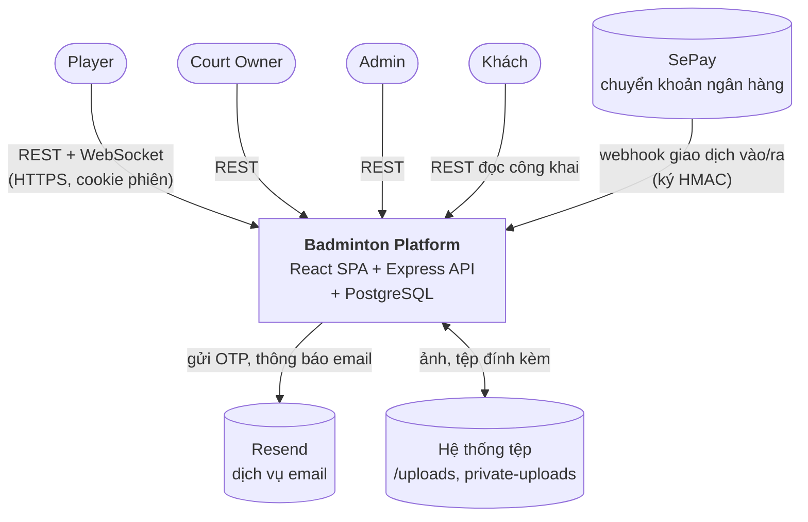

### 8.2. Sơ đồ thành phần và các lớp

**Hình 8.2. Sơ đồ thành phần (kiến trúc phân lớp)**

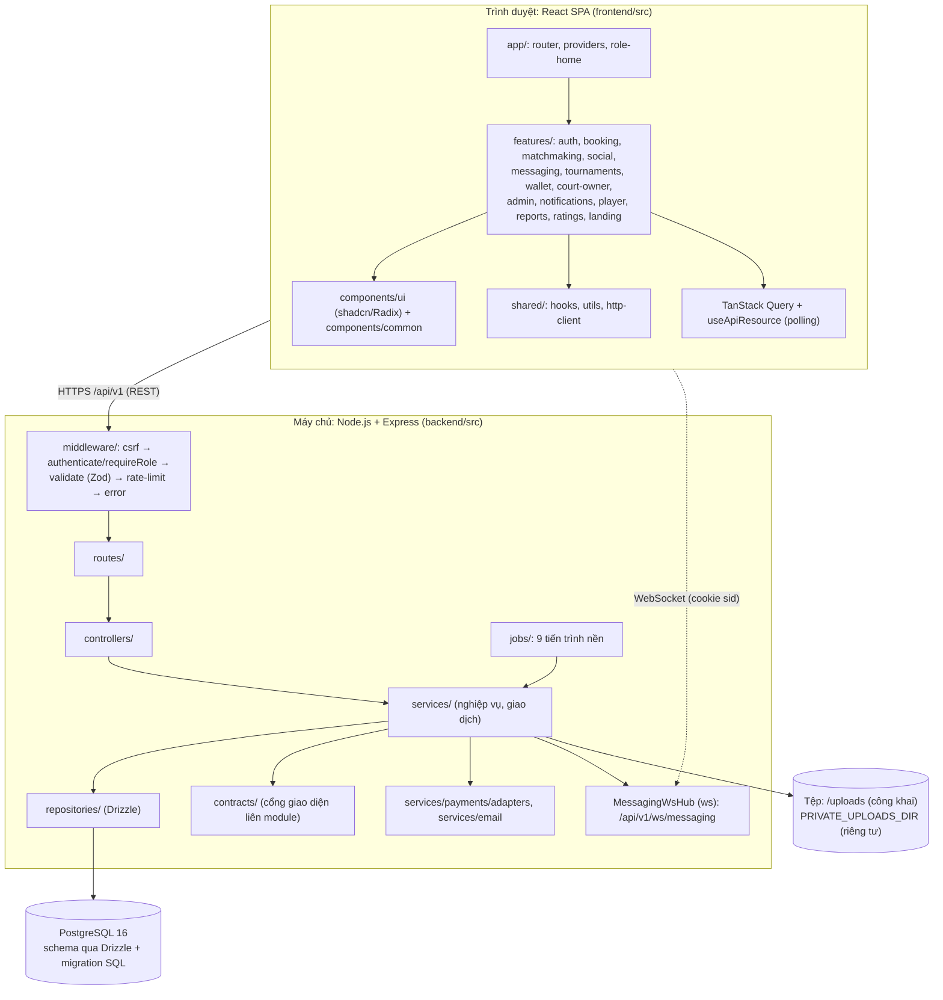

### 8.3. Quan hệ phụ thuộc giữa các module

Sơ đồ rút ra từ các lệnh `import` giữa các thư mục `services/` và `contracts/`. Mũi tên chấm là phụ thuộc thông qua giao diện trong `contracts/`.

**Hình 8.3. Phụ thuộc chính giữa các module nghiệp vụ**

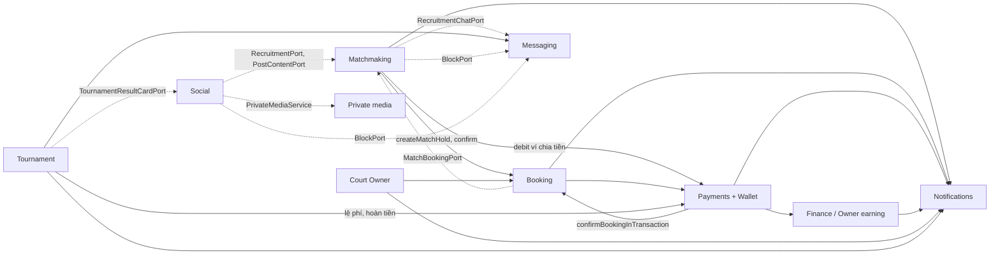

### 8.4. Sơ đồ triển khai

Hiện có hai môi trường được định nghĩa trong kho mã: máy phát triển và CI. Môi trường production chưa được quyết định (`tech-stack.md`, mục Deployment: TBD); sơ đồ không vẽ hạ tầng chưa tồn tại.

**Hình 8.4. Sơ đồ triển khai (phát triển và CI)**

```mermaid
flowchart TB
    subgraph DEV["Máy phát triển"]
        BR["Trình duyệt<br/>http://localhost:5173"]
        VITE["Vite dev server :5173<br/>proxy /api → :3000"]
        EXP["Node.js + Express :3000<br/>REST, ws, 9 jobs"]
        subgraph DOCK["Docker Compose"]
            PG[("postgres:16-alpine<br/>container badminton_postgres<br/>cổng 5433, volume postgres_data")]
        end
        FSL[("uploads/<br/>private-uploads/")]
        BR --> VITE --> EXP
        EXP --> PG
        EXP --> FSL
    end

    subgraph GH["GitHub Actions (ubuntu-latest, Node 22)"]
        CI1["ci.yml (PR vào main)<br/>backend: verify migrations → build → test<br/>frontend: lint → build"]
        CI2["e2e-nightly.yml (02:00 giờ VN)<br/>Playwright + Postgres"]
        PGC[("service postgres:16-alpine :5433<br/>badminton_test")]
        CI1 --> PGC
        CI2 --> PGC
    end

    SEPAY[(SePay)] -. "webhook cần URL công khai" .-> EXP
    RESEND[(Resend)] <-. "email" .- EXP
```

---

## 9. Thiết kế dữ liệu (ERD)

Lược đồ có hơn 70 bảng. Để đọc được, ERD chia thành bốn nhóm. Tên bảng và khóa ngoại lấy từ `backend/src/db/schema/*.ts`; chỉ vẽ các cột cần để hiểu quan hệ. Từ điển đầy đủ ở mục 6.3 và `docs/architecture/database-schema.md`.

### 9.1. Định danh, cơ sở sân và đặt sân

**Hình 9.1. ERD nhóm định danh, cơ sở sân và booking**

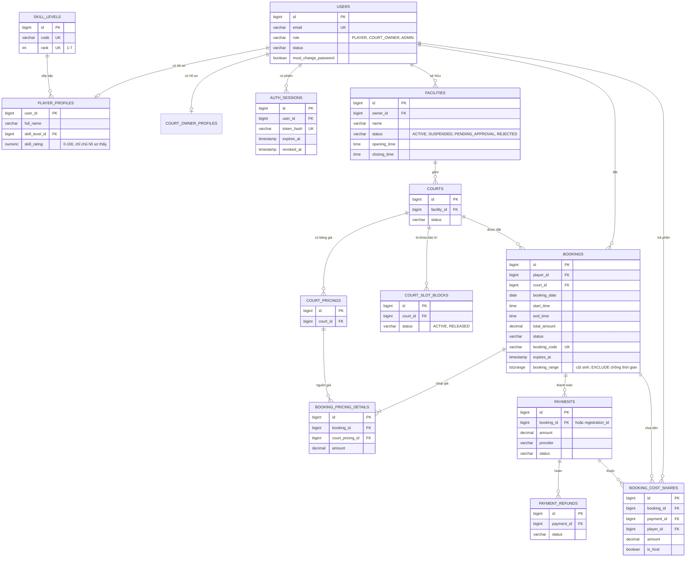

### 9.2. Ví sàn và dòng tiền

**Hình 9.2. ERD nhóm ví và tài chính**

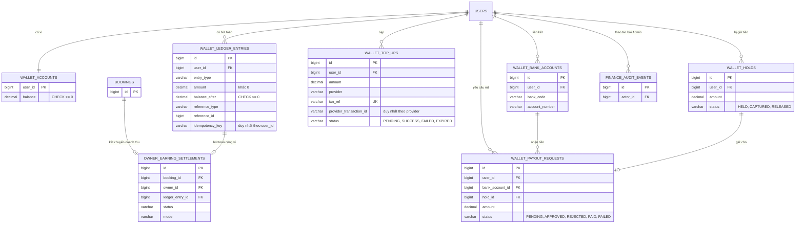

### 9.3. Social, Matchmaking, Messaging và báo cáo

**Hình 9.3. ERD nhóm Social, Matchmaking, Messaging**

```mermaid
erDiagram
    USERS ||--o{ POSTS : "đăng"
    POSTS ||--o{ POST_IMAGES : "kèm ảnh"
    MEDIA_FILES ||--o{ POST_IMAGES : "tệp ảnh"
    POSTS ||--o{ POST_COMMENTS : "có bình luận"
    POSTS ||--o{ POST_REACTIONS : "có reaction"
    USERS ||--o{ POST_COMMENTS : "viết"
    USERS ||--o{ POST_REACTIONS : "thả"
    POSTS ||--o| MATCHMAKING_REQUESTS : "bài tìm kèo"
    USERS ||--o{ MATCHMAKING_REQUESTS : "là chủ kèo"
    SKILL_LEVELS ||--o{ MATCHMAKING_REQUESTS : "min và max trình độ"
    BOOKINGS ||--o| MATCHMAKING_REQUESTS : "gắn sân"
    MATCHMAKING_REQUESTS ||--o{ MATCHMAKING_INVITATIONS : "Apply và Invite"
    USERS ||--o{ MATCHMAKING_INVITATIONS : "tham gia"
    MATCHMAKING_REQUESTS ||--o| MATCHMAKING_MATCHES : "chốt thành"
    MATCHES ||--o| MATCHMAKING_MATCHES : "liên kết"
    BOOKINGS ||--o| MATCHES : "sân của trận"
    MATCHES ||--o{ MATCH_PLAYERS : "người chơi"
    USERS ||--o{ MATCH_PLAYERS : "tham gia"
    MATCHES ||--o{ MATCH_GAMES : "các set"
    MATCHMAKING_REQUESTS ||--o| MATCHMAKING_REQUEST_CONVERSATIONS : "nhóm chat"
    CONVERSATIONS ||--o| MATCHMAKING_REQUEST_CONVERSATIONS : "thuộc kèo"
    CONVERSATIONS ||--o{ CONVERSATION_MEMBERS : "thành viên"
    USERS ||--o{ CONVERSATION_MEMBERS : "tham gia"
    CONVERSATIONS ||--o{ MESSAGES : "chứa"
    MESSAGES ||--o{ MESSAGE_ATTACHMENTS : "đính kèm"
    MESSAGES ||--o{ MESSAGE_REACTIONS : "reaction"
    USERS ||--o{ USER_BLOCKS : "chặn"
    USERS ||--o{ REPORTS : "báo cáo"
    POSTS ||--o{ REPORTS : "là đối tượng"
    MESSAGES ||--o{ REPORTS : "là đối tượng"

    POSTS {
        bigint id PK
        bigint author_id FK
        varchar type "FREE, MATCH_FINDING, TOURNAMENT_RESULT"
        text body "tối đa 2000 ký tự"
        timestamp published_at
        bigint tournament_id FK
    }
    MATCHMAKING_REQUESTS {
        bigint id PK
        bigint player_id FK
        bigint post_id FK
        varchar match_type "SINGLES, DOUBLES, GROUP"
        timestamp start_at
        int duration_minutes
        int capacity
        int min_players
        varchar status "OPEN, MATCHED, CANCELLED, EXPIRED"
        bigint booking_id FK "tùy chọn"
    }
    MATCHMAKING_INVITATIONS {
        bigint id PK
        bigint request_id FK
        bigint inviter_id FK
        bigint invitee_id FK
        varchar kind "INVITE, APPLY"
        varchar status
        timestamp expires_at
    }
    MATCHES {
        bigint id PK
        varchar match_type
        timestamp scheduled_at
        varchar status "PENDING_COURT, CONFIRMED, IN_PROGRESS, COMPLETED, CANCELLED"
        bigint booking_id FK "duy nhất"
    }
    MATCH_PLAYERS {
        bigint id PK
        bigint match_id FK
        bigint player_id FK
    }
    MATCH_GAMES {
        bigint id PK
        bigint match_id FK
        int game_no
    }
    CONVERSATIONS {
        bigint id PK
        varchar type "DIRECT, GROUP"
        varchar status "ACTIVE, DISSOLVED"
        varchar system_kind "NULL hoặc TOURNAMENT"
        bigint last_seq
    }
    CONVERSATION_MEMBERS {
        bigint id PK
        bigint conversation_id FK
        bigint user_id FK
        varchar state "ACTIVE, LEFT"
    }
    MESSAGES {
        bigint id PK
        bigint conversation_id FK
        bigint seq
    }
    REPORTS {
        bigint id PK
        bigint reporter_id FK
        varchar status "đúng một đối tượng bị báo cáo"
    }
    MEDIA_FILES {
        bigint id PK
        varchar kind "IMAGE, FILE"
    }
    POST_IMAGES {
        bigint id PK
    }
    POST_COMMENTS {
        bigint id PK
    }
    POST_REACTIONS {
        bigint id PK
    }
    MATCHMAKING_MATCHES {
        bigint id PK
    }
    MATCHMAKING_REQUEST_CONVERSATIONS {
        bigint id PK
    }
    MESSAGE_ATTACHMENTS {
        bigint id PK
    }
    MESSAGE_REACTIONS {
        bigint id PK
    }
    USER_BLOCKS {
        bigint id PK
    }
```

### 9.4. Giải đấu

**Hình 9.4. ERD nhóm Tournament**

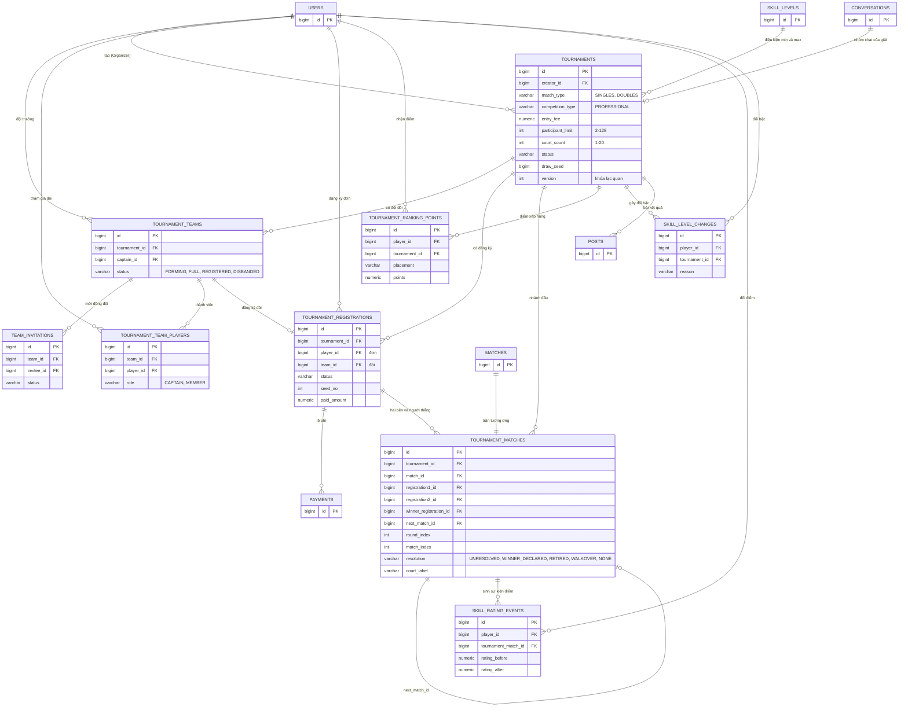

### 9.5. Bất biến được bảo đảm ở lớp cơ sở dữ liệu

**Bảng 9.1. Các ràng buộc CSDL quan trọng**

| Bất biến | Cơ chế | Vị trí |
|---|---|---|
| Hai booking hiệu lực không chồng thời gian trên một sân | `EXCLUDE USING gist (court_id WITH =, booking_range WITH &&) WHERE status IN (...)` | Migration `0003` |
| Số dư ví không âm; bút toán khác 0 | CHECK | `wallet.ts` |
| Mỗi thao tác tiền chỉ ghi một lần | Chỉ mục duy nhất từng phần theo (`user_id`, `idempotency_key`) | `wallet.ts` |
| Một giao dịch ngân hàng chỉ cộng ví một lần | Chỉ mục duy nhất theo (`provider`, `provider_transaction_id`) | `wallet.ts` |
| Thanh toán thuộc đúng một đối tượng (booking hoặc đăng ký giải) | CHECK `chk_payment_target` | `bookings.ts` |
| Loại kèo khớp số chỗ | CHECK `chk_matchmaking_requests_type_shape` | `matchmaking.ts` |
| Một booking gắn tối đa một kèo, một Match | Chỉ mục duy nhất | `matchmaking.ts` |
| Một người một đăng ký giải `CONFIRMED`; một đội đang hoạt động mỗi giải; hạt giống duy nhất | Chỉ mục duy nhất từng phần | `tournaments.ts` |
| Đăng ký đơn có `player_id`, đăng ký đôi có `team_id`, không đồng thời | CHECK `chk_tournament_registration_type` | `tournaments.ts` |
| Vị trí trận trong nhánh duy nhất | `uq_tournament_match_position` | `tournaments.ts` |
| Mỗi báo cáo đúng một đối tượng | CHECK `chk_report_target` | `reports.ts` |
| Mỗi cặp người dùng một hội thoại 1-1 | `uq_conversations_direct_pair` | `messaging.ts` |
| Bài kết quả giải gắn đúng một giải, mỗi tác giả một bài | CHECK + chỉ mục duy nhất | `social.ts` |

---

## 10. Thiết kế hành vi (sơ đồ trạng thái và tuần tự)

### 10.1. Sơ đồ trạng thái

**Hình 10.1. Vòng đời của booking**

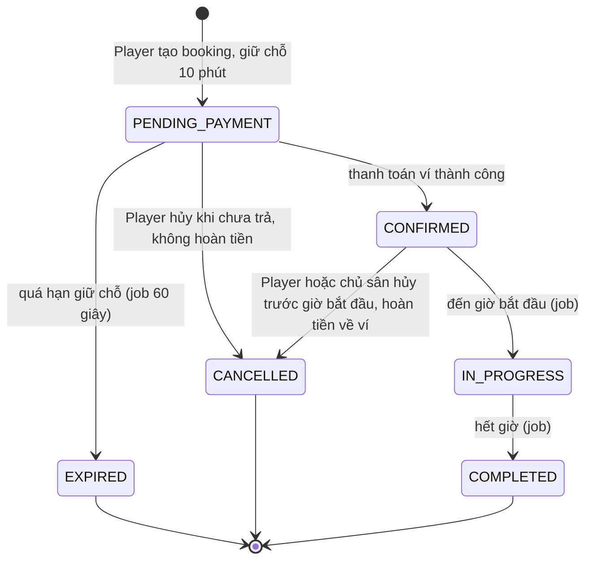

**Hình 10.2. Vòng đời của kèo (`matchmaking_requests`)**

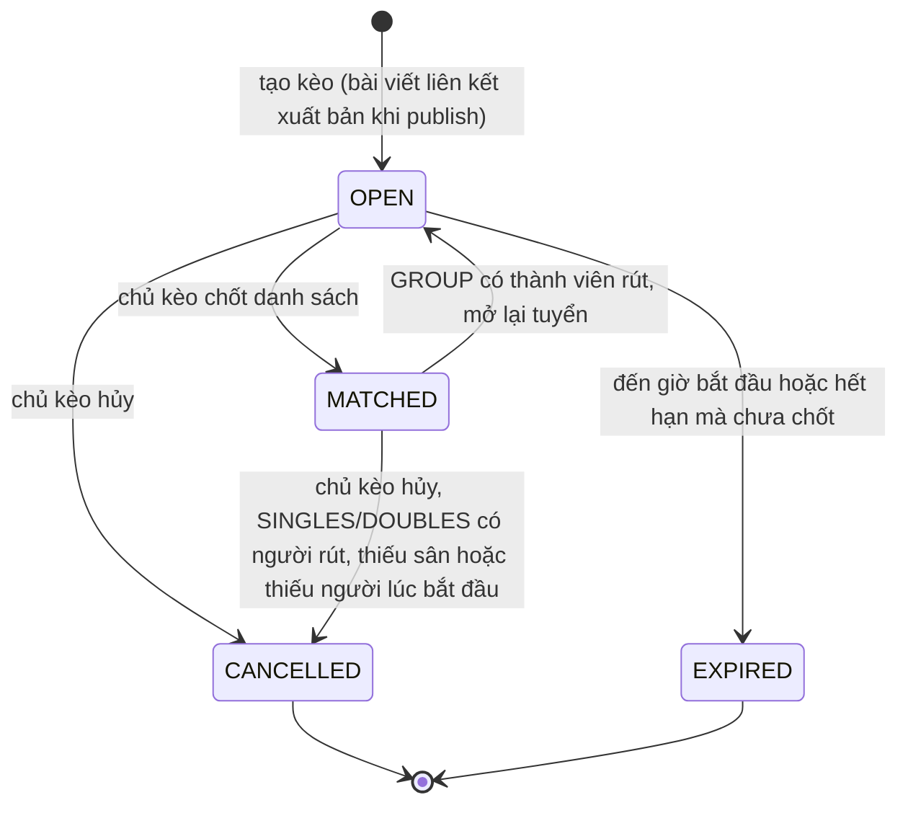

**Hình 10.3. Vòng đời của Match (`matches`)**

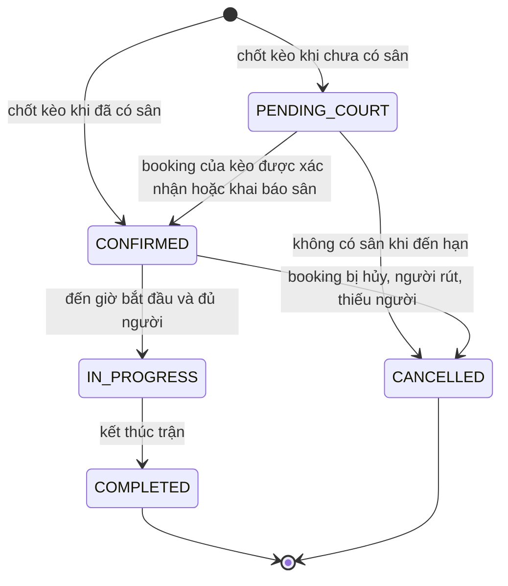

**Hình 10.4. Vòng đời của giải đấu**

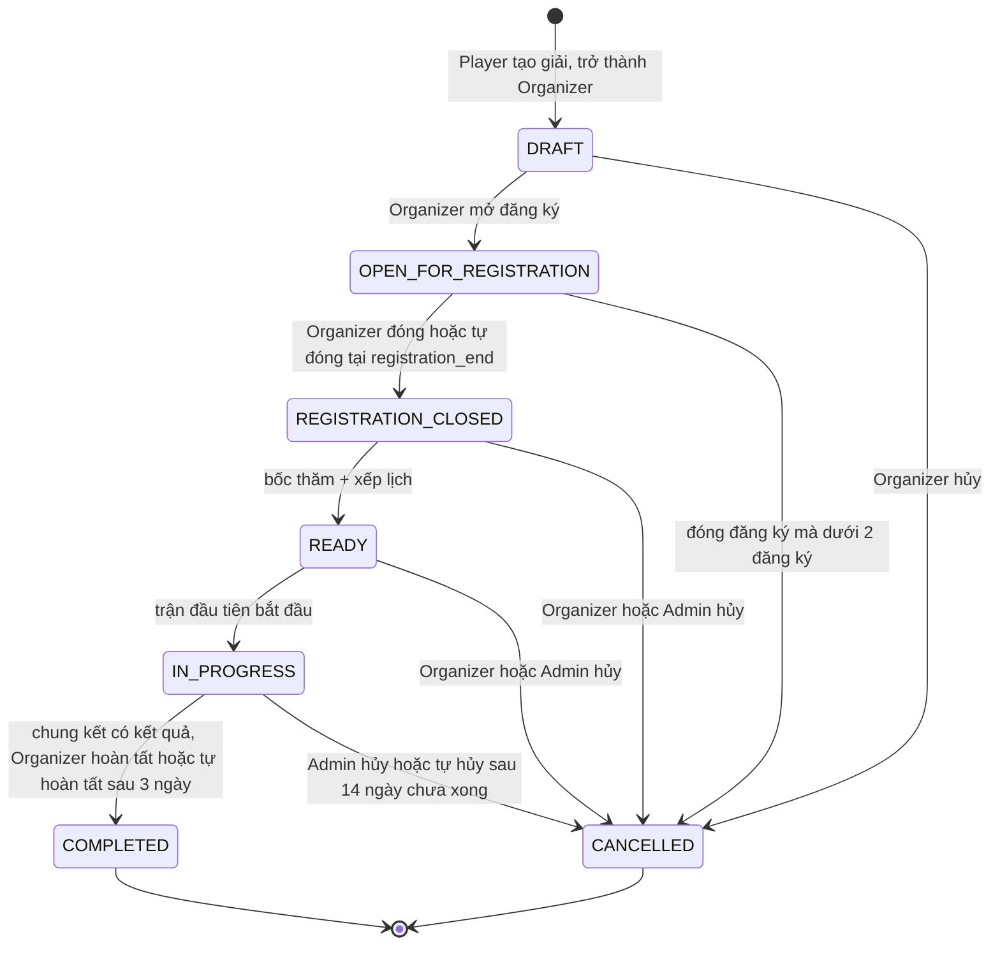

### 10.2. Sơ đồ tuần tự

Mỗi sơ đồ bám theo mã nguồn; tên thành phần trong sơ đồ là tên tệp hoặc lớp thật (xem chương 14).

**Hình 10.5. Đăng nhập và kiểm tra CSRF cho các yêu cầu sau đó**

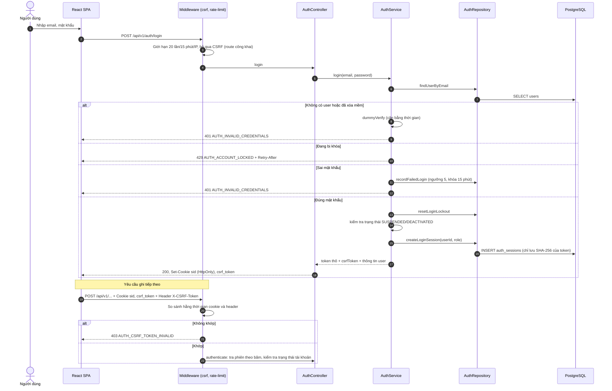

**Hình 10.6. Đặt sân, giữ chỗ và thanh toán bằng Ví sàn**

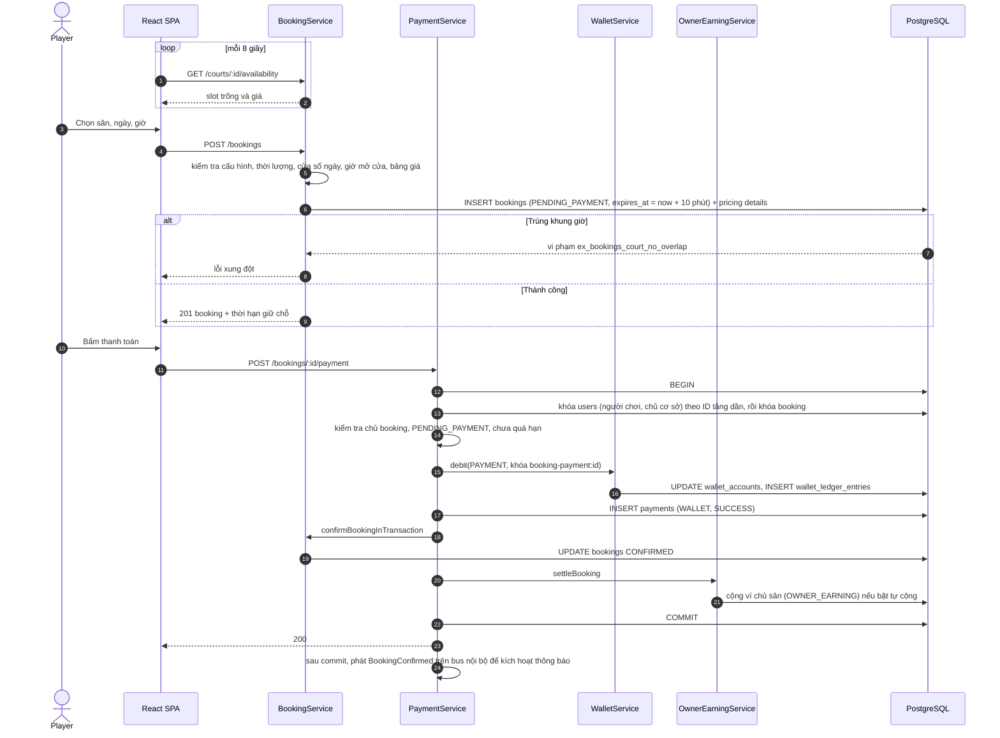

**Hình 10.7. Nạp ví qua SePay (webhook idempotent)**

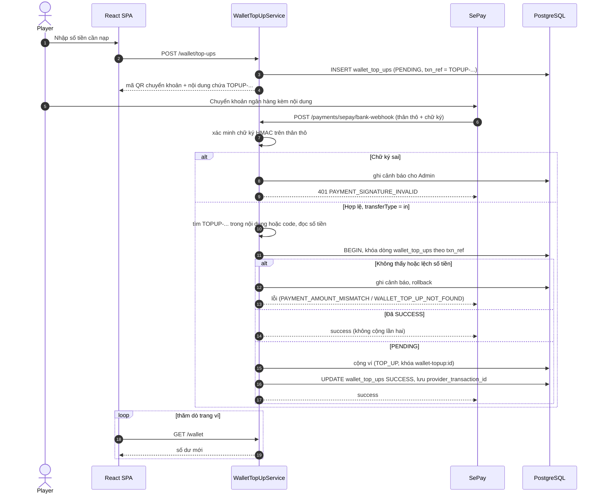

**Hình 10.8. Chốt kèo và đặt sân chia tiền (Split Bill)**

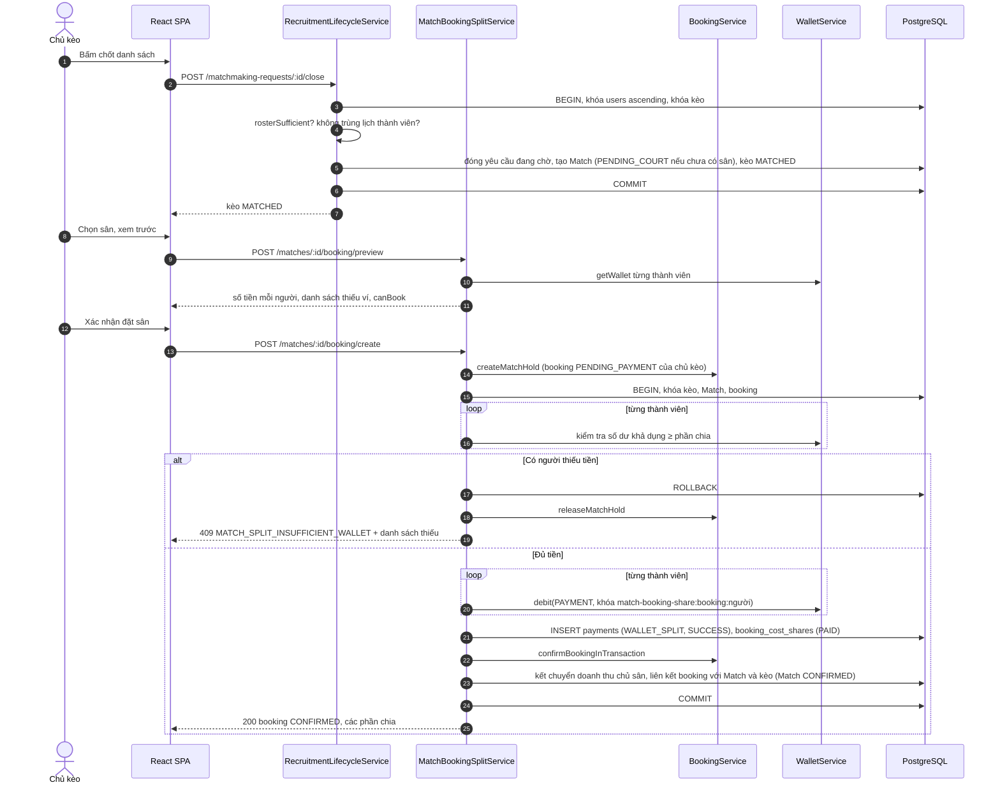

**Hình 10.9. Thành viên rút kèo và bị gỡ khỏi nhóm chat**

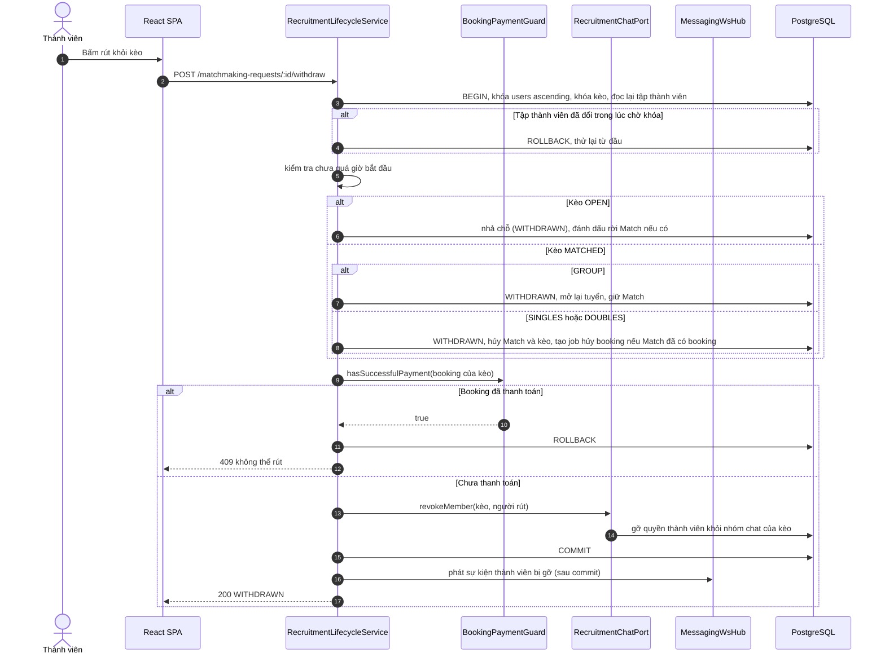

**Hình 10.10. Bốc thăm và xếp lịch tự động**

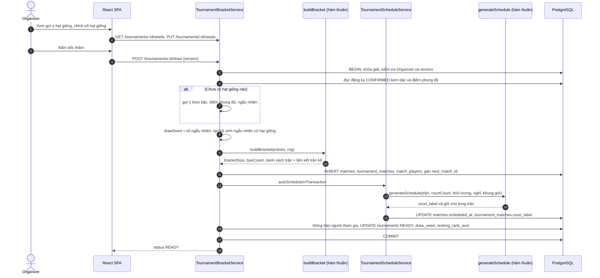

**Hình 10.11. Nhập kết quả, hoàn tất giải và cập nhật trình độ**

```mermaid
sequenceDiagram
    autonumber
    actor O as Organizer
    participant FE as React SPA
    participant MS as TournamentMatchService
    participant TS as TournamentService
    participant FEE as TournamentFeeService
    participant RK as TournamentRankingService
    participant SR as SkillRatingService
    participant HUB as MessagingWsHub
    participant DB as PostgreSQL

    O->>FE: Bắt đầu trận
    FE->>MS: POST .../matches/:mid/start
    MS->>DB: matches IN_PROGRESS, giải READY → IN_PROGRESS nếu là trận đầu
    O->>FE: Nhập tỉ số từng set
    FE->>MS: PUT .../matches/:mid/result
    MS->>MS: validateSets: 21 điểm cách 2, trần 30-29, 2 set thắng
    alt Tỉ số sai luật
        MS-->>FE: lỗi kèm lý do từng set
    else Hợp lệ
        MS->>DB: BEGIN, khóa giải và trận
        MS->>DB: ghi match_games, resolution, người thắng
        MS->>DB: đưa người thắng vào trận kế tiếp, ghi lại danh sách người chơi
        MS->>DB: COMMIT
        MS->>HUB: publish tournament.updated (scope MATCH)
        HUB-->>FE: refetch bracket và lịch
    end
    O->>FE: Hoàn tất giải sau trận chung kết
    FE->>TS: POST /tournaments/:id/complete {version}
    TS->>DB: BEGIN, khóa advisory replay, khóa giải
    TS->>TS: chung kết đã có người thắng?
    TS->>FEE: creditOrganizer (một lần)
    TS->>DB: giải COMPLETED
    TS->>RK: writeForTournament (điểm xếp hạng)
    TS->>SR: replayInTransaction (phát lại mọi trận theo thứ tự hoàn tất)
    SR->>DB: ghi skill_rating_events, cập nhật điểm phong độ, skill_level_changes
    TS->>DB: COMMIT
    TS-->>FE: status COMPLETED
```

**Hình 10.12. Kết nối WebSocket và đẩy cập nhật**

```mermaid
sequenceDiagram
    autonumber
    actor U as Người chơi
    participant FE as React SPA
    participant HUB as MessagingWsHub
    participant DB as PostgreSQL
    participant SV as Service (Messaging / Tournament)

    FE->>HUB: GET /api/v1/ws/messaging (Upgrade, Cookie sid)
    HUB->>DB: tra phiên theo băm token, kiểm tra user ACTIVE và cờ MESSAGING_ENABLED
    alt Phiên không hợp lệ
        HUB-->>FE: đóng kết nối mã 1008
    else Hợp lệ
        HUB-->>FE: kết nối mở
    end
    loop mỗi 25 giây khi tab hiển thị
        FE->>SV: POST /presence/heartbeat (REST)
    end
    FE->>HUB: tournament.watch {tournamentId} (tối đa 5)
    HUB->>HUB: canWatchTournament (không DRAFT, hoặc là Organizer)
    SV->>HUB: sau commit: message.created / conversation.member_changed / tournament.updated
    HUB-->>FE: đẩy sự kiện cho các kết nối liên quan
    Note over FE,HUB: Mất kết nối: FE gọi REST sync theo afterSeq để lấy tin còn thiếu
```

---

## 11. Thiết kế thuật toán

Hai thuật toán là trọng tâm của đề tài (Brief §3.4, §7). Cả hai là **hàm thuần, tất định**, không truy cập CSDL, nằm trong `backend/src/services/tournaments/`, có kiểm thử riêng. Các ví dụ dưới đây được chạy bằng chính các hàm trong mã nguồn.

### 11.1. Thuật toán 1a: sinh nhánh đấu, hạt giống và BYE

**Tệp:** `bracket/bracketGenerator.ts`, bộ sinh số ngẫu nhiên có hạt giống `bracket/seededRng.ts` (mulberry32).

**Đầu vào:** danh sách đăng ký `CONFIRMED` (mỗi mục có `registrationId`, `skillRank`, `skillRating`, `seedNo` hoặc rỗng) và bộ sinh ngẫu nhiên khởi tạo từ `draw_seed`.
**Đầu ra:** `bracketSize`, `byeCount`, `totalRounds`, các ô `slots`, danh sách trận kèm liên kết trận kế tiếp (`nextMatchRoundIndex`, `nextMatchIndex`, `nextRegistrationSlot`).

**Các bước:**

1. `bracketSize` = lũy thừa của 2 nhỏ nhất không nhỏ hơn số đăng ký N; `byeCount = bracketSize − N`; `totalRounds = log2(bracketSize)`.
2. **Thứ tự vị trí hạt giống** `seedPositions(size)`: bắt đầu từ `[1]`; với mỗi `size = 2, 4, ..., bracketSize`, thay mỗi hạt giống `s` bằng cặp `(s, size + 1 − s)`. Với size 8 kết quả là `1, 8, 4, 5, 2, 7, 3, 6`. Cách này tách hạt giống 1 và 2 về hai nửa nhánh khác nhau, hạt 1–4 ở bốn tứ nhánh khác nhau, và chúng chỉ gặp nhau muộn nhất có thể.
3. **Thứ tự bốc thăm** `orderForDraw`: các đăng ký có `seedNo` (do Organizer đặt hoặc do hệ thống gợi ý) xếp theo `seedNo` tăng dần và nhận hạt giống 1..k; các đăng ký còn lại được xáo trộn Fisher–Yates bằng bộ sinh có hạt giống rồi nhận các hạt giống tiếp theo. Nếu không có hạt giống nào, dùng thứ tự gợi ý: bậc trình độ giảm dần, hòa thì điểm phong độ giảm dần, vẫn hòa thì ngẫu nhiên có hạt giống.
4. **Điền ô:** ô thứ `i` nhận đăng ký có hạt giống `seedPositions[i]`; hạt giống lớn hơn N cho ô trống, tức **BYE**. Vì các hạt giống thấp nhất đứng cạnh hạt giống cao nhất, BYE tự động rơi vào các hạt giống cao.
5. **Dựng vòng 0:** mỗi cặp ô liền kề `(2j, 2j+1)` có đủ hai bên thì tạo một trận; có một ô trống thì bên còn lại **đi tiếp không cần trận** (BYE).
6. **Dựng các vòng sau:** ghép liên tiếp các nguồn (trận hoặc đăng ký được BYE) cho đến khi còn một trận (chung kết); gắn `nextMatch` và vị trí `registration1`/`registration2` cho từng trận nguồn.

**Độ phức tạp:** O(N log N) do sắp xếp; sinh nhánh O(bracketSize). **Tính chất:** cùng đầu vào và cùng `draw_seed` cho cùng nhánh; `draw_seed` được lưu để tái lập.

**Ví dụ (N = 6, hạt giống 1–6):** `bracketSize = 8`, `byeCount = 2`, `totalRounds = 3`. Các ô: `[1, BYE, 4, 5, 2, BYE, 3, 6]`. Hạt 1 và 2 được BYE. Vòng 0 chỉ còn hai trận: hạt 4 gặp hạt 5, hạt 3 gặp hạt 6. Vòng 1: hạt 1 gặp người thắng (4 gặp 5), hạt 2 gặp người thắng (3 gặp 6). Vòng 2 là chung kết.

**Hình 11.1. Lưu đồ thuật toán sinh nhánh**

```mermaid
flowchart TD
    A([Bắt đầu: danh sách đăng ký, draw_seed]) --> B{Số đăng ký N >= 2?}
    B -- Không --> X([Từ chối: cần ít nhất 2 đăng ký])
    B -- Có --> C[size = lũy thừa 2 nhỏ nhất >= N<br/>bye = size - N, rounds = log2 size]
    C --> D{Có đăng ký đã gán seedNo?}
    D -- Có --> E[Xếp theo seedNo tăng dần = hạt 1..k<br/>phần còn lại xáo Fisher-Yates bằng RNG có hạt giống]
    D -- Không --> F[Xếp theo bậc giảm dần,<br/>hòa: điểm phong độ, hòa: ngẫu nhiên có hạt giống]
    E --> G
    F --> G[Tính seedPositions size<br/>vd. size 8: 1,8,4,5,2,7,3,6]
    G --> H[Ô i nhận đăng ký có hạt = seedPositions i<br/>hạt > N cho ô trống = BYE]
    H --> I[Vòng 0: cặp ô liền kề đủ 2 bên → tạo trận<br/>có ô trống → bên kia đi tiếp]
    I --> J[Vòng k+1: ghép các nguồn liên tiếp<br/>gắn nextMatch và registration slot]
    J --> K{Còn hơn 1 nguồn?}
    K -- Có --> J
    K -- Không --> L([Trả về BracketPlan])
```

### 11.2. Thuật toán 1b: xếp lịch tự động trên sân ảo

**Tệp:** `schedule/scheduleGenerator.ts`, `schedule/conflicts.ts`; phần điều phối ở `TournamentScheduleService.ts`.

**Bài toán:** gán cho mỗi trận chưa đấu một nhãn sân "Sân 1..k" và giờ bắt đầu sao cho (1) hai trận không chồng thời gian trên cùng sân, (2) không vận động viên nào đấu hai trận chồng nhau và luôn nghỉ ít nhất `rest` phút giữa hai trận, (3) trận chỉ bắt đầu sau khi cả hai trận nguồn kết thúc cộng thời gian nghỉ, (4) mọi trận nằm trọn trong khung giờ mỗi ngày, tràn thì sang ngày kế.

**Phương pháp:** xếp lịch tham lam theo danh sách (greedy list scheduling), duyệt trận theo thứ tự (vòng, chỉ số trận). Với mỗi trận:

1. `ready = max(from, kết thúc của các trận nguồn + rest, thời điểm rảnh của các vận động viên đã biết)`.
2. Với mỗi sân `c`: `start_c = fitDailyWindow(max(courtFree[c], ready))`, trong đó `fitDailyWindow` dời giờ bắt đầu về đầu khung giờ nếu sớm hơn, hoặc sang đầu khung giờ ngày hôm sau nếu trận không vừa phần còn lại của ngày.
3. Chọn sân có `start` sớm nhất; hòa thì chọn sân số nhỏ nhất. Cập nhật `courtFree`, thời điểm kết thúc của trận và thời điểm rảnh của vận động viên.
4. Trận **đã cố định** (đang đấu, đã đấu, đã bị hủy/vắng mặt) giữ nguyên sân và giờ; trận đang diễn ra được coi là bận ít nhất đến `from`; trận không diễn ra không chiếm sân.

Giờ được tính theo `Asia/Ho_Chi_Minh` (UTC+7, không có giờ mùa hè). **Độ phức tạp:** O(M · k) với M trận, k sân. Phát hiện xung đột khi Organizer sửa tay (`conflicts.ts`) chỉ cảnh báo, không chặn lưu.

**Ví dụ (8 người, 2 sân, 45 phút/trận, nghỉ 15 phút, khung 08:00–21:00):**

**Bảng 11.1. Kết quả xếp lịch ví dụ**

| Trận | Vòng | Sân | Bắt đầu | Lý do |
|---|---|---|---|---|
| 1 | 0 | Sân 1 | 08:00 | Sân trống từ đầu |
| 2 | 0 | Sân 2 | 08:00 | Sân 1 đang bận, Sân 2 trống |
| 3 | 0 | Sân 1 | 08:45 | Sân 1 rảnh sau trận 1 |
| 4 | 0 | Sân 2 | 08:45 | Sân 2 rảnh sau trận 2 |
| 5 (bán kết 1) | 1 | Sân 1 | 09:30 | Cần sau trận 1, 2 (kết thúc 08:45) + 15 phút = 09:00; Sân 1 rảnh lúc 09:30 |
| 6 (bán kết 2) | 1 | Sân 2 | 09:45 | Cần sau trận 3, 4 (kết thúc 09:30) + 15 phút = 09:45 |
| 7 (chung kết) | 2 | Sân 1 | 10:45 | Cần sau bán kết 2 (kết thúc 10:30) + 15 phút |

### 11.3. Thuật toán 2: điểm phong độ và điều chỉnh bậc trình độ

**Tệp:** `rating/skillRating.ts`; phối hợp ở `SkillRatingService.ts`. Cơ sở lý luận ở `docs/research/bao-cao-cong-thuc-nang-trinh.md`.

**Trạng thái mỗi người chơi:** điểm phong độ `R ∈ [0, 100]`, số trận đã tính điểm, bậc hiện tại, cờ tạm thời.

**Khởi tạo:** `R` bằng điểm khảo sát `S`, kẹp vào dải điểm của bậc được xếp (dải của bậc r là `[min_r, min_{r+1})`); không có khảo sát thì lấy trung điểm dải.

**Cập nhật sau mỗi trận (kiểu Elo):**

- Xác suất kỳ vọng của một bên: `E = 1 / (1 + 10^((R_đối − R) / D))`, với `D = 15` (hệ số tỷ lệ). `R` của một bên đôi là trung bình hai người.
- Thay đổi điểm: `ΔR = K · (S − E)`, trong đó `S = 1` nếu thắng, `0` nếu thua. Mọi người cùng bên nhận cùng `ΔR`. Kết quả được kẹp vào `[0, 100]`.
- `K = 3` thông thường; `K = 6` cho 6 trận đầu (giai đoạn tạm thời); trận đôi nhân thêm hệ số `0,8`.
- Mọi thay đổi trong một trận tính từ điểm **trước trận** rồi mới áp dụng, nên thứ tự người chơi trong trận không ảnh hưởng kết quả.

**Điều chỉnh bậc (cuối mỗi giải, cho người đã thi đấu):** lặp đến khi ổn định:
- Lên một bậc khi `R ≥ min_{bậc kế} + h`.
- Xuống một bậc khi `R < min_{bậc hiện tại} − h`.
- `h = 3` là **vùng đệm** chống dao động quanh ranh giới; bậc thấp nhất không xuống, bậc cao nhất không lên.

**Tính lại tất định:** `replayInTransaction` phát lại toàn bộ trận của mọi giải đã hoàn tất theo thứ tự hoàn tất, dưới khóa tư vấn PostgreSQL, nên sửa kết quả trong 48 giờ cho ra cùng trạng thái như thể kết quả đúng ngay từ đầu. Bảng `skill_rating_events` là bộ nhớ đệm có thể dựng lại; `skill_level_changes` chỉ thêm.

**Ví dụ (cả hai đã có trên 6 trận, `K = 3`):** A có `R = 58` (bậc 4, dải 45–60), B có `R = 66` (bậc 5, dải 60–70). `E_A = 1 / (1 + 10^((66−58)/15)) = 0,2265`.
- Nếu A thắng: `ΔA = 3 · (1 − 0,2265) = +2,32` nên `R_A = 60,32`; `ΔB = 3 · (0 − 0,7735) = −2,32` nên `R_B = 63,68`.
- Cuối giải, A có `R = 60,32` chưa đạt `60 + 3 = 63` nên **vẫn ở bậc 4**: vùng đệm ngăn A lên bậc chỉ vì vượt ranh giới 60 một chút.
- Nếu bậc 5 có `R = 57,1`, người đó vẫn ở bậc 5 (chưa dưới `60 − 3 = 57`); tại `R = 56,9` thì xuống bậc 4.

**Hình 11.2. Lưu đồ cập nhật điểm phong độ**

```mermaid
flowchart TD
    A([Giải COMPLETED hoặc sửa kết quả trong 48 giờ]) --> B[Lấy khóa tư vấn replay]
    B --> C[Khởi tạo lại trạng thái từ điểm khảo sát]
    C --> D[Duyệt các giải theo thứ tự hoàn tất]
    D --> E[Duyệt các trận của giải theo thứ tự]
    E --> F[Tính R mỗi bên: đơn = R, đôi = trung bình]
    F --> G[E = 1 / 1 + 10^ R_đối - R / 15]
    G --> H[K = 3, hoặc 6 nếu 6 trận đầu, nhân 0,8 nếu đôi]
    H --> I[R_mới = clamp R + K x S - E, 0, 100]
    I --> J{Còn trận?}
    J -- Có --> E
    J -- Không --> K[Cuối giải: xét lại bậc cho người đã đấu<br/>lên nếu R >= min kế + 3, xuống nếu R < min hiện tại - 3]
    K --> L{Còn giải?}
    L -- Có --> D
    L -- Không --> M[Ghi skill_rating_events, skill_level_changes,<br/>cập nhật player_profiles, thông báo đổi bậc]
    M --> N([Kết thúc, nhả khóa khi COMMIT])
```

### 11.4. Thuật toán bổ trợ

**Bảng 11.2. Các thuật toán bổ trợ**

| Thuật toán | Tệp | Mô tả ngắn |
|---|---|---|
| Hạng thành tích | `placement/placement.ts` | Duyệt các trận đã có kết quả theo vòng tăng dần; người thua ở vòng nào nhận hạng của vòng đó (chung kết thua = á quân, bán kết = đồng hạng 3, tứ kết, vòng 16...); người thắng chung kết là vô địch |
| Điểm xếp hạng thành tích | `TournamentRankingService.ts` | `điểm = điểm cơ sở(hạng) × (bậc trung bình của giải ÷ 4) × min(1, N/8)`; điểm cơ sở: vô địch 100, á quân 70, bán kết 50, tứ kết 30, còn lại 10. Bảng xếp hạng cộng 4 giải tốt nhất trong 12 tháng, tách đơn/đôi |
| Kiểm tra tỉ số | `result/score.ts` | Set kết thúc hợp lệ: thắng 21 và thua ≤ 19, hoặc thắng 22–30 cách đúng 2, hoặc 30–29; set 3 chỉ khi 1–1; trận bỏ cuộc giữ set đang đánh dở |
| Khảo sát trình độ | `services/auth/skill-survey/` | Tính K, R, X, P, A, T từ 16 câu; `S = 0,40K + 0,20R + 0,15X + 0,10P + 0,10A + 0,05T` (trừ 15 nếu quay lại sau nghỉ dài); bậc = min(bậc theo S, trần G1, trần G2) |
| Chia tiền sân | `MatchBookingSplitService.splitAmounts` | Chia đều theo xu, phần dư phân cho chủ kèo rồi các thành viên theo ID tăng dần |

---

## 12. Thiết kế API, bảo mật, đồng thời và tiến trình nền

### 12.1. Danh mục API theo module

Tiền tố chung `/api/v1`. "Xác thực" là middleware `authenticate` (bắt buộc đăng nhập), `optionalAuthenticate` (đọc công khai, có phiên thì dùng) và `requireRole(...)`.

**Bảng 12.1. Nhóm API chính**

| Nhóm | Gốc đường dẫn | Điểm vào tiêu biểu | Xác thực |
|---|---|---|---|
| Xác thực | `/auth` | `POST /register`, `/register/verify`, `/login`, `/logout`, `GET /me`, `/skill-survey`, `POST /password/forgot`, `/password/reset`, `/password/change` | Công khai và phiên |
| Danh mục trình độ | `/skill-levels` | `GET /` | Công khai |
| Hồ sơ | `/players` | `GET/PATCH /me`, `/me/skill-survey`, `/me/skill-rating`, `POST /me/avatar`, `GET /:id`, `/:id/tournaments`, `/me/contact` | Phiên |
| Social | `/posts`, `/comments`, `/admin/posts`, `/admin/comments` | `GET/POST /posts`, `PATCH/DELETE /posts/:id`, `PUT/DELETE /posts/:id/reaction`, `GET/POST /posts/:id/comments` | Phiên |
| Matchmaking | `/matchmaking-requests`, `/matchmaking-applications`, `/matchmaking-invitations`, `/matches` | `POST /matchmaking-requests`, `/:id/publish`, `/:id/applications`, `/:id/invitations`, `/:id/close`, `/:id/withdraw`, `/:id/members/:playerId`, `/:id/court`, `/:id/chat`, `/:id/cancel`; `POST /matches/:id/booking/preview`, `/booking/create`, `/booking/remind-topup` | Player |
| Đặt sân | `/courts`, `/facilities`, `/bookings` | `GET /courts`, `/courts/:id/availability`, `POST /bookings`, `GET /bookings/my-bookings`, `POST /bookings/:id/payment`, `/bookings/:id/cancel` | Công khai (đọc), Player |
| Ví và thanh toán | `/wallet`, `/payments` | `GET /wallet`, `/wallet/entries`, `POST /wallet/top-ups`, `/wallet/withdrawals`, `/wallet/bank-accounts`; `POST /payments/sepay/bank-webhook` | Phiên; webhook ký chữ ký |
| Court Owner | `/owner` | `GET/POST /facilities`, `POST /facilities/:id/courts`, `/courts/:id/pricings`, `/courts/:id/block-slots`, `/bookings/:id/cancel`, `/courts/:id/standard-claims` | Court Owner |
| Giải đấu | `/tournaments`, `/tournament-rankings` | Tạo/sửa/mở/đóng/hủy/hoàn tất giải; `POST /:id/registrations`; đội đôi; `PUT /:id/seeds`, `POST /:id/draw`, `GET /:id/bracket`, `/:id/schedule`, `POST /:id/schedule/auto`, `.../matches/:mid/start`, `PUT .../matches/:mid/result`, `POST /:id/share` | Công khai (đọc), Player |
| Messaging | `/conversations`, `/messages`, `/blocks`, `/presence`, `/media` | Hội thoại 1-1 và nhóm, `GET/POST /conversations/:id/messages`, `/sync`, `/read`, `/typing`, reaction, chặn | Player |
| Thông báo | `/notifications` | `GET /`, `/unread`, `POST /:id/read` | Phiên |
| Báo cáo | `/reports` | `POST /` | Phiên |
| Quản trị | `/admin/*` | `users`, `facilities`, `standards`, `reports`, `wallet`, `finance` (hơn 30 điểm vào), `tournaments`, `configs`, `dashboard`, `global-search` | Admin |
| Sức khỏe | `/health` | `GET /health` | Công khai |

### 12.2. Thiết kế bảo mật

**Hình 12.1. Chuỗi xử lý một yêu cầu ghi**

```mermaid
flowchart LR
    R([Yêu cầu HTTP]) --> J[express.json<br/>hoặc raw cho webhook]
    J --> C[csrfProtection<br/>POST/PUT/PATCH/DELETE có sid]
    C --> A[authenticate<br/>tra phiên, kiểm tra trạng thái tài khoản,<br/>chặn khi must_change_password]
    A --> RL[requireRole<br/>RBAC]
    RL --> V[validate: Zod<br/>body, query, params]
    V --> CT[Controller]
    CT --> SV[Service: quyền theo ngữ cảnh,<br/>quy tắc nghiệp vụ, giao dịch]
    SV --> DB[(Ràng buộc PostgreSQL)]
    SV -. lỗi .-> E[errorHandler<br/>JSON thống nhất, không lộ chi tiết]
```

**Bảng 12.2. Mối đe dọa và biện pháp bảo mật**

| Mối đe dọa | Biện pháp |
|---|---|
| Đánh cắp phiên qua XSS | Token phiên chỉ nằm trong cookie `HttpOnly`; không dùng `localStorage` |
| Lộ cơ sở dữ liệu | Chỉ lưu SHA-256 của token phiên, token đặt lại mật khẩu; mật khẩu băm bcrypt có pepper; OTP lưu dạng HMAC và so sánh hằng thời gian |
| CSRF | Double-submit cookie + header; một origin; không bật CORS mở |
| Dò mật khẩu | Khóa tài khoản 5 lần/15 phút, giới hạn tốc độ theo IP, xác minh giả khi email không tồn tại để cân bằng thời gian |
| Leo thang đặc quyền | RBAC (`requireRole`) cộng quyền theo ngữ cảnh: Organizer chỉ quản lý giải của mình (kiểm `creator_id`), chủ booking mới thanh toán/hủy, chủ kèo mới chốt |
| Giả mạo webhook | Xác minh chữ ký HMAC trên thân thô; so khớp số tiền và mã tham chiếu; ghi cảnh báo cho Admin khi sai lệch |
| Trừ tiền lặp, webhook lặp | Khóa idempotency trong sổ cái, chỉ mục duy nhất theo giao dịch nhà cung cấp, thao tác lặp trả lại kết quả cũ |
| Lộ tệp riêng tư | Thư mục ngoài vùng tĩnh, kiểm quyền từng yêu cầu tải; bằng chứng báo cáo có kiểm quyền riêng |
| Tiêm SQL | Truy vấn tham số hóa qua Drizzle; SQL thô (`sql.raw`) chỉ dùng cho điều kiện lọc cố định do mã dựng, nằm trong `recruitment-state.ts` |
| Lộ chi tiết lỗi | Bộ xử lý lỗi tập trung trả `{ error: { code, message, details } }`, không trả stack trace |
| Thao tác quản trị trái phép | Ghi `admin_action_audits`, `finance_audit_events`, `system_config_audit`, `facility_status_audits` |
| Cấu hình thiếu bí mật ở production | Zod kiểm tra biến môi trường khi khởi động và thoát nếu thiếu (`PASSWORD_PEPPER`, `RESEND_API_KEY`, `OTP_HMAC_SECRET`, `WITHDRAWAL_PIN_PEPPER`) |

### 12.3. Thiết kế đồng thời và toàn vẹn giao dịch

1. **Bất biến ở CSDL trước, mã ứng dụng sau.** Ràng buộc loại trừ chống trùng sân; CHECK số dư; chỉ mục duy nhất từng phần cho đăng ký, đội, lời mời.
2. **Một giao dịch cho một thay đổi nghiệp vụ có tiền.** Trừ ví, tạo thanh toán, xác nhận booking, kết chuyển doanh thu, liên kết kèo cùng commit hoặc cùng rollback.
3. **Thứ tự khóa toàn cục** để tránh deadlock. Một giao dịch chỉ được khóa tài nguyên có hạng không nhỏ hơn hạng của mọi khóa đã giữ; nhiều dòng cùng bảng khóa theo khóa chính tăng dần.

   **Bảng 12.3. Hạng khóa toàn cục (Matchmaking Tech Design §24.7.2)**

   | Hạng | Tài nguyên | Hạng | Tài nguyên |
   |---|---|---|---|
   | 10 | `users` (ID tăng dần) | 70 | `courts`, `court_slot_blocks`, `court_pricings` |
   | 15 | `auth_sessions`, `auth_login_lockouts` | 80 | `bookings` |
   | 20 | `player_profiles` | 85 | `payments` |
   | 30 | `matchmaking_requests` | 90 | `conversations` |
   | 40 | `matchmaking_invitations` | 95 | `conversation_members`, `messages`, reaction, hiện diện |
   | 50 | `matches`, `match_players` | 100 | `posts` |
   | 55 | `match_booking_cancellation_jobs` | 105 | `post_comments`, `post_reactions` |
   | 60 | `facilities` | | |
   | 65 | khóa tư vấn `court:<id>:<ngày>` | | |

4. **Tập thành viên không biết trước:** chụp danh sách, khóa theo thứ tự, đọc lại; nếu tập đã đổi thì ném `TransactionRetryError` và thử lại từ đầu (`lockRecruitment`, `runLocked`).
5. **Khóa lạc quan** bằng cột `version` của giải đấu: các thao tác chuyển trạng thái (mở, đóng, bốc thăm, hủy, hoàn tất) gửi kèm phiên bản, sai phiên bản trả xung đột. Bảng `bookings` cũng có cột `version`.
6. **Rào chắn thanh toán trước khi commit rút kèo:** sau mọi ghi vào danh sách thành viên, `bookingPaymentGuard.hasSuccessfulPayment` được kiểm tra; nếu đã thanh toán thì cả giao dịch hoàn tác.
7. **Sự kiện sau commit:** thông báo thời gian thực (WebSocket, bus sự kiện booking) chỉ phát sau khi commit; phát thất bại không làm hoàn tác dữ liệu (best effort), máy khách đồng bộ bù qua REST.
8. **Tiến trình nền an toàn khi chạy lặp:** các bước được viết idempotent; bộ quét giải đấu dùng `pg_try_advisory_lock`; các bộ quét kèo, hoàn tiền, email và booking nhận lô bằng `FOR UPDATE SKIP LOCKED`.
9. **Tính lại điểm phong độ** dưới khóa tư vấn `pg_advisory_xact_lock` để hai lần tính không chồng nhau.

### 12.4. Tiến trình nền

**Bảng 12.4. Tiến trình nền khởi động cùng máy chủ (`backend/src/index.ts`)**

| Job | Chu kỳ | Nhiệm vụ |
|---|---|---|
| `booking-state` | 60 giây (quét bù sau 5 giây) | Hết hạn giữ chỗ, `CONFIRMED` → `IN_PROGRESS` → `COMPLETED` |
| `matchmakingScheduler` | 60 giây (quét bù 5 giây) | Hết hạn lời mời và yêu cầu, xử lý kèo đến giờ bắt đầu (hết hạn, hủy do thiếu sân hoặc thiếu người, bắt đầu Match) |
| `refund` | 60 giây | Xử lý tối đa 20 yêu cầu hoàn tiền mỗi lượt |
| `owner-earning` | 5 phút (quét bù 15 giây), chỉ khi `OWNER_EARNING_JOB_ENABLED` | Kết chuyển các booking chưa có khoản doanh thu |
| `tournament` | 60 giây (quét bù 10 giây) | Đóng đăng ký đến hạn, hết hạn lời mời đội, tự hoàn tất và tự hủy, nhắc trước 30 phút, tạo và khóa nhóm chat giải |
| `email-outbox` | 15 giây (cấu hình được) | Gửi email trong hàng đợi |
| `auth-cleanup` | 60 phút | Xóa thử thách OTP hết hạn và email đã gửi quá 30 ngày |
| `avatar-cleanup` | 60 phút | Dọn ảnh đại diện không còn được tham chiếu |
| `private-media-cleanup` | 60 phút | Dọn tệp riêng tư mồ côi |

### 12.5. Cấu hình, nhật ký và lỗi

- **Biến môi trường** đọc bằng `dotenv`, kiểm tra bằng Zod khi khởi động (`shared/config/env.ts`); thiếu hoặc sai thì dừng với thông báo rõ ràng.
- **Cấu hình nghiệp vụ** nằm ở bảng `system_configs`, đăng ký kiểu, giá trị mặc định và ngưỡng ở `shared/config/config-registry.ts` (71 khóa thuộc 11 miền: auth, booking, finance, matchmaking, messaging, player-skill-adjustment, refund, report, social, team, tournament). Admin sửa qua `/admin/configs`; mỗi thay đổi ghi `system_config_audit`.
- **Nhật ký** dạng JSON ra console với ba mức `info`, `warn`, `error` (`shared/logging/logger.ts`).
- **Lỗi** đi qua `middleware/error.middleware.ts`, định dạng thống nhất; `AppError` mang mã lỗi ổn định.

### 12.6. Kiểm thử và tích hợp liên tục

**Bảng 12.5. Các tầng kiểm thử và tích hợp liên tục**

| Tầng | Công cụ | Phạm vi | Vị trí |
|---|---|---|---|
| Đơn vị | Vitest | Thuật toán thuần: sinh nhánh, xếp lịch, điểm phong độ, hạng, tỉ số, khảo sát | `scheduleGenerator.test.ts`, `score.test.ts`, `bracketGenerator.test.ts`, `rating/skillRating.test.ts`, `placement/placement.test.ts`, `skill-survey-engine.test.ts` |
| Tích hợp và API | Vitest + Supertest, CSDL thử riêng (cổng 5433) | Luồng booking, ví, kèo, giải đấu, chat, thông báo, báo cáo, migration, đồng thời | 117 tệp ở `backend/src/__tests__` |
| Giao diện/E2E | Playwright | Luồng chính theo vai trò, giao diện có dữ liệu giả | `frontend/e2e` |
| Tĩnh | oxlint + `check:ui` (kiểm tra token thiết kế), `tsc` qua `build` | Frontend và backend | `npm run lint`, `npm run build` |
| CI | GitHub Actions | PR vào `main`: xác minh migration, build, kiểm thử backend; lint, build frontend. Hằng đêm: Playwright | `.github/workflows/` |

---

## 13. Thiết kế giao diện

### 13.1. Tổ chức giao diện

- **Định tuyến** trong `frontend/src/app/router.tsx`; mỗi vùng được bọc `RequireAuth` theo vai trò. Người dùng đã đăng nhập vào sai vùng bị chuyển về trang chủ của vai trò (`role-home.ts`): Admin → `/admin/dashboard`, Court Owner → `/owner`, Player → `/feed`.
- **Trạng thái:** phiên người dùng trong `AuthProvider` (React Context, phiên thật vẫn ở máy chủ); dữ liệu máy chủ qua TanStack Query hoặc hook `useApiResource` có polling; không có kho trạng thái toàn cục kiểu Redux.
- **Lớp truy cập API** tách khỏi thành phần giao diện (`shared/api/http-client.ts`, `features/<năng lực>/api`); không đặt logic nghiệp vụ backend trong thành phần.
- **Hệ thiết kế DS01:** token ngữ nghĩa, thang cỡ chữ và bo góc cố định, mẫu trang; tệp giao diện dựng lại phải nằm trong `frontend/ui-check.config.json` và qua `check:ui`. Figma "Badminton SmashPro" là tham chiếu phong cách, PRD và Tech Design quyết định hành vi.
- **Đáp ứng thiết bị:** kiểm tra ở 390 px và 1280 px.

### 13.2. Bản đồ màn hình theo vai trò

**Bảng 13.1. Các vùng giao diện chính (rút từ `router.tsx`)**

| Vùng | Đường dẫn tiêu biểu | Nội dung |
|---|---|---|
| Công khai | `/`, `/sign-in`, `/register`, `/register/verify`, `/register/result`, `/forgot-password`, `/tournaments`, `/tournaments/rankings`, `/tournaments/:id` | Trang đích, đăng nhập, đăng ký + khảo sát, xem giải |
| Player: Social và hồ sơ | `/feed`, `/posts/:postId`, `/profile`, `/profile/contact`, `/notifications`, `/messages`, `/messages/:conversationId`, `/settings/blocks` | Bảng tin, hồ sơ, thông báo, chat, chặn |
| Player: đặt sân và ví | `/courts`, `/courts/:courtId`, `/facilities/:facilityId`, `/bookings`, `/bookings/new`, `/bookings/:bookingId/pending`, `/bookings/:bookingId`, `/wallet` | Tìm sân, đặt, chờ thanh toán, lịch sử, ví |
| Player: Matchmaking | `/matchmaking`, `/matchmaking/activity`, `/matchmaking/requests/:requestId`, `/matchmaking/invitations`, `/matchmaking/matches`, `/matchmaking/matches/:matchId`, `/matchmaking/matches/:matchId/book` | Tìm và quản lý kèo, lời mời, Match, đặt sân chia tiền |
| Player: giải đấu | `/tournaments/new`, `/tournaments/mine`, `/tournaments/join/:token`, `/tournaments/:id/manage` | Tạo giải, giải của tôi, tham gia qua link, bảng điều khiển Organizer |
| Court Owner | `/owner`, `/owner/facilities`, `/owner/pricing`, `/owner/schedule`, `/owner/wallet`, `/owner/account`, `/owner/notifications` | Tổng quan, cơ sở, giá, lịch, ví, tài khoản |
| Admin | `/admin/dashboard`, `/admin/users`, `/admin/courts`, `/admin/approvals`, `/admin/standards`, `/admin/tournaments`, `/admin/reports`, `/admin/configs`, `/admin/finance`, `/admin/wallet`, `/admin/notifications` | Quản trị toàn nền tảng |

### 13.3. Hành vi giao diện đáng chú ý

**Bảng 13.2. Hành vi giao diện đáng chú ý**

| Hành vi | Cơ chế |
|---|---|
| Slot sân cập nhật liên tục | `useCourtAvailability` làm mới mỗi 8 giây; hiển thị cờ "dữ liệu cũ" khi gọi lỗi |
| Đếm ngược giữ chỗ | `BookingPendingPage` đếm từng giây từ `expires_at` |
| Thiếu số dư | Giao diện dẫn sang nạp ví; Split Bill hiển thị danh sách người thiếu và số tiền thiếu |
| Giải đấu realtime | Gửi `tournament.watch` qua WebSocket, nhận `tournament.updated` rồi refetch; không có socket thì làm mới 30 giây |
| Chat | `useMessagingSocket` giữ kết nối, gửi heartbeat 25 giây khi tab hiển thị, tự đồng bộ bù khi kết nối lại |
| Nhập tỉ số | Ba hàng set, set 3 chỉ bật khi 1–1, báo lỗi từng set ngay, hiển thị người thắng trước khi xác nhận |

---

<!--
## 14. Truy vết yêu cầu và đối chiếu sơ đồ với mã nguồn

### 14.1. Ma trận truy vết: use case → API → bảng dữ liệu → kiểm thử

Cột kiểm thử liệt kê tệp có thật trong kho mã. Tài liệu này không khẳng định các kiểm thử đã chạy xanh; kết quả chạy thuộc về báo cáo kiểm thử (chạy `npm test --prefix backend` và xem log CI).

**Bảng 14.1. Ma trận truy vết các use case trọng yếu**

| Use case | API chính | Bảng chính | Kiểm thử tự động |
|---|---|---|---|
| UC-AUTH-01 Đăng ký + khảo sát | `POST /auth/register`, `/auth/register/verify` | `pending_registrations`, `auth_challenges`, `users`, `player_profiles`, `player_skill_surveys` | `auth-endpoints.test.ts`, `email-otp-pin.test.ts`, `skill-survey-api.test.ts`, `skill-survey-engine.test.ts`; E2E `register-ui.spec.ts` |
| UC-AUTH-02 Đăng nhập, khóa, CSRF | `POST /auth/login` | `auth_sessions`, `auth_login_lockouts` | `auth-endpoints.test.ts`, `auth-middleware.test.ts`, `csrf-and-rate-limit.test.ts`; E2E `sign-in.spec.ts`, `forced-password-change.spec.ts` |
| UC-SOC-01..04 Social | `/posts`, `/posts/:id/reaction`, `/posts/:id/comments` | `posts`, `post_comments`, `post_reactions`, `post_images` | `social-posts.test.ts`, `social-interactions.test.ts`, `social-feed.test.ts`; E2E `feed-ui.spec.ts`, `social.spec.ts` |
| UC-MM-03..05 Apply, Invite, duyệt | `/matchmaking-requests/:id/applications`, `/invitations` | `matchmaking_invitations` | `matchmaking-applications.test.ts`, `matchmaking-membership.test.ts` |
| UC-MM-06,07 Chốt, rút, loại | `/matchmaking-requests/:id/close`, `/withdraw`, `/members/:playerId` | `matchmaking_requests`, `matches`, `match_players`, `conversation_members` | `matchmaking-lifecycle.test.ts`, `matchmaking-payment-lock.test.ts`, `matchmaking-chat.test.ts` |
| UC-MM-09 Split Bill | `/matches/:id/booking/preview`, `/booking/create` | `bookings`, `payments`, `booking_cost_shares`, `wallet_ledger_entries` | `match-booking-split.test.ts`, `match-booking-link.test.ts`; E2E `matchmaking-split-booking.spec.ts` |
| UC-BK-03 Giữ chỗ, chống trùng | `POST /bookings` | `bookings`, `booking_pricing_details` | `booking-write.test.ts`, `booking-lock-order.test.ts`, `booking-availability.test.ts` |
| UC-BK-04 Thanh toán ví | `POST /bookings/:id/payment` | `payments`, `wallet_ledger_entries`, `owner_earning_settlements` | `wallet-booking-payment.test.ts`, `booking-payment.test.ts`; E2E `booking-flow.spec.ts` |
| UC-BK-05 Hủy và hoàn tiền | `POST /bookings/:id/cancel`, `/owner/bookings/:id/cancel` | `bookings`, `payment_refunds` | `booking-cancel-refund.test.ts`, `owner-cancellation.test.ts`; E2E `court-owner-cancel.spec.ts` |
| UC-BK-07 Tự chuyển trạng thái | (job) | `bookings` | `booking-state-worker.test.ts` |
| UC-WAL-02 Nạp ví | `POST /wallet/top-ups`, `POST /payments/sepay/bank-webhook` | `wallet_top_ups`, `wallet_ledger_entries` | `wallet-top-up.test.ts`, `payment-integration.test.ts`, `wallet-ledger.test.ts` |
| UC-WAL-03 Rút tiền | `POST /wallet/withdrawals` | `wallet_payout_requests`, `wallet_holds`, `wallet_bank_accounts` | `wallet-payout.test.ts` |
| UC-TRN-03 Đăng ký giải | `POST /tournaments/:id/registrations` | `tournament_registrations`, `payments` | `tournament-registration.test.ts` |
| UC-TRN-04 Đội đôi | `/tournaments/:id/teams`, `/invitations` | `tournament_teams`, `team_invitations`, `tournament_team_players` | `tournament-teams.test.ts`; E2E `tournament-team-ui.spec.ts` |
| UC-TRN-05 Bốc thăm | `POST /tournaments/:id/draw` | `tournament_matches`, `matches` | `tournament-bracket.test.ts`, `bracketGenerator.test.ts` |
| UC-TRN-06 Lịch | `POST /tournaments/:id/schedule/auto` | `tournament_matches`, `matches` | `tournament-schedule.test.ts`, `scheduleGenerator.test.ts` |
| UC-TRN-07,08 Tỉ số, sửa | `PUT .../matches/:mid/result` | `match_games`, `tournament_matches` | `tournament-matches.test.ts`, `score.test.ts` |
| UC-TRN-09 Hoàn tất, điểm | `POST /tournaments/:id/complete` | `wallet_ledger_entries`, `tournament_ranking_points`, `skill_rating_events`, `skill_level_changes` | `tournament-finance.test.ts`, `tournament-jobs.test.ts`, `tournament-rating-ranking.test.ts`, `rating/skillRating.test.ts`, `placement/placement.test.ts` |
| UC-TRN-10 Realtime | WebSocket `tournament.watch` | (không ghi) | `tournament-realtime.test.ts`; E2E `tournament-live.spec.ts` |
| UC-MSG-01..06 Chat | `/conversations`, `/messages`, `/blocks` | `conversations`, `messages`, `conversation_members`, `user_blocks` | `messaging-foundation.test.ts`, `messaging-messages-media-and-sync.test.ts`, `messaging-ws-and-presence.test.ts`, `messaging-conversations-and-blocks.test.ts`, `messaging-concurrency-and-gates.test.ts` |
| UC-RPT-01, ADM-03 Báo cáo | `POST /reports`, `/admin/reports` | `reports`, `report_evidence` | `report-submission.test.ts`, `admin-reports.test.ts` |
| UC-ADM-05 Cấu hình | `/admin/configs` | `system_configs`, `system_config_audit` | `admin-config-api.test.ts`, `config-registry.test.ts` |
| UC-OWN-01..05 Chủ sân | `/owner/*` | `facilities`, `courts`, `court_pricings`, `court_slot_blocks`, `court_owner_reviews` | `owner-foundation.test.ts`, `owner-management.test.ts`, `owner-pricing.test.ts`, `owner-schedule.test.ts` |

### 14.2. Đối chiếu sơ đồ với mã nguồn

**Bảng 14.2. Vị trí mã nguồn minh chứng cho từng sơ đồ**

| Sơ đồ | Tệp mã nguồn đối chiếu |
|---|---|
| Hình 2.1 Chức năng theo tác nhân | `frontend/src/app/router.tsx` (vùng công khai, Player, Owner, Admin), `backend/src/app.ts` (gắn route) |
| Hình 8.1, 8.2 Ngữ cảnh, thành phần | `backend/src/app.ts` (thứ tự middleware và route), `backend/src/index.ts` (jobs, WebSocket), `backend/src/shared/config/env.ts` |
| Hình 8.3 Phụ thuộc module | Các `import` giữa `backend/src/services/*` và `backend/src/contracts/*` |
| Hình 8.4 Triển khai | `docker-compose.yml`, `.github/workflows/ci.yml`, `e2e-nightly.yml`, `frontend` cấu hình proxy Vite |
| Hình 9.1–9.4 ERD | `backend/src/db/schema/*.ts`; migration `backend/src/db/migrations/0003_careless_karma.sql` (ràng buộc loại trừ) |
| Hình 10.1 Booking | `services/booking/booking.service.ts`, `booking-state.service.ts`, `services/payments/payment.service.ts` |
| Hình 10.2, 10.3 Kèo và Match | `services/matchmaking/RecruitmentLifecycleService.ts`, `recruitment-state.ts`, `MatchmakingExpiryService.ts` |
| Hình 10.4 Giải đấu | `services/tournaments/TournamentService.ts`, `TournamentJobService.ts`, `TournamentMatchService.ts` |
| Hình 10.5 Đăng nhập, CSRF | `services/auth/AuthService.ts` (`login`), `middleware/csrf.middleware.ts`, `auth.middleware.ts`, `rate-limit.middleware.ts` |
| Hình 10.6 Đặt sân, thanh toán ví | `booking.service.ts` (`createBooking`), `payment.service.ts` (`createWalletBookingPayment`), `WalletService.ts`, `OwnerEarningService.ts` |
| Hình 10.7 Nạp ví SePay | `services/payments/WalletTopUpService.ts` (`handleSepayBankWebhook`), `sepay-signature.ts`, `app.ts` (thân thô cho webhook) |
| Hình 10.8 Chốt kèo, Split Bill | `RecruitmentLifecycleService.close`, `MatchBookingSplitService.placeBooking`, `previewBooking` |
| Hình 10.9 Rút kèo, gỡ chat | `RecruitmentLifecycleService.withdrawLocked`, `finalizeMemberDeparture`, `BookingPaymentGuardService.ts`, `messaging/RecruitmentChatService.ts` |
| Hình 10.10 Bốc thăm, xếp lịch | `TournamentBracketService.draw`, `bracket/bracketGenerator.ts`, `TournamentScheduleService.autoScheduleInTransaction`, `schedule/scheduleGenerator.ts` |
| Hình 10.11 Kết quả, hoàn tất | `TournamentMatchService.recordResult`, `result/score.ts`, `TournamentService.completeInTransaction`, `TournamentRankingService.ts`, `SkillRatingService.ts`, `rating/skillRating.ts` |
| Hình 10.12 WebSocket | `services/messaging/MessagingWsHub.ts`, `tournaments/TournamentRealtime.ts`, `frontend/src/features/messaging/hooks/useMessagingSocket.ts` |
| Hình 11.1, 11.2 Thuật toán | `bracketGenerator.ts`, `seededRng.ts`, `skillRating.ts` |
| Hình 12.1 Chuỗi xử lý yêu cầu | `backend/src/app.ts`, các `routes/*`, `middleware/validate.middleware.ts`, `error.middleware.ts` |

### 14.3. Kiểm tra nhanh năm điểm khớp mã (dùng khi hội đồng đối chiếu ngẫu nhiên)

Chạy tại thư mục gốc kho mã. Mỗi lệnh phải in ra dòng mã tương ứng.

**Bảng 14.3. Năm phép kiểm tra nhanh sơ đồ với mã nguồn**

| # | Khẳng định trong tài liệu | Lệnh kiểm tra |
|---|---|---|
| 1 | CSDL chặn trùng sân | `grep -n "ex_bookings_court_no_overlap" backend/src/db/migrations/0003_careless_karma.sql` |
| 2 | Số dư ví không âm, khóa idempotency duy nhất | `grep -n "chk_wallet_balance\|uq_wallet_entries_user_idempotency" backend/src/db/schema/wallet.ts` |
| 3 | Khóa 5 lần sai, mã `AUTH_ACCOUNT_LOCKED` | `grep -n "AUTH_ACCOUNT_LOCKED" backend/src/services/auth/AuthService.ts` và `grep -n "AUTH_FAILED_LOGIN_LOCKOUT" backend/src/shared/config/config-registry.ts` |
| 4 | Vị trí hạt giống 1,8,4,5,2,7,3,6 | `grep -n "size + 1 - seed" backend/src/services/tournaments/bracket/bracketGenerator.ts` |
| 5 | Rút kèo bị khóa sau thanh toán và thành viên bị gỡ khỏi chat | `grep -n "hasSuccessfulPayment\|revokeMember" backend/src/services/matchmaking/RecruitmentLifecycleService.ts` |

---

-->

## 15. Nhật ký thay đổi thiết kế, hạn chế và điểm lệch tài liệu

<!--
### 15.1. Nhật ký thay đổi thiết kế và lý do

Nguồn: lịch sử chốt nghiệp vụ trong `PROJECT-BRIEF.md` §7, bảng Change Log trong `tech-stack.md`, và `business-rules-config-matrix.md`. Dấu † đánh dấu lý do do người soạn suy ra từ ngữ cảnh, tài liệu gốc không ghi rõ; nhóm cần xác nhận lại trước khi bảo vệ.

**Bảng 15.1. Các thay đổi thiết kế quan trọng**

| Ngày | Thay đổi | Lý do |
|---|---|---|
| 2026-09-16 | Phiên đục lưu CSDL thay cho JWT; chốt Vitest + Supertest, Playwright | Cần kiểm tra lại trạng thái tài khoản mỗi yêu cầu và thu hồi mọi phiên cùng lúc |
| 2026-09-25 | Chốt lưu tệp cục bộ, thông báo trong ứng dụng, job `setInterval`, polling slot sân 5–10 giây | Giữ đơn giản cho MVP, không thêm hạ tầng |
| 2026-10-10 | Matchmaking chuyển sang chỉ mời; bỏ bước xác nhận của người chơi | Quyết định của chủ sở hữu (matrix §8.3); lý do chi tiết ở Matchmaking Tech Design † |
| 2026-10-31 | Bài tìm kèo có cấu trúc, Apply/Invite hai chiều, WebSocket cho chat, khảo sát trình độ trong đăng ký | Giải quyết vấn đề gốc là bài đăng nhóm Facebook/Zalo khó lọc và tách rời khỏi chat |
| 2026-11-08 | Chủ kèo chốt thủ công; khóa rút kèo sau khi booking thanh toán; gỡ thành viên khỏi chat khi rút; chuyển sang Ví sàn | Chống bùng kèo làm mất tiền sân của nhóm; thống nhất thanh toán một chỗ |
| 2026-11 (họp GVHD) | Tách Social và Matchmaking; hoãn Post-match Rating; hai loại giải; hai thuật toán trọng tâm | Tránh đánh giá cảm tính; gắn nâng trình với thành tích thi đấu thật |
| 2026-11-15 | Khảo sát 16 câu, 6 nhóm tiêu chí, 7 bậc, tham số theo phiên bản; thiết kế sổ cái ví | Khảo sát 6 câu không đủ độ chính xác (xem báo cáo nghiên cứu trình độ); ví cần sổ cái bất biến để kiểm toán † |
| 2026-11-17 | Cho phép Tailwind v4, shadcn/Radix, TanStack Query và các thư viện giao diện | Đồng nhất giao diện, truy cập tốt, giảm mã lặp |
| 2026-11-19 | Cấu hình tài chính: kết chuyển doanh thu chủ sân, rút tiền, kiểm toán | Admin cần đối soát dòng tiền toàn sàn (Brief §4) |
| 2026-11-20 | Thêm Split Bill cho kèo đã chốt | Giảm việc một người ứng tiền sân rồi thu lại của cả nhóm † |
| 2026-11-23 | Chạy thử CI trên GitHub Actions | Phát hiện sớm lỗi migration, build và kiểm thử trước khi hợp nhất † |
| 2026-11-24 | OTP email cho đăng ký, đặt lại và đổi mật khẩu; PIN rút tiền | Xác minh chủ sở hữu email và bảo vệ thao tác rút tiền † |
| 2026-11-25 | Thiết kế lại giải chuyên nghiệp: sân ảo, lệ phí trừ ví ngay, 3 set 21 điểm, trình độ theo điểm phong độ có lên và xuống, bảng xếp hạng | Bỏ phụ thuộc vào booking sân thật và cổng thanh toán; trình độ phản ánh phong độ |

-->

### 15.2. Hạn chế và nợ kỹ thuật đã biết

**Bảng 15.2. Hạn chế và nợ kỹ thuật đã biết**

| Hạn chế | Hệ quả | Hướng xử lý |
|---|---|---|
| Chưa có thiết kế triển khai production, CD và quét bảo mật | Không có môi trường staging công khai | Chọn nền tảng triển khai, đóng gói Docker, thêm bước quét phụ thuộc |
| Job và bộ giới hạn tốc độ chạy trong bộ nhớ một tiến trình | Chạy nhiều instance sẽ chạy job trùng và đếm giới hạn sai | Kho giới hạn dùng chung, khóa tư vấn cho mọi job |
| Tệp lưu trên đĩa cục bộ | Không mở rộng ngang; phải sao lưu cùng CSDL | Lưu trữ đối tượng nếu cần mở rộng |
| Giải phong trào (`CASUAL`) mới có cột phân loại | Không có luồng nghiệp vụ | Thiết kế riêng khi được duyệt |
| Mã và bảng của đánh giá sau trận còn lại (`/matches/.../ratings`, `/users/.../ratings`, `player_ratings`, `player_skill_adjustments`); `GET /players/:id` vẫn nạp tóm tắt đánh giá qua `profileRatingsReader` | Có thể gây hiểu nhầm là đang dùng để nâng trình; cấu hình tự điều chỉnh mặc định tắt | Ghi rõ là mã cũ; gỡ khi được duyệt |
| Trạng thái cũ `PENDING_PAYMENT`, `EXPIRED` của đăng ký giải và cột `facility_id` của giải còn trong lược đồ | Không còn được ghi | Dọn bằng migration khi an toàn |
| Chưa đo hiệu năng, chưa có báo cáo độ phủ mã | Chưa chứng minh được các mục tiêu hiệu năng và độ phủ | Xem mục 5.2 |
| Điểm xếp hạng và điểm phong độ phụ thuộc tham số mặc định chưa được hiệu chỉnh bằng dữ liệu thật | Cần dữ liệu giải thực để kiểm chứng `D = 15`, `K = 3`, `h = 3` | Thử nghiệm với giải thật, mô phỏng trong `docs/research/nang-trinh-mo-phong` |

<!--
### 15.3. Điểm lệch giữa tài liệu nội bộ và mã nguồn

Tài liệu này theo mã nguồn. Các điểm sau cần chủ sở hữu tài liệu cập nhật hoặc xác nhận, theo quy tắc "nêu mâu thuẫn, không tự chọn" của dự án.

**Bảng 15.3. Điểm lệch giữa tài liệu nội bộ và mã nguồn**

| # | Tài liệu nói | Mã nguồn thực tế | Xử lý đề xuất |
|---|---|---|---|
| 1 | `tech-stack.md` (Architectural Constraints): Split Bill ngoài MVP | `PROJECT-BRIEF.md` (2026-11-20) và mã có Split Bill (`MatchBookingSplitService`, `booking_cost_shares`) | Cập nhật `tech-stack.md` |
| 2 | `tech-stack.md`, matrix §2.8: nhà cung cấp thanh toán là VNPAY | Mặc định `PAYMENT_PROVIDER = WALLET`; nạp ví qua SePay (chuyển khoản ngân hàng); VNPAY và mock là adapter còn lại | Cập nhật tài liệu theo mô hình ví |
| 3 | `PROJECT-BRIEF.md` §3.3: doanh thu "sau khi hoàn tất" mới kết chuyển cho chủ sân | `OwnerEarningService.settleBooking` cộng ví ngay sau khi thanh toán thành công (khi `OWNER_EARNING_AUTO_CREDIT_ENABLED` = true, mặc định), có đảo khi hoàn tiền | Chốt lại quy tắc và cập nhật Brief hoặc mã |
| 4 | `PROJECT-BRIEF.md` §3.3: nạp ví qua MoMo/VNPay/VietQR | Chỉ có SePay (mã QR chuyển khoản), mock, và adapter VNPAY | Cập nhật Brief |
| 5 | `tech-stack.md`: thang đánh giá 1–5 sau trận là quyết định đã chốt | Post-match Rating ngoài MVP; trình độ dùng điểm 0–100 từ giải chuyên nghiệp | Gỡ hoặc đánh dấu lỗi thời |
| 6 | `README.md`: CI chạy cho mọi PR và push vào `develop`/`main` | `ci.yml` chỉ chạy khi PR vào `main` hoặc kích hoạt tay | Sửa README hoặc workflow |
| 7 | Brief và PRD Tournament: kết quả giải được chia sẻ lên bảng tin Social | Giao diện `FeedPage` gọi `/posts?type=FREE`; bài `TOURNAMENT_RESULT` không nằm trong danh sách đó | Xác nhận nơi hiển thị bài kết quả giải |

-->

<!--
### 15.4. Đối chiếu với tiêu chí rubric TC2.1

**Bảng 15.4. Mức đáp ứng tiêu chí TC2.1**

| Yêu cầu mức 5 của rubric | Bằng chứng trong tài liệu | Ghi chú |
|---|---|---|
| 100% use case có tiêu chí chấp nhận | Chương 3: 75/75 use case có AC (Bảng 3.17) | Đã đủ |
| Mô hình quy trình nghiệp vụ, quy tắc nghiệp vụ, từ điển dữ liệu | Hình 2.2; chương 4 (6 bảng, 53 quy tắc); mục 6.3 | Từ điển đầy đủ ở `database-schema.md` |
| Ít nhất 4 loại sơ đồ | Use case/chức năng (2.1), ngữ cảnh (8.1), thành phần (8.2, 8.3), triển khai (8.4), ERD (9.1–9.4), trạng thái (10.1–10.4), tuần tự (10.5–10.12), lưu đồ thuật toán (11.1, 11.2): tám loại | Cần chạy mục 14.3 trước buổi bảo vệ |
| Sơ đồ khớp 100% mã nguồn | Bảng 14.2 và mục 14.3 | Hội đồng đối chiếu ngẫu nhiên; nhóm phải kiểm lại sau mỗi lần sửa mã |
| Ít nhất 5 yêu cầu phi chức năng có ràng buộc định lượng | Bảng 5.1: 13 yêu cầu | Chỉ số hiệu năng chưa đo (mục 5.2) |
| Giải thích lựa chọn kiến trúc, công nghệ và phương án đã cân nhắc | Bảng 7.3 | Một số ô ghi "chưa ghi nhận" cần nhóm bổ sung lập luận |
| Mọi thay đổi thiết kế có ghi nhận lý do | Bảng 15.1 | Đối chiếu thêm với báo cáo tiến độ hằng tuần |
-->

---

## PHỤ LỤC

### Phụ lục A. Danh mục hình

**Bảng A.1. Danh mục hình**

| Hình | Nội dung |
|---|---|
| 2.1 | Sơ đồ chức năng tổng quát theo tác nhân |
| 2.2 | Luồng trải nghiệm chính của Player |
| 8.1 | Sơ đồ ngữ cảnh hệ thống |
| 8.2 | Sơ đồ thành phần |
| 8.3 | Phụ thuộc giữa các module nghiệp vụ |
| 8.4 | Sơ đồ triển khai (phát triển và CI) |
| 9.1 – 9.4 | ERD: định danh và đặt sân; ví và tài chính; Social, Matchmaking, Messaging; giải đấu |
| 10.1 – 10.4 | Trạng thái: booking; kèo; Match; giải đấu |
| 10.5 – 10.12 | Tuần tự: đăng nhập; đặt sân và thanh toán; nạp ví; chốt kèo và Split Bill; rút kèo và gỡ chat; bốc thăm và xếp lịch; kết quả và hoàn tất giải; WebSocket |
| 11.1, 11.2 | Lưu đồ sinh nhánh; lưu đồ cập nhật điểm phong độ |
| 12.1 | Chuỗi xử lý một yêu cầu ghi |

### Phụ lục B. Đưa tài liệu vào báo cáo Word/PDF

1. Mở tệp này trong Kiro hoặc VS Code với Markdown Preview hỗ trợ Mermaid. Có thể thêm tiện ích "Markdown Preview Mermaid Support" nếu sơ đồ chưa hiển thị.
2. Với báo cáo Word, dán từng khối mã Mermaid vào https://mermaid.live, xuất PNG hoặc SVG, chèn ảnh vào vị trí cùng số hiệu hình, giữ nguyên chú thích "Hình x.y".
3. Bảng Markdown dán trực tiếp vào Word qua "Paste Special" hoặc dùng Pandoc: `pandoc docs/reports/SRS-SDD-badminton-platform.md -o SRS-SDD.docx`. Pandoc không dựng sơ đồ Mermaid, nên chèn ảnh sơ đồ thủ công.
4. Cập nhật tên nhóm, giảng viên hướng dẫn ở đầu tài liệu, và điền các chỉ số ở mục 5.2 sau khi đo.
