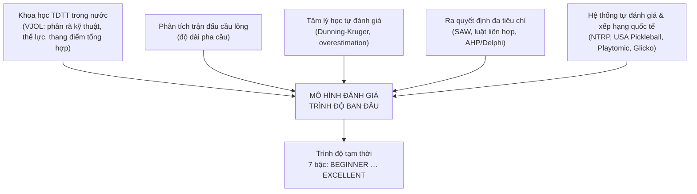
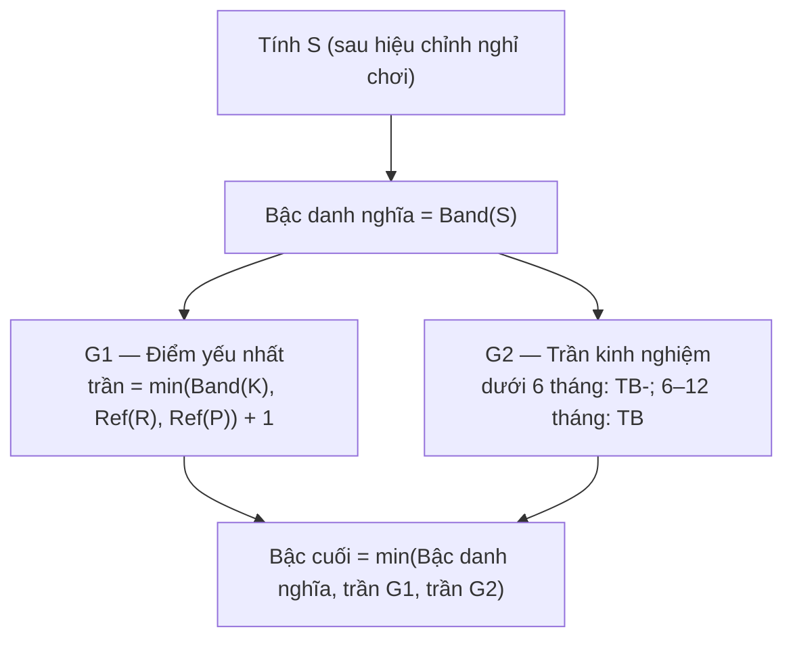

# BÁO CÁO NGHIÊN CỨU & MÔ HÌNH HÓA: ĐÁNH GIÁ TRÌNH ĐỘ BAN ĐẦU CỦA NGƯỜI CHƠI CẦU LÔNG

**Đề tài:** Nền tảng số hóa hệ sinh thái cầu lông (*Badminton Ecosystem Digital Platform*)
**Phiên bản:** 2.4 — 2026-11-15
**Trạng thái:** Đã chốt nội dung (xem các quyết định ở §11). Tài liệu này là nguồn gốc của mô hình; các tài liệu nghiệp vụ và kỹ thuật của dự án sẽ được cập nhật dựa trên nó.

**Mục đích tài liệu:**
1. Trình bày cơ sở lý luận, mô hình toán học và tài liệu tham khảo để dùng trong Báo cáo Tiểu luận chuyên ngành (TLCN).
2. Đặc tả đầy đủ nội dung khảo sát, cách tính điểm, luật chặn và thiết kế lưu trữ để làm đầu vào cho tài liệu nghiệp vụ, tài liệu kỹ thuật và mã nguồn của tính năng Đăng ký.

**Lịch sử phiên bản:**
- **2.4:** Chuyển từ 6 lên **7 bậc**: tách "Khá/Giỏi" thành **Khá** (`GOOD`, từ 70 điểm) và **Giỏi** (`EXCELLENT`, từ 80 điểm); dải TB+ còn 60–70. Bổ sung cơ sở từ bảng điểm tổng hợp của Ngô Trung Dũng (2023) và lập luận chọn 7 bậc thay vì 9 bậc (§3.6). Chạy lại ví dụ và phân tích độ nhạy.
- **2.3:** Thiết kế lưu định nghĩa khảo sát (câu hỏi, trọng số, dải điểm, tham số luật chặn) trong cơ sở dữ liệu theo phiên bản, để sau này phát triển chức năng Admin (§10).
- **2.2:** Bỏ luật chặn bắt buộc có thành tích cho bậc cao nhất; thay bằng mốc điểm cao, thành tích giải chỉ là điểm cộng. Chốt các vấn đề mở (§11).
- **2.1:** Luật G1 dùng bảng bậc tham chiếu ghi trực tiếp cho $R$ và $P$. Sửa câu hỏi 1, 14, 16. Thêm quy tắc làm tròn.
- **2.0:** Công thức quy đổi chung cho mọi câu hỏi; trọng số mới $K$ 40, $R$ 20, $X$ 15, $P$ 10, $A$ 10, $T$ 5; thêm kỹ năng tạt cầu; $R$ đo số lượt giữ cầu trước khi tự hỏng; $A$ chỉ tính khi đạt giải; bỏ luật chặn Rally (bị G1 bao trọn); thêm luật trần kinh nghiệm G2; làm lại danh mục tài liệu tham khảo.
- **1.0:** Bản phân tích ban đầu (trọng số 35/20/15/15/10/5, 8 kỹ năng, 3 luật chặn).

---

## 1. ĐẶT VẤN ĐỀ

### 1.1. Thực trạng phân loại trình độ trong cầu lông phong trào

Cộng đồng cầu lông phong trào Việt Nam tìm bạn chơi và tuyển vãng lai chủ yếu qua các nhóm Facebook/Zalo, sử dụng một hệ trình độ ước lệ:

$$\text{Mới chơi} \rightarrow \text{Yếu} \rightarrow \text{TB-} \rightarrow \text{TB} \rightarrow \text{TB+} \rightarrow \text{Khá} \rightarrow \text{Giỏi}$$

Hệ này có ba bất cập:

1. **Không có chuẩn định lượng cho người chơi phong trào.** Các bộ tiêu chuẩn đánh giá trình độ trong nước được xây dựng cho vận động viên đội tuyển và sinh viên chuyên ngành, dựa trên test thực địa có người giám sát (Ngô Trung Dũng, 2023; bài VJOL số 5/2025 — xem §2.1).
2. **Tự đánh giá quá cao (skill inflation).** Người có năng lực thấp thường không nhận ra hạn chế của mình nên tự đánh giá cao hơn thực tế (Kruger & Dunning, 1999). Trong thể thao phong trào, một nghiên cứu trên người trượt tuyết nghiệp dư cho thấy **79,8% tự đánh giá cao hơn quan sát của chuyên gia**, và **mức đánh giá sai giảm dần khi trình độ tăng** (Luppino et al., 2023).
3. **Chủ kèo không có công cụ kiểm chứng** thông tin trình độ người chơi tự khai trước khi duyệt vào kèo.

### 1.2. Mục tiêu

Đề xuất **mô hình đánh giá trình độ ban đầu** khi đăng ký tài khoản, gồm:
- một bảng khảo sát các **hành vi cụ thể, quan sát được trên sân** thay cho việc tự chọn nhãn trình độ;
- một **công thức tổng hợp có trọng số** cho ra điểm liên tục $S \in [0, 100]$ và **7 bậc trình độ**;
- một **hệ luật chặn trần** để hạn chế khai khống;
- **mốc điểm cao cho hai bậc trên cùng** (Khá, Giỏi), để các bậc này chỉ đạt được khi vượt trội ở hầu hết các mặt, và thành tích thi đấu giúp đạt mốc dễ hơn.

Kết quả là **trình độ tạm thời (tentative)**, không phải chứng nhận năng lực; trình độ chính thức được điều chỉnh sau này qua thi đấu (§10.6).

---

## 2. CƠ SỞ KHOA HỌC

Mô hình dựa trên năm nhóm cơ sở. Bảng ở §3.2 chỉ rõ thành phần nào dựa trên nguồn nào, và phần nào là giả định của đề tài.



### 2.1. Nghiên cứu khoa học TDTT trong nước

**(a) Ngô Trung Dũng (2023)** — *Tạp chí Khoa học Đào tạo và Huấn luyện Thể thao*, số đặc biệt 2023. Bảng tiêu chuẩn phân loại trình độ tập luyện của VĐV Cầu lông Đội tuyển quốc gia gồm **5 yếu tố, 21 test**, mỗi test xếp vào 5 mức (Tốt / Khá / Trung bình / Yếu / Kém):

| Yếu tố | Số test | Ví dụ test |
| :--- | :---: | :--- |
| Kỹ thuật | 4 | Phát cầu ngắn vào ô 30×30 cm (20 quả); đập cầu vào ô 30×30 cm |
| Chiến thuật | 4 | Lên lưới bỏ nhỏ kết hợp lùi đập (10 lần, bấm giây); tấn công 2 góc cuối sân |
| Thể lực | 6 | Nhảy dây 10 giây; chạy 1500 m; di chuyển nhặt đổi cầu 6 điểm |
| Tâm lý | 3 | Phản xạ đơn, phản xạ phức (ms); loại hình thần kinh |
| Sinh lý | 4 | Chiều cao, cân nặng, tần số tim, dung tích sống |

Điểm các test được cộng thành **điểm tổng hợp** (tối đa 21 test × 10 điểm = 210) và xếp loại theo **Bảng 3** của nghiên cứu. Quy đổi ra tỷ lệ so với điểm tối đa:

| Xếp loại | Điểm tổng hợp | Tỷ lệ so với tối đa |
| :--- | :---: | :---: |
| Tốt | ≥ 189 | ≥ 90% |
| Khá | 147 – 188 | 70% – 90% |
| Trung bình | 105 – 146 | 50% – 70% |
| Yếu | 64 – 104 | 30% – 50% |
| Kém | ≤ 63 | < 30% |

Nghiên cứu cũng dùng bảng điểm này để **dự báo thành tích thi đấu** của từng VĐV (Bảng 4). Đề tài kế thừa **cách phân loại theo tỷ lệ điểm tổng hợp**, đặc biệt mốc **Khá từ 70% điểm tối đa** (§3.5).

**(b) Bài "Lựa chọn test đánh giá trình độ kỹ thuật cho VĐV đội tuyển cầu lông TP. Hồ Chí Minh"** — *Tạp chí Khoa học và Đào tạo Thể dục Thể thao*, số 5/2025. Phương pháp:
- tổng hợp **14 test kỹ thuật** từ tài liệu: giao cầu thuận tay cao sâu, giao cầu trái tay thấp gần, đánh cầu cao sâu (thẳng/chéo), hất cầu (thẳng/chéo), đập cầu (thẳng/chéo), chặt cầu (thẳng/chéo), **tạt cầu (thẳng/chéo)**, ve cầu (bỏ nhỏ), móc cầu (kéo cầu);
- phỏng vấn **20 chuyên gia** (HLV, giảng viên) **hai lần cách nhau một tuần**, chọn test có **≥ 80% ý kiến đồng ý**;
- kiểm định **Wilcoxon** giữa hai lần phỏng vấn (sig. > 0,05: ý kiến ổn định);
- kiểm tra độ tin cậy test–retest trên 10 VĐV: hệ số tương quan **r = 0,86 – 0,97**.

**Những gì đề tài kế thừa:**
- Phân rã năng lực thành các nhóm (Kỹ thuật, Thể lực…) và phân rã Kỹ thuật thành các kỹ năng thành phần.
- Các kỹ năng trong nhóm Kỹ thuật được xem là **ngang nhau** (cả hai nghiên cứu đều không gán trọng số riêng cho từng test kỹ thuật).
- Bổ sung kỹ năng **tạt cầu** vào nhóm $K$ (có trong bộ 14 test của nghiên cứu (b)).
- Phân loại trình độ theo **tỷ lệ của điểm tổng hợp** (nghiên cứu (a)).

**Những gì đề tài không kế thừa và lý do:**
- **Ngưỡng số của test:** đối tượng của hai nghiên cứu là VĐV đội tuyển, khác hoàn toàn người chơi phong trào.
- **Nhóm Tâm lý và Sinh lý:** người dùng không thể tự đo phản xạ (ms) hay dung tích sống qua web, và các chỉ số hình thái không quyết định trình độ phong trào.

### 2.2. Chuyển test thực địa thành câu hỏi hành vi (operationalization)

Test thực địa cần sân, dụng cụ và người giám sát. Trên nền tảng web, người dùng tự khai báo từ xa, nên đề tài chuyển mỗi nhóm năng lực thành **biến hành vi đại diện (behavioral proxy)**:

| Trong nghiên cứu thực địa | Trong khảo sát của đề tài | Cơ sở |
| :--- | :--- | :--- |
| Kỹ thuật: số quả trúng ô mục tiêu | **$K$**: 9 kỹ năng, mỗi kỹ năng 4 mức mô tả độ ổn định | Thang đánh giá neo hành vi — BARS (Smith & Kendall, 1963); các bộ mô tả trình độ NTRP, USA Pickleball |
| Chiến thuật và thể lực: bài di chuyển bấm giây | **Bộ pháp** (một kỹ năng trong $K$) và **$P$** | Các bài "chiến thuật" trong Ngô Trung Dũng (2023) thực chất là bài di chuyển tính thời gian, gần với bộ pháp và tốc độ |
| (không có tương đương) | **$R$**: độ ổn định khi giữ cầu | Bộ mô tả NTRP phân biệt trình độ bằng khả năng duy trì rally và hạn chế lỗi tự đánh hỏng (§2.3) |
| Thể lực: chạy 1500 m, nhảy dây | **$P$**: thời lượng duy trì chất lượng thi đấu | Đo trực tiếp hệ quả của thể lực trong bối cảnh thi đấu phong trào |

### 2.3. Phân tích trận đấu: vì sao $R$ đo "giữ cầu trước khi tự hỏng"

Nếu hiểu $R$ là "số lượt chạm cầu trong một pha" thì sẽ mâu thuẫn với số liệu phân tích trận đấu, vì ở trình độ cao, pha cầu thi đấu thực tế lại **ngắn**:
- Đơn nam đỉnh cao: trung bình khoảng 6,8 lượt đánh mỗi pha (Phomsoupha & Laffaye, 2015).
- Đôi nam Olympic 2008–2016: trung vị khoảng 4 lượt đánh mỗi pha (Abián-Vicén et al., 2018).

Người giỏi kết thúc pha cầu nhanh bằng tấn công, nên "pha cầu ngắn" không có nghĩa là trình độ thấp. Vì vậy đề tài định nghĩa $R$ là **độ ổn định**: số lượt người chơi giữ được cầu khi đánh qua lại giằng co **trước khi chính mình đánh hỏng**. Cách hiểu này khớp với bộ mô tả NTRP, nơi bước tiến từ mức thấp lên mức trung bình được mô tả bằng việc "duy trì rally" và "không còn tự đánh hỏng điểm" (USTA NTRP).

### 2.4. Tâm lý học tự đánh giá: vì sao cần luật chặn

- **Kruger & Dunning (1999):** người ở nhóm năng lực thấp nhất đánh giá bản thân cao hơn thực tế rất nhiều, do thiếu chính năng lực để nhận ra sai sót của mình.
- **Luppino et al. (2023):** 79,8% người trượt tuyết nghiệp dư đánh giá cao hơn quan sát của chuyên gia (32% ở mức nghiêm trọng); mức đánh giá quá cao **giảm dần khi trình độ tăng** và tập trung ở nhóm mới chơi.

Ba hệ quả cho thiết kế:
1. Không thể chỉ cộng điểm tự khai báo; cần **luật chặn không bù trừ** dựa trên các câu trả lời phải nhất quán với nhau (G1, §4).
2. Nhóm dễ tự đánh giá quá cao nhất là **người mới chơi**, nên cần Luật trần kinh nghiệm (G2, §4).
3. Các bậc cao nhất là các bậc hấp dẫn nhất để khai khống, nên **mốc điểm của Khá và Giỏi được đặt cao** (70 và 80/100, §3.5): chỉ đạt được khi vượt trội ở hầu hết các mặt, hoặc có thêm thành tích thi đấu, là thông tin có tính khách quan hơn tự cảm nhận.

### 2.5. Lý thuyết ra quyết định đa tiêu chí (MCDM)

- **Cộng có trọng số (Simple Additive Weighting — SAW):** điểm tổng là tổng có trọng số của các tiêu chí đã chuẩn hóa (Hwang & Yoon, 1981). Đây là mô hình **bù trừ**: tiêu chí mạnh có thể bù cho tiêu chí yếu.
- **Phương pháp liên hợp (conjunctive):** phương án bị loại nếu bất kỳ tiêu chí nào dưới ngưỡng tối thiểu, tức **không bù trừ** (Hwang & Yoon, 1981). Các luật chặn trần ở §4 là dạng áp dụng của nguyên lý này.
- **Xác định trọng số bằng chuyên gia:** trong khoa học thể thao, trọng số thường được xác định bằng **Delphi** kết hợp **AHP** (Saaty, 1980). Ví dụ: Ye et al. (2024) dùng 15 chuyên gia, Delphi nhiều vòng và AHP (thang Saaty 1–9, gộp ý kiến bằng trung bình nhân, kiểm tra tỷ số nhất quán CR) để xây dựng hệ chỉ tiêu thể lực cho VĐV đơn nam đỉnh cao. Trọng số của nghiên cứu này dành cho thể lực VĐV chuyên nghiệp nên **không chuyển sang** được cho đề tài; đề tài chỉ kế thừa **phương pháp** (xem §3.3 và §7).

### 2.6. Hệ thống tự đánh giá và xếp hạng quốc tế

- **USTA NTRP (quần vợt)** và **USA Pickleball Skill Rating Definitions:** người chơi tự xếp hạng bằng cách đối chiếu với **mô tả hành vi theo từng mức**. Đây là tiền lệ cho thang 4 mức có mô tả cụ thể trong nhóm $K$.
- **Playtomic (padel/tennis):** người dùng mới làm một bảng hỏi ngắn về kinh nghiệm và khả năng để có **trình độ khởi điểm ước lượng**; trình độ này được điều chỉnh dần theo kết quả trận, với độ tin cậy thấp lúc đầu.
- **Glicko (Glickman, 1999):** người chơi mới có độ lệch xếp hạng lớn (RD mặc định 350), nghĩa là hệ thống chưa tin cậy xếp hạng của họ cho đến khi có thêm kết quả thi đấu.

Ý nghĩa: gắn nhãn **`isSkillTentative = true`** cho trình độ từ khảo sát là cách làm có tiền lệ; và trong các hệ thống này, **kết quả thi đấu** là căn cứ đáng tin hơn tự đánh giá (cơ sở cho việc cộng điểm thành tích $A$).

### 2.7. Các cơ sở bổ sung

- **Kinh nghiệm và tần suất ($X$), đào tạo ($T$):** trình độ chuyên môn phụ thuộc vào lượng luyện tập tích lũy, và luyện tập có chủ đích, có hướng dẫn hiệu quả hơn chơi tự do (Ericsson et al., 1993).
- **Thời gian lên trình (nguồn cộng đồng):** ShopVNB ước tính, với 2–3 buổi/tuần: Newbie → Novice 1–3 tháng; → Intermediate thêm 3–6 tháng; → "Trung bình cộng" thêm 3–6 tháng; → Upper-Intermediate thêm 6–12 tháng; → Advanced thêm 6–12 tháng; → Expert thêm 1–3 năm. Đây là nguồn tham khảo thực tiễn, không phải nghiên cứu khoa học; đề tài dùng để đặt ngưỡng cho Luật trần kinh nghiệm (G2).
- **Thang phân loại 9 cấp (nguồn cộng đồng):** cũng ShopVNB đưa ra thang tham khảo 9 cấp (Newbie, Novice, Intermediate, Trung bình cộng, Upper-Intermediate, Advance, Expert, Semi-Pro, Elite), đồng thời lưu ý đây **không phải hệ thống chuẩn hóa** và các mức "Trung bình cộng", "Expert", "Semi-Pro" là diễn giải bổ sung. Đề tài dùng thang này để đối chiếu khi chọn số bậc (§3.6) và để viết mô tả các bậc (§3.5).
- **Nghỉ tập (detraining):** ngừng tập trên 4 tuần làm suy giảm các thích nghi về tim mạch, chuyển hóa và cơ bắp, kéo theo giảm thành tích (Mujika & Padilla, 2000a, 2000b). Nguồn này ủng hộ **việc trừ điểm** khi nghỉ dài; **mức trừ cụ thể** là giả định của đề tài.

---

## 3. MÔ HÌNH TOÁN HỌC

### 3.1. Nguyên tắc quy đổi thang điểm

Mọi câu hỏi đều có các lựa chọn **xếp theo thứ bậc** từ thấp đến cao. Lựa chọn thứ $i$ (đếm từ 0) của một câu hỏi có $n$ lựa chọn được quy đổi về thang $[0, 100]$ bằng **một công thức chung**:

$$C = \frac{i}{n - 1} \times 100$$

Ví dụ: câu 5 lựa chọn cho điểm $0, 25, 50, 75, 100$; câu 6 lựa chọn cho điểm $0, 20, 40, 60, 80, 100$.

Lý do chọn thang chia đều: không đưa thêm giả định về khoảng cách giữa các mức; mọi tiêu chí cùng phạm vi $[0, 100]$ nên trọng số phản ánh đúng mức độ quan trọng; dễ kiểm tra và dễ cài đặt.

### 3.2. Sáu nhóm tiêu chí và trọng số

| Ký hiệu | Nhóm tiêu chí | Trọng số $w_i$ | Cách tính | Cơ sở có nguồn | Giả định của đề tài |
| :---: | :--- | :---: | :--- | :--- | :--- |
| $K$ | Kỹ thuật (9 kỹ năng) | **40%** | $K = \dfrac{\sum_{j=1}^{9} k_j}{27} \times 100$, với $k_j \in \{0,1,2,3\}$ | Phân rã kỹ thuật, các kỹ năng ngang nhau (§2.1); thang neo hành vi (§2.2) | Danh sách 9 kỹ năng; trọng số 40% |
| $R$ | Độ ổn định giữ cầu | **20%** | 6 mức, quy đổi theo §3.1 | NTRP: consistency là tiêu chí phân trình độ (§2.3) | Các mốc số lượt; trọng số |
| $X$ | Kinh nghiệm & tần suất | **15%** | $X = 0.7\,X_{\text{years}} + 0.3\,X_{\text{freq}}$ | Ericsson et al. (1993); ShopVNB (§2.7) | Hệ số 0,7/0,3; trọng số |
| $P$ | Thể lực thi đấu | **10%** | 5 mức, quy đổi theo §3.1 | Nhóm Thể lực trong Ngô Trung Dũng (2023) | Trọng số |
| $A$ | Thành tích thi đấu | **10%** | 5 mức, quy đổi theo §3.1; chỉ tính khi **đạt giải** | Kết quả thi đấu là bằng chứng khách quan hơn tự đánh giá (§2.6) | Toàn bộ thang và trọng số |
| $T$ | Đào tạo bài bản | **5%** | 5 mức, quy đổi theo §3.1 | Ericsson et al. (1993) | Trọng số |

$$\sum_i w_i = 0.40 + 0.20 + 0.15 + 0.10 + 0.10 + 0.05 = 1.00$$

### 3.3. Lập luận cho bộ trọng số

> **Lưu ý về tính trung thực học thuật.** Không có nghiên cứu nào công bố trọng số cho việc đánh giá trình độ người chơi cầu lông phong trào. Bộ trọng số dưới đây là **bộ trọng số khởi tạo do tác giả đề xuất** dựa trên lập luận chuyên môn. Đề tài **không** khẳng định trọng số được xác lập bằng AHP. Hướng xác định bằng phương pháp chuyên gia (Delphi/AHP) như các nghiên cứu ở §2.1 và §2.5 được trình bày ở §7.

1. **$K$ = 40% (lớn nhất).** Cầu lông là môn thiên về kỹ thuật: không có kỹ thuật phát lực và điều cầu thì thể lực tốt cũng không đưa được cầu vào sân. $K$ cũng là nhóm có nhiều câu hỏi nhất (9 câu) nên ổn định nhất về mặt đo lường.
2. **$R$ = 20%.** Độ ổn định là dấu hiệu phân trình độ rõ ràng nhất ở người chơi phong trào (§2.3), và câu hỏi về số lượt giữ cầu dễ tự đánh giá hơn câu hỏi về kỹ thuật trừu tượng.
3. **$X$ = 15%.** Năm chơi và tần suất là thông tin **khách quan, khó khai khống** hơn tự đánh giá kỹ năng, giúp "neo" điểm tổng. Không đặt cao hơn vì thời gian chơi không đồng nghĩa với trình độ.
4. **$P$ = 10%.** Phần lớn người chơi phong trào đánh đôi; đánh đôi phụ thuộc vào vị trí và phản xạ cự ly ngắn nhiều hơn sức bền đường dài. Người lớn tuổi có kỹ thuật vẫn thi đấu ngang người trẻ.
5. **$A$ = 10%.** Thành tích thi đấu là **điểm cộng**, không phải điều kiện bắt buộc. Kết hợp với mốc điểm cao của Khá (70) và Giỏi (80) (§3.5), thành tích giúp người chơi giỏi **dễ lên bậc cao hơn**: mỗi bậc thành tích cộng thêm 2,5 điểm vào $S$ (ví dụ đạt giải cấp quận cộng 5 điểm, cấp quốc gia cộng 10 điểm). Một hồ sơ chơi rất tốt nhưng chưa có giải đạt $S = 76.96$ (Khá); cùng hồ sơ đó đã đạt giải cấp quận đạt $S = 81.96$ (Giỏi) (§5).

   Trọng số được giữ nhỏ để người chưa có giải **không bị kéo tụt**. Ví dụ, một người chơi Khá điển hình chưa từng đạt giải (7/9 kỹ năng ở mức cao nhất, giữ cầu từ 20 lượt, giữ phong độ qua 3 ván, chơi 4–7 năm, tự học) vẫn đạt $S = 73.19$, tức **Khá**, đúng với cách gọi của cộng đồng. $A$ cũng giúp phân biệt thứ tự người chơi trong cùng một bậc (ví dụ VĐV chuyên nghiệp $S = 100$ so với người đạt giải cấp quận $S \approx 82$, cùng ở Giỏi).
6. **$T$ = 5%.** Đảm bảo **công bằng**: đa số người chơi phong trào không có điều kiện học HLV; trọng số cao sẽ phạt oan người tự học có năng lực thật.

### 3.4. Công thức tổng hợp

**Điểm thô:**
$$S_{\text{raw}} = 0.40K + 0.20R + 0.15X + 0.10P + 0.10A + 0.05T$$

**Hiệu chỉnh nghỉ chơi:** nếu người chơi **đang quay lại sau thời gian nghỉ liên tục trên 6 tháng** (câu 4, §9):
$$S = \begin{cases} \max(0,\ S_{\text{raw}} - 15) & \text{nếu returningAfterBreak = true} \\ S_{\text{raw}} & \text{ngược lại} \end{cases}$$

Mức trừ 15 điểm bằng **độ rộng một dải điểm** của các bậc dưới (§3.5), tức tương đương giảm khoảng một bậc. Hướng trừ có cơ sở (Mujika & Padilla, 2000a, 2000b); con số 15 là giả định của đề tài.

**Quy tắc làm tròn:** mọi phép tính và mọi phép so sánh với ranh giới dải điểm đều dùng **giá trị chưa làm tròn**. Chỉ làm tròn 2 chữ số thập phân khi **lưu trữ và hiển thị**. Lý do: các giá trị như $33.33$, $66.67$ là số lẻ vô hạn; nếu làm tròn trước khi so sánh, một hồ sơ có $S = 59.996$ có thể bị làm tròn thành $60.00$ và nhảy sai bậc.

### 3.5. Bảy bậc trình độ và dải điểm

| Dải điểm $S$ | Mã bậc | Tên | Mô tả |
| :---: | :---: | :---: | :--- |
| $0 \le S < 15$ | `BEGINNER` | Mới chơi (1) | Mới làm quen; chủ yếu cố đưa cầu qua lưới; chưa giữ được cầu qua lại ổn định |
| $15 \le S < 30$ | `WEAK` | Yếu (2) | Đánh qua lại được ở tốc độ chậm; kỹ thuật cơ bản chưa vững; di chuyển chưa hiệu quả, hay đứng sai vị trí |
| $30 \le S < 45$ | `AVERAGE_MINUS` | Trung bình yếu (3) | Thực hiện được phông, bỏ nhỏ, đập cầu ở mức nhất định nhưng chưa kiểm soát lực và điểm rơi; dễ tự đánh hỏng khi đối phương tăng tốc |
| $45 \le S < 60$ | `AVERAGE` | Trung bình (4) | Kỹ thuật cơ bản tương đối đều; duy trì pha cầu ổn định hơn; chơi đôi hiểu vị trí; độ ổn định chưa đồng đều giữa các kỹ thuật |
| $60 \le S < 70$ | `AVERAGE_PLUS` | Trung bình khá (5) | Kỹ thuật vững, ít lỗi tự đánh hỏng; phối hợp đôi tốt; bắt đầu vận dụng chiến thuật có chủ đích |
| $70 \le S < 80$ | `GOOD` | Khá (6) | Kỹ thuật toàn diện, độ ổn định cao; đọc trận đấu và điều chỉnh chiến thuật theo đối thủ; người chơi phong trào năng lực cao |
| $80 \le S \le 100$ | `EXCELLENT` | Giỏi (7) | Kỹ thuật chuyên sâu, chính xác ngay cả dưới áp lực; chủ động công thủ tốc độ cao; thường đã có thành tích thi đấu (bao gồm cả bán chuyên và chuyên nghiệp) |

**Cơ sở đặt mốc:**
- Các bậc 1–4 rộng đều 15 điểm.
- Mốc **Khá từ 70 điểm** tương ứng mốc **Khá từ 70% điểm tối đa** trong bảng điểm tổng hợp của Ngô Trung Dũng (2023) (§2.1).
- Mốc **Giỏi từ 80 điểm** được đặt cao có chủ đích: chơi phong trào giỏi khác với thi đấu, nên bậc cao nhất phải khó đạt.
- Khi chưa có thành tích ($A = 0$), điểm tối đa là 90. Muốn đạt **Khá**, người chơi cần khoảng 78% điểm tối đa ở các nhóm còn lại; muốn đạt **Giỏi**, cần khoảng 89%. Có thành tích giải thì các mốc này dễ đạt hơn.
- Các ranh giới cụ thể là giả định của đề tài.

Ký hiệu: $\text{Band}(x)$ là bậc (1–7) mà một điểm $x \in [0, 100]$ rơi vào theo bảng trên.

### 3.6. Vì sao chọn 7 bậc

Đề tài đã đối chiếu với thang tham khảo 9 cấp của ShopVNB (§2.7):

| Thang 9 cấp (ShopVNB) | Thang 7 bậc của đề tài |
| :--- | :--- |
| Newbie (yếu/mới chơi) | Mới chơi, Yếu (tách làm hai) |
| Novice (trung bình yếu) | TB- |
| Intermediate (trung bình) | TB |
| Trung bình cộng; Upper-Intermediate (trung bình khá) | TB+ (gộp hai cấp) |
| Advance (khá) | Khá |
| Expert (tốt); Semi-Pro (bán chuyên); Elite (đội tuyển quốc gia) | Giỏi (gộp ba cấp) |

Hai thang bao phủ cùng một khoảng trình độ. Đề tài chọn **chia mịn ở các bậc dưới**, nơi tập trung đông người chơi phong trào, và **gộp ở các bậc trên**, vì:
1. **Độ chính xác của công cụ đo có giới hạn.** Với 9 cấp, mỗi dải chỉ khoảng 11 điểm; sai lệch tự đánh giá ở 1–2 câu đã đủ làm đổi cấp (§6).
2. **Các cấp trên cùng không xác định được bằng bảng hỏi.** Chính nguồn tham khảo lưu ý rằng không thể xác định trình độ bán chuyên chỉ dựa vào số năm kinh nghiệm, số giải đã tham gia hay khả năng thắng các trận phong trào. Expert, Semi-Pro và Elite chỉ phân biệt được qua kết quả thi đấu thực tế (§10.6); trong cùng bậc Giỏi, họ vẫn được phân biệt qua điểm $S$.
3. **Thang 9 cấp không phải hệ chuẩn hóa**, và một phần ba số cấp là diễn giải bổ sung của tác giả (§2.7).
4. **Khớp với ngôn ngữ cộng đồng.** Các nhóm tìm kèo dùng đúng 7 tên gọi Mới chơi, Yếu, TB-, TB, TB+, Khá, Giỏi; tách "Trung bình cộng" và "Trung bình khá" sẽ gây nhầm lẫn vì ngoài thực tế "TB+" chính là "trung bình khá".
5. **Ghép kèo hiệu quả hơn.** Càng nhiều bậc, mỗi bậc càng ít người và chủ kèo càng khó chọn khoảng trình độ phù hợp.

---

## 4. HỆ LUẬT CHẶN TRẦN (GUARDRAILS)

Điểm $S$ là kết quả **bù trừ**. Hai luật chặn dưới đây bổ sung yếu tố **không bù trừ** (phương pháp liên hợp, §2.5) để hạn chế khai khống (§2.4). Mỗi luật cho ra một **bậc trần**; bậc cuối cùng là giá trị nhỏ nhất giữa bậc danh nghĩa và các bậc trần.



### G1 — Luật điểm yếu nhất (Bottleneck: Kỹ thuật – Ổn định – Thể lực)

$$\text{cap}_{G1} = \min\big(\text{Band}(K),\ \text{Ref}(R),\ \text{Ref}(P)\big) + 1$$

- **Nguyên lý:** năng lực thi đấu bị giới hạn bởi điểm yếu nhất trong ba yếu tố trực tiếp trên sân. Kinh nghiệm ($X$), đào tạo ($T$) hay thành tích ($A$) cao không bù được việc không giữ nổi cầu hoặc không trụ nổi một set.
- **$\text{Band}(K)$:** tra bảng dải điểm §3.5. $K$ có 28 giá trị có thể (0/27 đến 27/27) nên gần như liên tục, dùng chung bảng dải điểm là phù hợp.
- **$\text{Ref}(R)$, $\text{Ref}(P)$:** **bậc tham chiếu ghi trực tiếp** cho từng lựa chọn. $R$ và $P$ chỉ có 5–6 lựa chọn; nếu tra bảng dải điểm của $S$ sẽ có bậc bị bỏ qua (nhảy bậc), nên đề tài gán bậc tham chiếu theo nguyên tắc **mỗi lựa chọn cao hơn tương ứng đúng một bậc**:

| Độ ổn định giữ cầu ($R$) | Bậc tham chiếu | Trần G1 do $R$ |
| :--- | :---: | :---: |
| Dưới 5 lượt | 1 | Yếu |
| 5–9 lượt | 2 | TB- |
| 10–14 lượt | 3 | TB |
| 15–19 lượt | 4 | TB+ |
| Từ 20 lượt | 5 | Khá |
| Từ 20 lượt và chủ động dứt điểm | 6 | Giỏi |

| Thể lực ($P$) | Bậc tham chiếu | Trần G1 do $P$ |
| :--- | :---: | :---: |
| Hụt hơi trước 20 phút | 2 | TB- |
| Trụ được 20–40 phút | 3 | TB |
| Khoảng 1 giờ, tụt sức ở ván 3 | 4 | TB+ |
| Giữ phong độ qua 3 ván | 5 | Khá |
| Nhiều trận liên tục | 6 | Giỏi |

  Bậc tham chiếu thấp nhất của $P$ là 2 (không phải 1), vì $P$ có trọng số thấp nhất trong ba yếu tố và đánh đôi phong trào ít phụ thuộc sức bền (§3.3); thể lực kém một mình không nên kéo người chơi xuống Yếu.

- **Điều kiện tối thiểu suy ra từ G1:**

| Muốn đạt | $K$ (tổng kỹ năng) | $R$ | $P$ |
| :--- | :---: | :---: | :---: |
| TB+ | $K \ge 45$ (≥ 13/27) | ≥ 15 lượt | ≥ khoảng 1 giờ |
| Khá | $K \ge 60$ (≥ 17/27) | ≥ 20 lượt | Giữ phong độ qua 3 ván |
| Giỏi | $K \ge 70$ (≥ 19/27) | ≥ 20 lượt **và** chủ động dứt điểm | Đánh nhiều trận liên tục |

### G2 — Luật trần kinh nghiệm (Experience Cap)

| Thời gian chơi | Trần G2 |
| :--- | :---: |
| Dưới 6 tháng | TB- |
| 6 tháng – dưới 1 năm | TB |
| Từ 1 năm trở lên | Không giới hạn |

- **Nguyên lý:** người mới chơi là nhóm tự đánh giá quá cao nhiều nhất (Luppino et al., 2023), trong khi trình độ cần thời gian tích lũy (Ericsson et al., 1993).
- **Cơ sở ngưỡng:** theo bảng thời gian lên trình của ShopVNB (§2.7), thời gian nhanh nhất để đạt mức "Intermediate" là khoảng 4 tháng và mức "Trung bình cộng" là khoảng 7 tháng. Việc ánh xạ "Intermediate" ≈ TB- và "Trung bình cộng" ≈ TB là **giả định của đề tài**.

### Thứ tự áp dụng

Mỗi luật chỉ **hạ trần** (lấy giá trị nhỏ hơn), nên kết quả không phụ thuộc thứ tự áp dụng:

$$\text{Rank}_{\text{final}} = \min\big(\text{Band}(S),\ \text{cap}_{G1},\ \text{cap}_{G2}\big)$$

Một luật được ghi nhận là **đã kích hoạt** khi bậc trần của nó nhỏ hơn bậc danh nghĩa $\text{Band}(S)$.

### Vì sao không dùng luật chặn bắt buộc có thành tích cho bậc cao nhất

Đề tài đã cân nhắc một luật "muốn đạt bậc cao nhất phải từng đạt giải từ cấp quận trở lên" và **chọn không dùng**. Thay vào đó, yêu cầu "bậc cao nhất phải khó đạt" được thực hiện bằng **mốc điểm cao** kết hợp **điểm cộng thành tích**:
- Mô hình giữ được tính nhất quán: bậc được quyết định bởi điểm, và mọi yếu tố (kể cả thành tích) đều đóng góp qua điểm.
- Không loại hẳn những người chơi rất giỏi nhưng chưa có điều kiện đi thi đấu; họ vẫn có thể đạt Giỏi nếu vượt trội ở mọi mặt.
- Đánh đổi: người tự chọn mức tối đa ở mọi câu (khai khống toàn bộ một cách nhất quán) vẫn đạt Giỏi dù chưa có giải (§5.1, §7).

---

## 5. VÍ DỤ MINH HỌA

Thứ tự 9 kỹ năng: Giao cầu, Phông cầu, Đập cầu, Bỏ nhỏ/lưới, Thủ cầu, Tạt cầu, Trái tay, Bộ pháp, Phối hợp đôi.

### 5.1. Tổng hợp 6 kịch bản

| # | Kịch bản | $K$ | $R$ | $X$ | $P$ | $A$ | $T$ | $S$ | Bậc danh nghĩa | Luật kích hoạt | **Bậc cuối** |
| :---: | :--- | :---: | :---: | :---: | :---: | :---: | :---: | :---: | :---: | :---: | :---: |
| 1 | Bù trừ: tay tốt, bộ pháp và trái tay yếu | 59,26 | 60 | 62 | 75 | 25 | 25 | 56,25 | TB | — | **TB** |
| 2 | Khai khống kỹ thuật | 100 | 20 | 62 | 25 | 0 | 0 | 55,80 | TB | G1 | **TB-** |
| 3 | Người mới chơi tự khai cao | 66,67 | 40 | 30 | 50 | 0 | 50 | 46,67 | TB | G2 | **TB-** |
| 4 | Chơi rất tốt, chưa từng đạt giải | 88,89 | 100 | 76 | 100 | 0 | 0 | 76,96 | Khá | — | **Khá** |
| 5 | Như #4, đã đạt giải cấp quận | 88,89 | 100 | 76 | 100 | 50 | 0 | 81,96 | Giỏi | — | **Giỏi** |
| 6 | Như #5, mới quay lại sau nghỉ > 6 tháng | 88,89 | 100 | 76 | 100 | 50 | 0 | 66,96 | TB+ | — | **TB+** |

**Ảnh hưởng của thành tích** (giữ nguyên hồ sơ #4, chỉ thay đổi câu 16):

| Thành tích | $A$ | $S$ | Bậc cuối |
| :--- | :---: | :---: | :---: |
| Chưa từng đạt giải | 0 | 76,96 | Khá |
| Đạt giải nội bộ CLB/công ty/trường | 25 | 79,46 | Khá |
| Đạt giải cấp quận/huyện hoặc giải sinh viên | 50 | 81,96 | **Giỏi** |
| Huy chương cấp tỉnh/thành phố | 75 | 84,46 | **Giỏi** |
| Đạt giải cấp quốc gia hoặc thi đấu chuyên nghiệp | 100 | 86,96 | **Giỏi** |

**Các trường hợp kiểm tra thêm:**
- **Người chơi Khá điển hình, chưa có giải** (7/9 kỹ năng mức 3, giữ cầu từ 20 lượt, giữ phong độ qua 3 ván, chơi 4–7 năm, 2–3 buổi/tuần, tự học): $S = 73.19$ → **Khá**.
- **Người mới thật** (chơi dưới 6 tháng, 1 buổi/tuần, chỉ giao cầu, phông cầu và phối hợp đôi ở mức 1, giữ cầu dưới 5 lượt, trụ 20–40 phút): $S = 8.44$ → **Mới chơi**.
- **VĐV chuyên nghiệp** (tối đa mọi câu): $S = 100$ → **Giỏi**.
- **Chọn mức tối đa mọi câu, trừ thành tích** (chưa từng đạt giải): $S = 90.00$ (hoặc $86.25$ nếu chọn "tự học") → **Giỏi**. Đây là đánh đổi của việc không dùng luật chặn bắt buộc có thành tích (§4, §7).

### 5.2. Kịch bản 1 — tính chi tiết từng bước

Chơi 2–4 năm, 2–3 buổi/tuần, tự học qua video. Kỹ năng: 7 kỹ năng mức 2, trái tay và bộ pháp mức 1 (tổng 16/27). Giữ cầu 15–19 lượt; giữ phong độ qua 3 ván; từng đạt giải nội bộ CLB.

**Bước 1 — Quy đổi và gộp nhóm:**
- $K = 16/27 \times 100 = 59.26$
- $R$: lựa chọn thứ 3 trong 6 → $3/5 \times 100 = 60$
- $X = 0.7 \times 60 + 0.3 \times 66.67 = 42 + 20 = 62$
- $P$: lựa chọn thứ 3 trong 5 → $3/4 \times 100 = 75$; $A = 25$; $T = 25$

**Bước 2 — Cộng có trọng số:**
$$S = 0.40(59.26) + 0.20(60) + 0.15(62) + 0.10(75) + 0.10(25) + 0.05(25)$$
$$S = 23.70 + 12.00 + 9.30 + 7.50 + 2.50 + 1.25 = \mathbf{56.25}$$

**Bước 3 — Hiệu chỉnh nghỉ chơi:** không nghỉ, $S = 56.25$.

**Bước 4 — Bậc danh nghĩa:** $56.25 \in [45, 60)$ → TB (bậc 4).

**Bước 5 — Luật chặn:**
- G1: $\text{Band}(K) = 4$, $\text{Ref}(R) = 4$ (15–19 lượt), $\text{Ref}(P) = 5$ (qua 3 ván) → trần $= 4 + 1 = 5$.
- G2: chơi trên 1 năm → không giới hạn (trần 7).
- Bậc cuối $= \min(4, 5, 7) = 4$.

**Kết quả: TB.** Điểm yếu về bộ pháp và trái tay được bù bởi kỹ thuật tay, độ ổn định và thể lực (tính bù trừ của SAW), và không luật chặn nào phải can thiệp.

### 5.3. Kịch bản 2, 3, 4 — luật chặn và mốc điểm hoạt động

- **Kịch bản 2 (G1):** tự chấm mọi kỹ năng ở mức cao nhất nhưng chỉ giữ cầu được 5–9 lượt và chỉ trụ được 20–40 phút. Điểm thô đạt TB, nhưng các câu trả lời **không nhất quán**: người có kỹ thuật hoàn hảo không thể tự đánh hỏng sau dưới 10 lượt. G1: $\min(7, 2, 3) + 1 = 3$ → TB-.
- **Kịch bản 3 (G2):** chơi dưới 6 tháng nhưng tập 4 buổi/tuần và tự chấm mọi kỹ năng mức 2. Điểm thô đạt TB; G1 cho phép tới TB ($\min(5, 3, 4) + 1 = 4$); G2 chặn ở TB-.
- **Kịch bản 4 và 5 (mốc điểm):** kỹ năng gần tối đa, giữ cầu từ 20 lượt và chủ động dứt điểm, thể lực tối đa. Chưa có giải: $S = 76.96$ → Khá. Đã đạt giải cấp quận: được cộng 5 điểm, $S = 81.96$ → Giỏi.

---

## 6. PHÂN TÍCH ĐỘ NHẠY (SƠ BỘ)

**Cách làm:** lần lượt tăng hoặc giảm từng trọng số 5 điểm phần trăm, phân bổ lại các trọng số còn lại theo tỷ lệ để tổng vẫn bằng 1, rồi tính lại bậc cuối của 6 kịch bản ở §5. Tổng cộng 6 trọng số × 2 hướng × 6 kịch bản = 72 lần tính.

**Kết quả:** **68/72 lần tính không đổi bậc.** 4 lần đổi bậc:

| Thay đổi trọng số | Kịch bản | $S$ mới | Bậc mới (bậc cũ) |
| :--- | :---: | :---: | :---: |
| Giảm $A$ 5 điểm phần trăm | 4 | 81,23 | Giỏi (Khá) |
| Giảm $T$ 5 điểm phần trăm | 4 | 81,01 | Giỏi (Khá) |
| Giảm $T$ 5 điểm phần trăm | 6 | 71,27 | Khá (TB+) |
| Tăng $T$ 5 điểm phần trăm | 5 | 77,64 | Khá (Giỏi) |

**Nhận xét:**
- Các kịch bản 1, 2, 3 ổn định với mọi thay đổi trọng số.
- Cả 4 lần đổi bậc đều xảy ra ở ranh giới của hai bậc trên cùng (70 và 80 điểm), với các hồ sơ cách ranh giới khoảng 2–3 điểm và có $A$ hoặc $T$ thấp. Khi trọng số của tiêu chí mà hồ sơ đạt 0 điểm giảm xuống, phần trọng số đó được chuyển sang các tiêu chí hồ sơ đạt điểm cao, nên $S$ tăng (và ngược lại).
- Như vậy ranh giới Khá và Giỏi là nơi nhạy cảm nhất của mô hình, và là ưu tiên hàng đầu khi hiệu chỉnh bằng dữ liệu thật (§7).

> Phân tích này chỉ mang tính minh họa trên 6 hồ sơ tự xây dựng. Phân tích đầy đủ cần một tập hồ sơ lớn hơn (§7).

---

## 7. HẠN CHẾ VÀ HƯỚNG PHÁT TRIỂN

**Hạn chế:**
1. Bộ trọng số, ranh giới dải điểm, mức trừ nghỉ chơi, bậc tham chiếu của G1 và ngưỡng của G2 là **giả định của tác giả**, chưa được chuyên gia thẩm định.
2. Mô hình **chưa được kiểm chứng độ hợp lệ** (validity) bằng cách so sánh với trình độ thực tế của người chơi.
3. Dữ liệu là **tự khai báo**, kể cả thành tích giải; luật chặn giảm được khai khống thiếu nhất quán nhưng không ngăn được người khai sai một cách nhất quán. Cụ thể, người chọn mức tối đa ở mọi câu vẫn đạt Giỏi ($S = 86$–$90$) dù chưa có thành tích.
4. Việc ánh xạ các mức của ShopVNB sang 7 bậc của hệ thống là diễn giải của đề tài.
5. Bậc Giỏi gộp nhiều cấp độ (người chơi xuất sắc, bán chuyên, chuyên nghiệp); các nhóm này chỉ phân biệt được qua điểm $S$.

**Hướng phát triển:**
1. **Xác định trọng số bằng phương pháp chuyên gia:** phỏng vấn HLV, chủ CLB và người chơi lâu năm theo Delphi/AHP, kiểm tra tỷ số nhất quán $CR < 0.1$ (Saaty, 1980), tương tự quy trình của Ye et al. (2024) và bài VJOL số 5/2025.
2. **Hiệu chỉnh bằng dữ liệu thật:** thu khảo sát của một nhóm người chơi đã được chủ CLB xác nhận trình độ, đo tỷ lệ khớp và ma trận nhầm lẫn, rồi tinh chỉnh trọng số và ranh giới.
3. **Phân tích độ nhạy mở rộng** trên tập hồ sơ lớn.
4. **Xác minh thành tích** qua kết quả các giải đấu tổ chức trên nền tảng.
5. **Điều chỉnh trình độ sau đăng ký** qua kết quả Giải đấu chuyên nghiệp trên nền tảng (§10.6).
6. **Chức năng Admin** xem và điều chỉnh tham số mô hình theo phiên bản (§10.4).

---

## 8. ĐÓNG GÓP CỦA MÔ HÌNH

1. **Ứng dụng:** chuyển hệ trình độ ước lệ truyền miệng thành một mô hình định lượng có thể tự động hóa, kết hợp mô hình bù trừ (SAW) và luật không bù trừ (liên hợp), với 7 bậc khớp ngôn ngữ của cộng đồng.
2. **Chống khai khống:** hai luật chặn nhắm vào hai kiểu khai khống phổ biến: câu trả lời không nhất quán (G1) và người mới tự đánh giá cao (G2); mốc điểm cao cho Khá và Giỏi làm các bậc trên cùng khó đạt nếu không vượt trội hoặc không có thành tích thi đấu.
3. **Minh bạch và kiểm tra được:** mọi điểm thành phần, điểm tổng và luật đã kích hoạt đều được lưu lại cùng phiên bản khảo sát; điểm liên tục $S$ có thể dùng làm tiêu chí phụ khi cần phân thứ tự người chơi cùng bậc.
4. **Sẵn sàng mở rộng:** tham số mô hình được lưu theo phiên bản, cho phép điều chỉnh sau này mà không làm sai lệch kết quả cũ.

---

## 9. NỘI DUNG KHẢO SÁT (16 CÂU, 4 BƯỚC)

Điểm của mỗi lựa chọn được tính theo §3.1 (ghi trong ngoặc).

### Bước 1 — Tiểu sử & thói quen

1. **Thời gian chơi ($X_{\text{years}}$):** *Tổng thời gian bạn thực sự chơi cầu lông là bao lâu (không tính các giai đoạn nghỉ)?*
   Dưới 6 tháng (0) · 6 tháng – dưới 1 năm (20) · 1 – dưới 2 năm (40) · 2 – dưới 4 năm (60) · 4 – dưới 7 năm (80) · Từ 7 năm trở lên (100)
2. **Tần suất ($X_{\text{freq}}$):** *Hiện tại bạn chơi trung bình bao nhiêu buổi mỗi tuần?*
   Dưới 1 buổi (0) · 1 buổi (33,33) · 2–3 buổi (66,67) · Từ 4 buổi trở lên (100)
3. **Đào tạo ($T$):** *Bạn đã từng học cầu lông bài bản chưa?*
   Chưa từng học (0) · Tự học qua video/bạn bè (25) · Học lớp cơ bản/HLV dưới 6 tháng (50) · Học có giáo trình từ 6 tháng trở lên (75) · Từng ở đội tuyển/lớp năng khiếu (100)
4. **Quay lại sau nghỉ:** *Bạn có đang quay lại chơi sau một thời gian nghỉ liên tục trên 6 tháng, và mới chơi lại chưa đến 3 tháng không?*
   Không · Có (trừ 15 điểm)
   *Ràng buộc:* nếu câu 1 là "Dưới 6 tháng" thì câu này không hiển thị và mặc định "Không".

### Bước 2 — Kỹ thuật ($K$, 9 kỹ năng)

Thang chung cho mỗi kỹ năng:
**0** Chưa làm được · **1** Làm được khi cầu chậm/dễ · **2** Ổn định khi đánh giao lưu · **3** Ổn định cả khi bị ép tốc độ cao

5. **Giao cầu:** giao cầu ngắn sát lưới và giao cầu cao sâu cuối sân.
6. **Phông cầu:** từ cuối sân đánh cầu cao sâu về sát cuối sân đối phương.
7. **Đập cầu:** đập cầu cắm, có lực và điều chỉnh được hướng.
8. **Bỏ nhỏ / cầu lưới:** bỏ nhỏ, ve, móc cầu sát mép lưới.
9. **Thủ cầu:** đỡ đập, hất cầu cao sâu thoát hiểm khi bị tấn công.
10. **Tạt cầu & phản tạt:** đánh cầu ngang lưới tốc độ nhanh, chủ động hoặc phản tạt khi bị ép.
11. **Trái tay:** đánh trái tay từ cuối sân qua lưới để thoát thế bị động.
12. **Bộ pháp:** di chuyển bao các góc sân và hồi về vị trí trung tâm.
13. **Phối hợp đánh đôi:** hiểu vị trí tấn công (trên–dưới) và phòng thủ (hai bên), biết bọc lót đồng đội.

### Bước 3 — Thực chiến & thể lực

14. **Độ ổn định giữ cầu ($R$):** *Khi đánh qua lại giằng co với người cùng trình độ, bạn thường giữ được bao nhiêu lượt chạm cầu trước khi **chính bạn** đánh hỏng?*
    *(Đếm cả hai bên: bạn đánh, đối phương đánh lại là 2 lượt.)*
    Dưới 5 lượt (0) · 5–9 lượt (20) · 10–14 lượt (40) · 15–19 lượt (60) · Từ 20 lượt trở lên (80) · Từ 20 lượt trở lên và thường chủ động kết thúc pha cầu bằng tấn công (100)
15. **Thể lực ($P$):** *Trong một buổi chơi, bạn duy trì được chất lượng đánh như thế nào?*
    Hụt hơi trước 20 phút (0) · Trụ được 20–40 phút (25) · Đánh khoảng 1 giờ nhưng tụt sức ở ván 3 (50) · Giữ phong độ qua cả 3 ván (75) · Đánh nhiều trận liên tục trong buổi mà vẫn giữ chất lượng (100)

### Bước 4 — Thành tích thi đấu

16. **Thành tích ($A$):** *Thành tích thi đấu cao nhất bạn từng đạt được là gì? (Chỉ tính khi đạt giải Nhất, Nhì hoặc Ba.)*
    Chưa từng đạt giải (0) · Đạt giải nội bộ CLB/công ty/trường (25) · Đạt giải cấp quận/huyện hoặc giải sinh viên (50) · Đạt huy chương giải cấp tỉnh/thành phố (75) · Đạt giải cấp quốc gia hoặc thi đấu chuyên nghiệp (100)

---

## 10. THIẾT KẾ KỸ THUẬT

### 10.1. Nguyên tắc: tham số là dữ liệu, cách tính là code

Để sau này có thể phát triển chức năng cho Admin **xem và chỉnh sửa** công thức mà không phải đổi cấu trúc cơ sở dữ liệu, toàn bộ **tham số** của mô hình được lưu trong cơ sở dữ liệu theo **phiên bản**; còn **thuật toán** được cài đặt trong code backend.

| Lưu trong cơ sở dữ liệu (chỉnh được ở phiên bản mới) | Cài đặt trong code (cố định) |
| :--- | :--- |
| Nội dung câu hỏi, các bước, nhãn và điểm của từng lựa chọn | Cấu trúc 6 nhóm $K, R, X, P, A, T$ |
| Danh sách kỹ năng của nhóm $K$ và thang 4 mức | Công thức cộng có trọng số (§3.4) |
| Trọng số 6 nhóm; hệ số $X_{\text{years}} / X_{\text{freq}}$ | Cách áp dụng G1 (bậc thấp nhất + 1) và G2 (lấy trần theo lựa chọn) |
| Mức trừ nghỉ chơi | Quy tắc làm tròn (§3.4) |
| Mốc dải điểm của từng bậc | Kiểm tra hợp lệ của định nghĩa và câu trả lời |
| Bậc tham chiếu G1 cho từng lựa chọn của $R$, $P$; trần G2 theo thời gian chơi | |

Nhóm $K$ được tính tổng quát theo số kỹ năng $n$ của phiên bản: $K = \dfrac{\sum k_j}{3n} \times 100$ (phiên bản 1: $n = 9$, mẫu số 27). Muốn thêm một **loại luật mới** hoặc **nhóm tiêu chí mới** thì phải sửa code.

**Phạm vi MVP:** chưa có giao diện Admin. Phiên bản 1 (đúng nội dung §3, §4, §9) được đưa vào cơ sở dữ liệu qua migration với trạng thái `ACTIVE`; backend đọc định nghĩa này để hiển thị câu hỏi và tính điểm. Giao diện Admin là hướng phát triển sau (§10.4).

### 10.2. Thay đổi cơ sở dữ liệu

**(a) Bảng mới `skill_survey_versions` — định nghĩa khảo sát theo phiên bản**

| Cột | Kiểu | Ý nghĩa |
| :--- | :--- | :--- |
| `version` | smallint, khóa chính | Số phiên bản (1, 2, …) |
| `status` | varchar, `DRAFT` / `ACTIVE` / `RETIRED` | Trạng thái |
| `definition` | jsonb, bắt buộc | Toàn bộ câu hỏi, điểm, trọng số, dải điểm, tham số luật chặn (§10.3) |
| `note` | text | Lý do tạo phiên bản |
| `created_by`, `created_at` | khóa ngoại `users`, timestamp | Người và thời điểm tạo |
| `published_by`, `published_at` | khóa ngoại `users`, timestamp | Người và thời điểm đưa vào sử dụng |

Ràng buộc:
- **Chỉ một phiên bản `ACTIVE`** tại mỗi thời điểm (unique index có điều kiện `WHERE status = 'ACTIVE'`).
- **Phiên bản đã `ACTIVE` hoặc `RETIRED` không được sửa `definition`** (trigger chặn cập nhật). Muốn thay đổi thì tạo phiên bản mới.

**(b) Bảng mới `player_skill_surveys` — kết quả khảo sát của từng người chơi**

| Cột | Kiểu | Ý nghĩa |
| :--- | :--- | :--- |
| `user_id` | bigint, khóa chính, khóa ngoại `player_profiles` | Mỗi người chơi đúng một kết quả; không làm lại |
| `survey_version` | smallint, khóa ngoại `skill_survey_versions` | Phiên bản đã làm |
| `answers` | jsonb | Câu trả lời gốc, theo mã câu hỏi và mã lựa chọn |
| `score_k` … `score_t` | 6 cột numeric(5,2), 0–100 | Điểm thành phần, lưu riêng để thống kê và hiệu chỉnh (§7) |
| `raw_score`, `final_score` | numeric(5,2), 0–100, `final_score ≤ raw_score` | $S_{\text{raw}}$ và $S$ |
| `nominal_skill_level_id` | khóa ngoại `skill_levels` | Bậc danh nghĩa $\text{Band}(S)$ |
| `resulting_skill_level_id` | khóa ngoại `skill_levels` | Bậc cuối sau luật chặn |
| `applied_guardrails` | text[], mặc định rỗng | Các luật đã kích hoạt (`G1_BOTTLENECK`, `G2_EXPERIENCE_CAP`) |
| `created_at` | timestamp | Thời điểm làm khảo sát |

**(c) Bảng `player_profiles`:** thêm cột `is_skill_tentative` (boolean, mặc định `true`). Chuyển thành `false` khi người chơi được nâng trình chính thức qua giải đấu. Không chép điểm $S$ sang hồ sơ, vì $S$ chỉ đúng tại thời điểm làm khảo sát; khi cần $S$ thì lấy từ `player_skill_surveys`.

**(d) Bảng `skill_levels`:** chuyển từ 6 lên **7 bậc** theo §3.5:
- đổi tên bậc 6 `GOOD` từ "Khá / Giỏi" thành **"Khá"**;
- thêm bậc 7 **`EXCELLENT` — "Giỏi"**;
- cập nhật mô tả của cả 7 bậc theo §3.5.

Mốc điểm của từng bậc **không** lưu ở bảng này mà nằm trong `definition` của phiên bản khảo sát.

**(e) Cấu hình liên quan:** tắt cơ chế tự đổi bậc theo đánh giá sau trận (`PLAYER_SKILL_ADJUSTMENT_ENABLED = false`) để khớp với vòng đời trình độ (§10.6).

### 10.3. Cấu trúc `definition` (rút gọn từ phiên bản 1)

```json
{
  "weights": { "K": 0.40, "R": 0.20, "X": 0.15, "P": 0.10, "A": 0.10, "T": 0.05 },
  "experienceMix": { "years": 0.7, "frequency": 0.3 },
  "returningPenalty": 15,
  "bands": [
    { "skillLevelCode": "BEGINNER",      "minScore": 0 },
    { "skillLevelCode": "WEAK",          "minScore": 15 },
    { "skillLevelCode": "AVERAGE_MINUS", "minScore": 30 },
    { "skillLevelCode": "AVERAGE",       "minScore": 45 },
    { "skillLevelCode": "AVERAGE_PLUS",  "minScore": 60 },
    { "skillLevelCode": "GOOD",          "minScore": 70 },
    { "skillLevelCode": "EXCELLENT",     "minScore": 80 }
  ],
  "skillScale": [
    { "value": 0, "label": "Chưa làm được" },
    { "value": 1, "label": "Làm được khi cầu chậm/dễ" },
    { "value": 2, "label": "Ổn định khi đánh giao lưu" },
    { "value": 3, "label": "Ổn định cả khi bị ép tốc độ cao" }
  ],
  "steps": [
    { "title": "Tiểu sử & thói quen", "questionIds": ["yearsPlaying", "frequencyPerWeek", "coaching", "returningAfterBreak"] },
    { "title": "Kỹ thuật", "questionIds": ["skill.service", "skill.clear", "..."] },
    { "title": "Thực chiến & thể lực", "questionIds": ["rallyConsistency", "stamina"] },
    { "title": "Thành tích thi đấu", "questionIds": ["tournamentAchievement"] }
  ],
  "questions": [
    {
      "id": "yearsPlaying", "group": "X_YEARS",
      "text": "Tổng thời gian bạn thực sự chơi cầu lông là bao lâu (không tính các giai đoạn nghỉ)?",
      "options": [
        { "code": "LESS_THAN_6M", "label": "Dưới 6 tháng", "score": 0, "experienceCap": "AVERAGE_MINUS" },
        { "code": "6M_TO_1Y", "label": "6 tháng – dưới 1 năm", "score": 20, "experienceCap": "AVERAGE" },
        { "code": "1Y_TO_2Y", "label": "1 – dưới 2 năm", "score": 40 }
      ]
    },
    {
      "id": "returningAfterBreak", "group": "RETURNING", "type": "BOOLEAN",
      "text": "Bạn có đang quay lại chơi sau một thời gian nghỉ liên tục trên 6 tháng, và mới chơi lại chưa đến 3 tháng không?",
      "hiddenWhen": { "questionId": "yearsPlaying", "optionCode": "LESS_THAN_6M" }
    },
    {
      "id": "skill.service", "group": "K", "type": "SKILL",
      "text": "Giao cầu", "description": "Giao cầu ngắn sát lưới và giao cầu cao sâu cuối sân."
    },
    {
      "id": "rallyConsistency", "group": "R",
      "text": "Khi đánh qua lại giằng co với người cùng trình độ, bạn thường giữ được bao nhiêu lượt chạm cầu trước khi chính bạn đánh hỏng?",
      "options": [
        { "code": "LESS_THAN_5", "label": "Dưới 5 lượt", "score": 0, "bottleneckRef": 1 },
        { "code": "5_TO_9", "label": "5–9 lượt", "score": 20, "bottleneckRef": 2 }
      ]
    }
  ]
}
```

Các câu hỏi không liệt kê đầy đủ ở trên có cấu trúc tương tự; nội dung đầy đủ của phiên bản 1 là §9 (câu hỏi), §3 (trọng số, dải điểm) và §4 (bậc tham chiếu, trần kinh nghiệm). Điểm của từng lựa chọn được **ghi tường minh** (phiên bản 1 dùng thang chia đều theo §3.1), để phiên bản sau có thể điều chỉnh nếu cần.

**Kiểm tra hợp lệ trước khi một phiên bản được đưa vào sử dụng:**
- tổng trọng số bằng 1; hai hệ số của $X$ có tổng bằng 1;
- mốc dải điểm bắt đầu từ 0, tăng dần, mỗi bậc trong `skill_levels` xuất hiện đúng một lần;
- điểm lựa chọn nằm trong 0–100 và tăng dần theo thứ tự lựa chọn;
- mỗi lựa chọn của $R$ và $P$ có `bottleneckRef` từ 1 đến (số bậc − 1); `experienceCap` (nếu có) là một mã bậc hợp lệ;
- có đủ các nhóm $K, R, X_{\text{years}}, X_{\text{freq}}, P, A, T$, và nhóm $K$ có ít nhất một kỹ năng.

### 10.4. Hướng phát triển: chức năng Admin (ngoài MVP)

Cấu trúc ở §10.2 cho phép bổ sung chức năng Admin sau này **mà không đổi cơ sở dữ liệu**:

```
ACTIVE v1 ──"Tạo bản mới"──▶ DRAFT v2 (sao chép từ v1)
                               │ Admin sửa câu hỏi, trọng số, dải điểm...
                               │ Hệ thống kiểm tra hợp lệ (§10.3)
                               ▼
                          "Đưa vào sử dụng" ──▶ v2: ACTIVE, v1: RETIRED
```

- Admin xem được phiên bản đang dùng và mọi phiên bản cũ.
- Người chơi đã có bậc **giữ nguyên** bậc và kết quả; phiên bản mới chỉ áp dụng cho người đăng ký sau đó.
- Mỗi kết quả luôn tra được về đúng phiên bản và tham số đã dùng để tính.

### 10.5. Dữ liệu gửi lên và kết quả trả về

> **Lưu ý (22/11/2026):** ví dụ dưới đây minh họa ý tưởng. Hình dạng API chính thức để triển khai (tên trường, mã option, `meta.skillSurveyResult`, `guardrails`/`strengths`/`areaToImprove` do server tính, endpoint đọc lại kết quả) là Auth Tech Design, mục "Registration skill survey".

Frontend lấy định nghĩa phiên bản đang dùng từ backend (ví dụ `GET /auth/skill-survey`) để hiển thị, và chỉ gửi **câu trả lời**; mọi phép tính được thực hiện ở backend.

```typescript
// Gửi lên khi đăng ký
interface SkillSurveySubmission {
  surveyVersion: number;                              // phải trùng phiên bản ACTIVE
  answers: Record<string, string | number | boolean>; // khóa = id câu hỏi
  // ví dụ: { "yearsPlaying": "2Y_TO_4Y", "returningAfterBreak": false,
  //          "skill.service": 2, "rallyConsistency": "15_TO_19", ... }
}

// Kết quả tính và lưu
interface SkillSurveyResult {
  surveyVersion: number;
  components: { K: number; R: number; X: number; P: number; A: number; T: number };
  rawScore: number;          // S_raw (0.00–100.00)
  finalScore: number;        // S sau hiệu chỉnh nghỉ chơi
  nominalSkillLevel: string; // Band(S)
  skillLevel: string;        // bậc cuối sau luật chặn (BEGINNER … EXCELLENT)
  appliedGuardrails: Array<'G1_BOTTLENECK' | 'G2_EXPERIENCE_CAP'>;
  isSkillTentative: true;
}
```

Backend kiểm tra câu trả lời theo định nghĩa của phiên bản: đủ mọi câu bắt buộc, mã lựa chọn hợp lệ, kỹ năng trong khoảng 0–3, `returningAfterBreak` bằng `false` khi chơi dưới 6 tháng. Nếu `surveyVersion` khác phiên bản đang dùng (người dùng mở form cũ), backend từ chối và yêu cầu tải lại trang.

### 10.6. Vòng đời trình độ

1. **Đăng ký:** bắt buộc làm khảo sát một lần; trình độ gắn nhãn tạm thời.
2. **Ghép kèo:** dùng `skillLevel`; điểm $S$ có thể dùng làm tiêu chí phụ.
3. **Điều chỉnh:** đánh giá sau trận giữa người chơi **không** tự động đổi bậc. Bậc chỉ được điều chỉnh chính thức qua thành tích tại **Giải đấu chuyên nghiệp** trên nền tảng (công thức nâng trình nằm ngoài phạm vi tài liệu này).

---

## 11. CÁC QUYẾT ĐỊNH ĐÃ CHỐT (2026-11-15)

| # | Vấn đề | Quyết định |
| :---: | :--- | :--- |
| 1 | Có bắt buộc thành tích giải để đạt bậc cao nhất không? | **Không dùng luật chặn.** Bậc do điểm quyết định; mốc Khá **70**, Giỏi **80**; thành tích chỉ là điểm cộng (§3.5, §4) |
| 2 | "Đạt giải" gồm những gì? | Chỉ tính **Nhất, Nhì, Ba**; vào tứ kết không tính |
| 3 | Bộ trọng số khởi tạo, ranh giới dải điểm, bậc tham chiếu G1 | **Chấp nhận cho MVP** như §3 và §4; ghi rõ là giả định của đề tài, hiệu chỉnh sau khi có dữ liệu (§7) |
| 4 | Ngưỡng của G2 (6 tháng / 1 năm) | **Chấp nhận** như §4 |
| 5 | Tài khoản tạo trước khi có khảo sát | Dữ liệu hiện có chỉ là **dữ liệu mẫu**; xóa và tạo lại khi triển khai, không cần cơ chế chuyển đổi |
| 6 | Bậc riêng cho VĐV bán chuyên/chuyên nghiệp | **Không**; gộp trong bậc Giỏi, phân biệt qua điểm $S$ (§3.6) |
| 7 | Lưu công thức ở đâu | Tham số (câu hỏi, trọng số, dải điểm, tham số luật chặn) lưu trong **cơ sở dữ liệu theo phiên bản**; thuật toán trong code. **Chưa làm giao diện Admin** trong MVP, nhưng cấu trúc sẵn sàng để phát triển sau (§10) |
| 8 | Số bậc trình độ | **7 bậc**: tách "Khá/Giỏi" thành Khá (`GOOD`, từ 70) và Giỏi (`EXCELLENT`, từ 80); không dùng thang 9 cấp (§3.6) |

---

## 12. TÀI LIỆU THAM KHẢO

Ký hiệu kiểm chứng: ✅ đã đối chiếu nội dung với bản gốc · ⚠️ mới đối chiếu qua tóm tắt/trích đoạn, cần đọc bản đầy đủ trước khi trích số liệu · ✏️ cần bổ sung thông tin.

### 12.1. Nghiên cứu khoa học TDTT trong nước

1. ✅ Ngô Trung Dũng. (2023). Xây dựng tiêu chuẩn đánh giá trình độ tập luyện của vận động viên Cầu lông Đội tuyển quốc gia. *Tạp chí Khoa học Đào tạo và Huấn luyện Thể thao*, số đặc biệt 2023. https://vjol.info.vn/KHDTHLTT/vi/article/view/152306/
2. ✅✏️ [Tên tác giả]. (2025). Lựa chọn test đánh giá trình độ kỹ thuật cho vận động viên đội tuyển cầu lông Thành phố Hồ Chí Minh. *Tạp chí Khoa học và Đào tạo Thể dục Thể thao*, (5), [trang]. https://vjol.info.vn/tckh-daotaotheducthethao/vi/article/view/176249/
3. ⚠️✏️ [Tên tác giả]. ([Năm]). Lựa chọn test đánh giá trình độ thể lực và kỹ thuật cho sinh viên đội tuyển cầu lông Đại học Cần Thơ. *Tạp chí Khoa học và Đào tạo Thể dục Thể thao*. https://vjol.info.vn/tckh-daotaotheducthethao/vi/article/view/176247/
4. ⚠️✏️ [Tên tác giả]. ([Năm]). Đánh giá thực trạng sức mạnh tốc độ của vận động viên đội tuyển cầu lông Thành phố Hồ Chí Minh. *Tạp chí Khoa học và Đào tạo Thể dục Thể thao*. https://vjol.info.vn/tckh-daotaotheducthethao/vi/article/view/204334/

### 12.2. Phân tích trận đấu và khoa học thể thao quốc tế

5. ⚠️ Phomsoupha, M., & Laffaye, G. (2015). The science of badminton: Game characteristics, anthropometry, physiology, visual fitness and biomechanics. *Sports Medicine, 45*(4), 473–495. https://doi.org/10.1007/s40279-014-0287-2
6. ⚠️ Abián-Vicén, J., Sánchez, L., & Abián, P. (2018). Performance structure analysis of the men's and women's badminton doubles matches in the Olympic Games from 2008 to 2016 during playoffs stage. *International Journal of Performance Analysis in Sport, 18*(4), 633–644. https://ideas.repec.org/a/taf/rpanxx/v18y2018i4p633-644.html
7. ✅ Ye, B., Zhu, H., Yang, Z., He, Z., Liu, G., Pan, H., & Guo, H. (2024). Construction and analysis of the physical fitness evaluation index system for elite male singles badminton players: Based on Delphi and AHP methods. *Life, 14*(8), 944. https://doi.org/10.3390/life14080944
8. ⚠️ Mujika, I., & Padilla, S. (2000a). Detraining: Loss of training-induced physiological and performance adaptations. Part I: Short term insufficient training stimulus. *Sports Medicine, 30*(2), 79–87.
9. ⚠️ Mujika, I., & Padilla, S. (2000b). Detraining: Loss of training-induced physiological and performance adaptations. Part II: Long term insufficient training stimulus. *Sports Medicine, 30*(3), 145–154.

### 12.3. Tâm lý học tự đánh giá và luyện tập

10. ⚠️ Kruger, J., & Dunning, D. (1999). Unskilled and unaware of it: How difficulties in recognizing one's own incompetence lead to inflated self-assessments. *Journal of Personality and Social Psychology, 77*(6), 1121–1134. https://doi.org/10.1037/0022-3514.77.6.1121
11. ✅ Luppino, F., van Diepen, M., den Hollander-Gijsman, M., Bartlema, K., & Dekker, F. (2023). Level of overestimation among Dutch recreational skiers: Unskilled tourists in the mountains. *Clinical Journal of Sport Medicine, 33*(6), e172–e180. https://doi.org/10.1097/JSM.0000000000001158
12. ⚠️ Ericsson, K. A., Krampe, R. T., & Tesch-Römer, C. (1993). The role of deliberate practice in the acquisition of expert performance. *Psychological Review, 100*(3), 363–406.
13. ⚠️ Smith, P. C., & Kendall, L. M. (1963). Retranslation of expectations: An approach to the construction of unambiguous anchors for rating scales. *Journal of Applied Psychology, 47*(2), 149–155.

### 12.4. Ra quyết định đa tiêu chí

14. ⚠️ Hwang, C.-L., & Yoon, K. (1981). *Multiple attribute decision making: Methods and applications*. Springer.
15. ⚠️ Saaty, T. L. (1980). *The analytic hierarchy process*. McGraw-Hill.

### 12.5. Hệ thống tự đánh giá và xếp hạng

16. ⚠️ Glickman, M. E. (1999). Parameter estimation in large dynamic paired comparison experiments. *Journal of the Royal Statistical Society: Series C (Applied Statistics), 48*(3), 377–394.
17. ⚠️✏️ United States Tennis Association. *NTRP General Characteristics / Self-Rating Guidelines*. (Cần lấy bản chính thức từ usta.com; các bản sao trên web có câu chữ khác nhau.)
18. ⚠️ USA Pickleball. (2020). *Skill Rating Definitions*. https://usapickleball.org/wp-content/uploads/2020/07/USAPA-Skill-Rating-Definitions-2020.pdf
19. ⚠️ Playtomic. *How the Playtomic level system works*. Playtomic Help Center. https://playerhelp.playtomic.com/hc/en-gb/articles/43310980754193-How-the-Playtomic-level-system-works

### 12.6. Nguồn tham khảo thực tiễn (cộng đồng)

20. ✅ ShopVNB. *Khám phá các trình độ cầu lông* (các mục về thang phân loại 9 cấp và "Mất bao lâu để nâng cao trình độ cầu lông?"). https://shopvnb.com/trinh-do-cau-long.html

> **Lưu ý trích dẫn:** bài của ShopVNB có dẫn lại "Shuttle Smash" và "ma trận kỹ năng của Ace Badminton Club", nhưng đề tài không tìm thấy bản công bố của hai nguồn này, nên chỉ trích bài gốc của ShopVNB.
